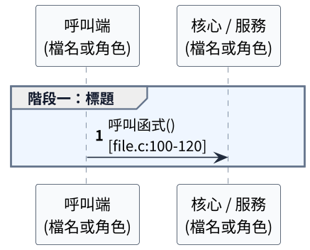

# PlantUML Diagram Style & Rendering Reference

Use this template for study-companion diagrams so they stay visually consistent with chapter figures and render Traditional Chinese cleanly.

## Directory & Naming Convention

Store both `.puml` source and rendered `.png` in a `figs/` directory alongside the question sheet:

```text
study/
├── 5.1-questions.md
└── figs/
    ├── 5.1-q1-mmap.puml
    ├── 5.1-q1-mmap.png
    └── 5.1-q1-free-buffer.puml
```

Reference in Markdown with relative paths:

```markdown

```

## Standard Sequence Diagram Header



### Recommended Group Accent Colors

- `#EFF6FF` (soft blue): Request / entry / setup phase
- `#F0FDF4` (soft green): Core execution / data copy / allocation phase
- `#FFF7ED` (soft orange): Dispatch / async follow-up / reclaim phase
- `#FEF2F2` (soft red): Error / rejection / security guard path
- `#F8FAFC` (soft slate): Reply / cleanup phase

## Rendering & Verification

1. Render to PNG:
   ```bash
   plantuml -tpng path/to/figs/<name>.puml
   ```
2. Visually inspect the generated `.png` by reading the image file directly:
   - Confirm CJK characters render cleanly (no tofu/boxes).
   - Check for awkward line breaks, clipped labels, or overlapping boxes.
   - Verify cited file names and line numbers match local source files.
   - Confirm no specific device model codenames appear in any label or note.
