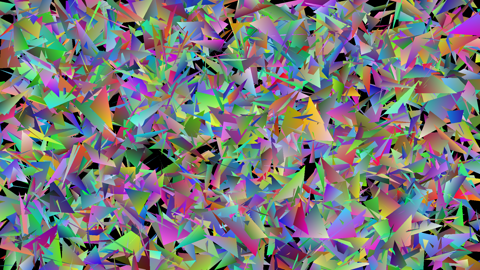

# Advanced Computer Architecture 第十八支影片完整筆記：ASIC、FPGA 與傳統的 graphics pipeline（Chapter 6, Part I）

> **課程**：Advanced Computer Architecture — Chapter 6: GPUs (Part I) -- Traditional Graphics Pipeline（播放清單第 18 支）
> **講者**：Smruti R. Sarangi（IIT Delhi）
> **來源**：YouTube 自動字幕（56:20）＋ 課本 *Next-Gen Computer Architecture* v3.2 **Ch6** §6.1–6.2（p.215–225）
> **章號**：影片 Chapter 6 = 課本 Ch6。
> **標記說明**：
> - `【口頭】`：老師在影片裡口頭補充、課本沒有的內容
> - `【Q&A】`：學生主動提問與老師回答（本講沒有）
> - `【課本補充】`：課本有、但這支影片沒細講的內容
> - `【原始碼】`：Linux v6.2.12 原始碼節錄（本講沒有）
> - `【實測】`：在本機（Intel i7-13650HX、NVIDIA RTX 4060 Laptop GPU、Ubuntu、kernel 6.5.0、gcc 11.4、Python 3.10）實際執行的結果
> - `⚠️`：逐字稿缺字、或影片／課本／實測說法不一致之處
> - `[mm:ss]`：影片時間點

⚠️ 自動字幕有不少錯字：「a6」= ASIC、「kuda」= CUDA、「elimination」= illumination（光照）、「garage／corrode shading」= Gouraud shading、「form／fong」= Phong、「sas」= SASS、「polymorphism」= Polymorph engine。筆記直接改正。

---

## 目錄

- [0. 本講地圖](#0-本講地圖)
- [1. 這一章需要什麼](#1-這一章需要什麼)
- [2. IPC 4–6 不夠](#2-ipc-46-不夠)
- [3. ASIC 與 ASIP](#3-asic-與-asip)
- [4. PLA](#4-pla)
- [5. FPGA 與 lookup table](#5-fpga-與-lookup-table)
- [6. 為什麼需要 GPU](#6-為什麼需要-gpu)
- [7. Raster 與 vector graphics](#7-raster-與-vector-graphics)
- [8. Shader program](#8-shader-program)
- [9. Graphics pipeline 與軟體堆疊](#9-graphics-pipeline-與軟體堆疊)
- [10. Vertex processor](#10-vertex-processor)
- [11. Polymorph engine](#11-polymorph-engine)
- [12. Rasterizer](#12-rasterizer)
- [13. Fragment processor](#13-fragment-processor)
- [14. Pixel engine](#14-pixel-engine)
- [15. 從 GPU 到 GPGPU](#15-從-gpu-到-gpgpu)
- [16. 【實測】](#16-實測)
- [17. 一頁速查表](#17-一頁速查表)
- [18. 與後續講次的連結](#18-與後續講次的連結)
- [附：本講一句話總結](#附本講一句話總結)

---

## 0. 本講地圖

```
OOO 再怎麼努力 IPC 也只有 1.5–2.5；矩陣運算有 n² 個獨立的加法 → 要「幾百個小 ALU」
選項：ASIC（一個應用一顆晶片）→ ASIP（多一點彈性）→ PLA → FPGA（LUT ＋ 可程式的連線）
GPU：本來為了畫面（1920×1080×60 ≈ 1.25 億像素/秒）
  vector graphics：使用者寫規則和物件，GPU 算出畫面
  pipeline：vertex processor（現在是 Polymorph engine）→ rasterizer → fragment processor → pixel engine
  這些大多是線性代數 → GPU 被改造成 GPGPU
```

---

## 1. 這一章需要什麼

[00:00] 背景：in-order pipeline、一點 C++、一點平行程式（Ch9 或老師的大學部教材）。

[01:12] 三部分：

1. 應用專用的計算：GPU、ASIC、FPGA（本講）。
2. **CUDA 10** 程式語言（[第 19 支](lecture19_note.md)）：雖然 CUDA 11 是最新的，CUDA 10 已經夠複雜，而且寫書時它最新。
3. GPGPU 的設計（[第 20 支](lecture20_note.md)）。

---

## 2. IPC 4–6 不夠

[01:48] 就算用上前面所有的技巧，IPC 4–6 也很難達到：4-issue 的 OOO 處理器通常 IPC 只有 **1.5–2.5**。

[02:14] 但飛機機翼模擬、天氣預報、影像辨識……需要更高的效能。核心是**線性代數**，特別是矩陣：

```c
for (i = 0; i < N; i++)
    for (j = 0; j < N; j++)
        c[i][j] = a[i][j] + b[i][j];
```

[03:14] 每個元素的計算**完全獨立**：n² 個加法都可以平行做。n 很大時，「平行度多到用卡車載」。IPC 4–6 太少了。

[04:16] 一般的多核處理器是**通用**的，要跑各種程式，所以被 fetch 和 issue width（4–6）限制。

[04:45] 解法：一種新處理器，有**幾百個小的計算單元**（ALU 或 core）：

- 通常是 1–3 issue 的 in-order core，ISA 很簡單。
- 很多現代程式語言的功能（不規則的記憶體存取、條件分支）**不支援**。
- 適合「大量平行、但每個都很簡單」的運算。

---

## 3. ASIC 與 ASIP

[06:40] **ASIC**（application specific integrated circuit）：為一個特定的應用做的晶片，輸入、輸出、格式都固定，不用軟體。

[07:10] 一定要有**市場**才值得做。例如攝影機要很快的影像處理、洗衣機要另一種晶片，兩個市場都夠大。ASIC 通常**不太能程式化**。

[08:11] **ASIP**（application specific instruction-set processor）：多一點彈性，有基本的 ISA，可以寫小程式。「可以想成一個很弱的處理器，加上很重的 ASIC 功能。」

---

## 4. PLA

[08:42] 以前的 **PLA**（programmable logic array）可以實作**任何** boolean 函數：

```
輸入 A B C → 也產生 A̅ B̅ C̅
AND plane：每個 AND gate 從每個變數選它或它的反相 → 一個 minterm
           （圖上一條線其實是三條：一條 A 或 A̅、一條 B 或 B̅、一條 C 或 C̅）
OR plane：每個 OR gate 選幾個 minterm 加起來 → 一個函數
```

[11:37] 例子：8 個 minterm、4 個輸出函數 f1–f4。選擇的地方都是**可程式**的。

[12:10] 實作一個 adder 很簡單：一個函數算 sum，另一個算 carry。

[12:38] PLA 只能做**組合邏輯**，沒有狀態元件（flip-flop、register），所以後來被 FPGA 取代。

---

## 5. FPGA 與 lookup table

[13:07] **FPGA** = PLA 的延伸：

- 有**狀態元件**。
- 有**可程式的連線（interconnect）**：把不同的邏輯元件接到不同的狀態元件，就能做出客製的處理單元。

[13:37] 現在 FPGA 裡的 PLA 少很多了，改用 **lookup table（LUT）**。例：兩個 4-bit 數相加：

- 輸入 8 bit → 一張 **2⁸ 格**的表。
- 每格存答案（最多 5 bit：sum 加 carry）。

[14:35] 很精密的軟體可以把任何函數拆成很多小的 LUT 存取，就算是兩個 64-bit 數相加，也拆成很多小計算。LUT ＋ 可程式的邏輯 ＋ 可程式的連線 → 可以做出任何東西：加法、乘法、整個大處理器。

[15:06] 連線本身也是用類似 PLA 的邏輯（多工器）做的。FPGA 也用 **anti-fuse**：程式化後會一直保持狀態（不細講）。

[16:03] FPGA 的限制：

| 限制 | 說明 |
|---|---|
| 時脈低 | 【口頭】400–600 MHz |
| 一個 cycle 做不多 | ASIC 一下就做完的，FPGA 可能要好幾個 cycle |
| 面積負擔大 | |
| **很貴** | 「一顆 FPGA 幾乎跟一台最新的伺服器一樣貴」 |

[16:35] 以前多用來做硬體原型，現在 FPGA 本身和程式化的軟體都成熟了，也用在正式產品上，例如 **DNA 定序**、線性代數。

⚠️ 時脈：影片說 400–600 MHz；課本 p.216 說「到 2020 年，FPGA 的時脈不能超過 600 MHz（通用處理器 3–4 GHz）」。兩者不衝突，課本只給上限。

（本機用 Python 做了一個 LUT 加法器，見 [§16.2](#162-用-lut-做加法)。）

---

## 6. 為什麼需要 GPU

[17:03] ASIC 很好但太專用、小應用不值得做；FPGA 負擔大。而**圖形密集**的工作幾乎無所不在（視窗系統、遊戲）→ 設計出 **GPU**。之後才被改造來跑數值、科學程式 → **GPGPU**（general purpose GPU）。

[18:03] 算一下（老師錄影的螢幕）：

```
1920 × 1080 像素 × 60 張/秒 ≈ 1.25 億像素/秒
3 GHz × IPC 2 = 60 億條指令/秒
→ 每個像素只有約 48 條指令
```

[18:39] 聽起來很多，但對高強度的遊戲和特效不夠。【口頭】老師寫書或做投影片時，角落還開著 YouTube 聽音樂，處理器要同時跑 PowerPoint、處理聲音和影片。

【課本補充】課本 p.218 用比較舊的 1024 × 768 螢幕（786,432 像素）算：3 GHz、IPC 2 → 每個像素每秒 7633 條指令，60 Hz → **每個像素每張 127 條**。縮小一個視窗夠用，玩遊戲不夠。

（本機的數字見 [§16.1](#161-每個像素有幾條指令)。）

---

## 7. Raster 與 vector graphics

[20:10] **30 年前**：螢幕就是一個像素陣列（frame），每格一個顏色，每秒重算 30–50 次；大部分時間不變，有變才更新。

[20:39] **現代**：要**建構**畫面。使用者寫的是一組**規則**：

- 例：一個角色在城市裡跑，後面有拿槍的人和鳴笛的警車。
- 使用者定義物件、物件之間的互動、陰影、光照等效果。
- 最後的畫面要從規則算出來。手機的小螢幕上長方形比較小，大螢幕上比較大，都能看。

[22:03] **Vector graphics**：存的是規則，不是每個像素。例如一條線只存起點和終點，換到別的螢幕要拉長很容易，再 **render**（正確地畫出來）。

[22:29] 老師的例子：一張用規則畫的果樹圖放大後還是清楚；另一張只存像素的 **raster（點陣）** 圖放大後就糊了。

[23:31] 兩個時代：

| 時代 | 方式 |
|---|---|
| 以前 | 大多是 raster graphics |
| 之後 | 物件 = 一組多邊形（大多是**三角形**），畫面由這些形狀的互動產生。先是 2D（像湯姆貓與傑利鼠），現在是 3D |

[23:58] 電影是另一個問題：電影是**編碼**（高度壓縮）過的，要由顯示卡**解碼**。

[24:26] 大部分圖形工作都是「用物件描述互動，GPU 把它轉成畫面」。GPU 在做大量的幾何運算 → 人們發現它可以被改造成 GPGPU，而且不用大改。

[25:31] 老師展示一張遊戲自動產生的畫面：岩石面向太陽的那一面亮、另一面有陰影；牆有牆的紋理、天空有天空的感覺。同一個遊戲在手機上看起來也很像：手機的 GPU 依自己的螢幕大小解讀規則。

---

## 8. Shader program

[28:04] 圖形這邊要一個 **shader program**：主程式，對物件、頂點、像素做所有繁重的工作：

- 轉換：平移、旋轉、skew……
- 效果：紋理、陰影……
- 這些大多也是線性代數。

[29:12] Shader program 的輸入輸出：

```
            texture cache（紋理）
                  ↓
輸入（像素或頂點）→ [ shader program ] → 輸出（像素或頂點）
                  ↑                     ↓
          constant cache（唯讀資料）   GPU 裡的 cache；用不到的寫到 off-chip 記憶體
                  ↕
             off-chip 記憶體
```

- [29:51] 早期的 GPU 有一個 **constant cache** 放唯讀資料（像模型的常數），今天可能大多沒有了。
- [30:20] **GPU 和 CPU 通常不共用 cache**，透過 **off-chip 的 DRAM** 溝通。

---

## 9. Graphics pipeline 與軟體堆疊

[30:53] 經典的 graphics pipeline 有**四級**：

```
vertex processor → rasterizer → fragment processor → pixel engine
```

[31:30] 程式設計師描述場景：物件、互動、光源、光照、陰影、表面的法向量，其餘由硬體和軟體自動算。

[32:07] 常見的 API：

| API | 平台 |
|---|---|
| **DirectX** | Windows |
| **OpenGL** | 跨平台 |

[32:30] GPU 程式分兩部分：一部分跑在 CPU、一部分跑在 GPU。binary 是 **fat binary**：同時有 CPU 和 GPU 的程式碼。

[32:50] NVIDIA 的程式先編譯成**虛擬 ISA**：**PTX**（老師說 portable thread execution）。執行時再編譯成真的 ISA：**SASS**（shader assembly）。

[33:25] 像 Java：

- 發佈 PTX，別人看不到你的原始碼，智慧財產安全。
- 執行時針對那一顆 GPU 做最佳化，動態編譯成 SASS。

（本機的 GPU 和 CUDA 工具鏈見 [§16.3](#163-本機的-gpu-與-ptxsass)。）

---

## 10. Vertex processor

[34:00] 第一級。3D 表面拆成一組**三角形**。為什麼是三角形？

- 三個頂點**一定在同一個平面**上：平面和法向量都很好算 → 反射等效果好算。
- 處理三角形的文獻很多，大部分運算最後都變成矩陣運算。

[34:31] 做的事：

- **Ray tracing**：追蹤光線、看它跟表面怎麼互動 → 光照、反射。
- 加顏色和紋理。
- 移動、旋轉、縮放物件。
- 算三角形的**深度**（離眼睛多遠）：遠的看起來不一樣，也會被近的物件**擋住（occlusion）**。

[35:35] Vertex processor 就是對形狀做**所有幾何運算**的那一級，大量用線性代數。以前用客製的硬體，現在對到**通用的硬體**上，變成一大堆線性代數運算。

---

## 11. Polymorph engine

[36:11] 現在 vertex processor 被 **Polymorph engine** 取代（老師說主要講 NVIDIA 的 GPU）。它本身是 **5 級 pipeline**：pipeline 裡的一級又是一條 pipeline。

| 級 | 做什麼 |
|---|---|
| **Vertex fetch** | 物件的**區域座標**轉成**世界座標**（所有物件用同一組 xyz 軸）；抓頂點、做幾何運算（角色的四肢、子彈的移動、光照、陰影）。**Hull shader**：大多邊形切成小多邊形，離眼睛近的切細、遠的切粗 |
| **Tessellation** | 再切成三角形和線段 |
| **Viewport transformation** | 整個場景放不進螢幕，只留看得到的那一塊（**viewport**） |
| **Attribute setup** | 算每個物件的**深度**、標記看得到的那一面（front face）、光線怎麼照在不同法向量的表面上 → 一大串三角形，附上光照和距離 |
| **Stream output** | 寫到記憶體（有時是 cache，直接 pipeline 給下一級；有時要寫到主記憶體） |

[38:27] 【口頭】這跟我們看東西的方式一樣：近的東西看得比較清楚，遠的大東西細節比較少。

【課本補充】課本 p.221：圖 6.6 來自 NVIDIA **Fermi**（GF100，Wittenbrink et al. 2011）。Polymorph engine 把很多工作交給 **SM**（streaming multiprocessor）做，特別是 vertex shading 和 hull shading。

---

## 12. Rasterizer

[42:35] 把三角形轉成 **fragment**：fragment = 一組像素。現在知道螢幕了，就看三角形裡面的每一個像素。也可以先算每個 fragment 的顏色和可見度。

[43:08] Rasterization 幾何運算不多，很難從它的硬體得到「通用」的價值（不像 Polymorph engine）。所以**現代 GPU 還是有專用的 rasterizer 硬體**。

【課本補充】課本 p.222：不同處理器的 rasterization 級差很多：NVIDIA Tesla 時比較小，Fermi 時比較大。課本提醒，級與級之間的界線不嚴格：一個動作在哪一級做都可以，只要它依賴的動作做完了。

---

## 13. Fragment processor

[43:50] 第三級。輸入是像素格式的 fragment，但三角形還沒「沖洗好」：只知道**三個頂點**的顏色，不知道裡面的。三個子步驟：

### 13.1 內插（interpolation）

[44:21] 用三個頂點的顏色加一個函數，算出裡面每個像素的顏色：

| 方法 | 假設 | 複雜度 |
|---|---|---|
| **Gouraud shading** | 三角形是**平的**；考慮所有光源（包括別的三角形的反射）、法向量的內積、表面的吸收／反射／穿透率 | 簡單 |
| **Phong shading** | 三角形**不一定是平的**，可以是平滑的曲面；反射模型很複雜 | 比較花時間，但平滑的斜面看起來好很多 |

（本機寫了一個 Gouraud 的小版本，見 [§16.4](#164-在-cpu-上畫一張)。）

### 13.2 Texture mapping

[48:04] 每個 fragment 疊上紋理（磚、泥土、木頭……）。大部分 GPU 有專門放紋理的 cache。

### 13.3 Fog computation

[48:36] **Distance fog**：近的像素比較清楚，遠的比較模糊。例如鐵軌明明平行，遠處看起來卻交在一起。這些讓人感覺到距離的效果叫 distance fog。用前面 vertex processor 給的「每個物件離眼睛多遠」來算。

---

## 14. Pixel engine

[49:38] 最後一級，做兩件事：

### 14.1 Depth 與 color buffering

[50:13] 每個 fragment 有一個 **z 深度**。一個物件可能擋住另一個的一部分（**occlusion**）。知道每個 fragment 的 z，就能算出每個像素看不看得到。

### 14.2 透明度

[51:18] 像素的顏色用 **32 bit**：

| 通道 | bit |
|---|---|
| R | 8 |
| G | 8 |
| B | 8 |
| **alpha**（透明度：一端全透明、一端全不透明，中間是半透明） | 8 |

[51:50] 在這裡處理半透明的物件，最後把整個畫面送到顯示裝置（螢幕、大螢幕、投影機）。

---

## 15. 從 GPU 到 GPGPU

[52:21] FLOPS（每秒浮點運算）：

| 時間 | 高階 CPU | GPU |
|---|---|---|
| 2004 年初 | 約 20 GFLOPS | 超過 50 GFLOPS |
| 一年後 | （差不多） | 160–170 GFLOPS |
| 之後 | | 很快到 1 TFLOPS |

[52:54] 但那時 GPU 只做圖形，沒辦法拿來做一般計算。【口頭】「於是邪惡的處理器設計師和程式設計師盯上了 GPU。」除了 rasterizer，大部分圖形計算都是線性代數；能做圖形，就能做其他高效能、科學計算。

[53:24] 想法：程式設計師寫在一層，下面一層層的軟體（API、函式庫、PTX、SASS）把它轉換下去。如果圖形程式可以對到 PTX，任何程式都可以，PTX「不應該在乎」。→ **GPGPU** 誕生。

[54:23] 先改**軟體**：把別的問題的線性代數**對到一個場景**，讓 GPU 處理場景，再從算好的場景裡把結果取出來。「這真的是很間接的做法。」

[54:59] 後來改**硬體**：設計更有彈性的 GPU，同時能做圖形和非圖形的工作。

【課本補充】課本 p.224：從 2006 年起，科學界逐漸意識到 GPU 的潛力。課本的數字：2004 年 4 月高階桌機 CPU 約 20 GFLOPS、NVIDIA GPU 約 50 GFLOPS；2005 年 5 月 GPU 到 170 GFLOPS，CPU 差不多（Geer 2005）。先改軟體的做法，課本說「像是用汽車的引擎來開船」（Rumpf and Strzodka 2006）。

---

## 16. 【實測】

程式在 `experiments/lecture18/`。

### 16.1 每個像素有幾條指令

本機的螢幕是 1920 × 1080、**59.96 Hz**（`xrandr`），跟老師的一樣：

```
1920 × 1080 × 59.96 ≈ 1.243 億像素/秒
P-core 4.7 GHz × IPC 2 = 94 億條指令/秒 → 每個像素約 76 條
```

比老師的 3 GHz 多一點，但還是同一個數量級：一個核心每個像素只能做幾十條指令。

### 16.2 用 LUT 做加法

`lut.py`：

```
4-bit 加法 LUT： 256 格，每格 5 bit；全部對嗎： True
16-bit 加法用 4 個帶進位的 LUT（每個 512 格）：隨機 10 萬組全部對嗎： True
如果 16-bit 加法直接做成一張表： 4294967296 格 × 17 bit ≈ 8.5 GiB
```

- 影片 [13:37] 的 2⁸ 格表是對的。
- 大的加法不能做成一張大表（16 bit 就要 8.5 GiB），所以要像 [14:35] 說的，**拆成很多小 LUT 串起來**：這裡 4 個 512 格的表（多 1 bit 進位輸入）就夠了。

### 16.3 本機的 GPU 與 PTX／SASS

`nvidia-smi`：

```
NVIDIA GeForce RTX 4060 Laptop GPU, 最高 3105 MHz, 8188 MiB, driver 580.178.04, CUDA 13.0
```

本機裝了 CUDA 工具鏈（`/usr/local/cuda/bin/nvcc`）。[§9](#9-graphics-pipeline-與軟體堆疊) 說的 PTX → SASS，在 [第 19 支](lecture19_note.md) 用 `nvcc` 實際編譯一個 kernel 來看。

### 16.4 在 CPU 上畫一張

`raster.c`：用**一個 CPU 核心**做 [§12](#12-rasterizer)–[§14](#14-pixel-engine) 的最小版本：2000 個隨機三角形 → 找出每個三角形裡的像素（rasterization）→ 用 barycentric 座標內插顏色（**Gouraud**）和深度 → **z-buffer** 決定誰看得見。畫面 1920 × 1080。`experiments/lecture18/raster.c:38-46`：

```c
				float w0 = edge(b, c, x, y) / area, w1 = edge(c, a, x, y) / area, w2 = 1 - w0 - w1;
				if (w0 < 0 || w1 < 0 || w2 < 0) continue;      /* 不在三角形裡（rasterization） */
				frag++;
				float z = w0 * a.z + w1 * b.z + w2 * c.z;       /* 內插深度 */
				if (z >= zbuf[y * W + x]) continue;             /* 被擋住了（z-buffer） */
				zbuf[y * W + x] = z;
				unsigned r = w0 * a.r + w1 * b.r + w2 * c.r, g = w0 * a.g + w1 * b.g + w2 * c.g,
					 bl = w0 * a.b + w1 * b.b + w2 * c.b;  /* Gouraud：內插顏色 */
				rgb[y * W + x] = r << 16 | g << 8 | bl;
```

```
P-core（cpu2）：一張 51.8 ms（每秒 19.3 張）；fragment 6115867 個，畫面上有顏色的像素 1953358 個（94%）
              一張 50.5 ms（每秒 19.8 張）
E-core（cpu14）：一張 90.9 ms（每秒 11.0 張）
```

畫出來的樣子（縮小成 480 × 270，`raster.png`）：



- 每個三角形內部的顏色從三個頂點平滑地漸變：這就是 Gouraud 內插。三角形互相蓋住的地方，z 比較小（比較近）的贏。
- 這麼簡單的場景（沒有紋理、光照、fog），一個 P-core 也只能畫**每秒 20 張**，到不了 60 張。每張要處理 610 萬個 fragment（三角形互相重疊，所以比 207 萬個像素多），每個 fragment 大約 40 個 cycle。這就是 [§6](#6-為什麼需要-gpu) 說的：一般的處理器做不來，要 GPU。
- 每個像素的計算互相獨立（只有 z-buffer 要比），正好適合「幾百個小 core 平行做」。

---

## 17. 一頁速查表

| 主題 | 重點 |
|---|---|
| 動機 | OOO IPC 1.5–2.5；矩陣有 n² 個獨立運算 → 幾百個小 ALU |
| ASIC | 一個應用一顆晶片；要有市場；不太能程式化 |
| ASIP | 多一點 ISA、可以寫小程式 |
| PLA | AND plane（minterm）＋ OR plane；只有組合邏輯 |
| FPGA | LUT ＋ 狀態元件 ＋ 可程式連線；400–600 MHz；很貴；原型、DNA 定序、線性代數 |
| 為什麼要 GPU | 1920×1080×60 ≈ 1.25 億像素/秒；3 GHz、IPC 2 → 每像素 48 條指令 |
| Raster／vector | 存像素 vs 存規則；現代是三角形組成的 3D |
| Shader program | 讀 texture cache、constant cache、off-chip 記憶體；GPU 和 CPU 不共用 cache |
| API、編譯 | DirectX、OpenGL；fat binary；PTX（虛擬 ISA）→ 執行時編成 SASS |
| Pipeline | vertex processor → rasterizer → fragment processor → pixel engine |
| Polymorph engine | vertex fetch（世界座標、hull shader）→ tessellation → viewport → attribute setup（深度、光照）→ stream output |
| Rasterizer | 三角形 → fragment；還是專用硬體 |
| Fragment processor | 內插（Gouraud 平面／Phong 曲面）、texture、fog |
| Pixel engine | z 深度、occlusion；RGBA 各 8 bit；送到螢幕 |
| GPGPU | 2004 CPU 20 vs GPU 50 GFLOPS → 一年 170；先改軟體（對到場景）再改硬體 |
| 實測 | 本機每像素約 76 條指令；一個 P-core 畫 2000 個三角形每秒只有 20 張 |

---

## 18. 與後續講次的連結

| 本講觀念 | 在哪裡 |
|---|---|
| In-order pipeline | [第 4 支](lecture04_note.md)（Ch2） |
| Predicated execution | [第 17 支](lecture17_note.md) |
| CUDA、PTX、kernel、thread、block | [第 19 支](lecture19_note.md) |
| SM、warp、GPU 的 pipeline 和 register file | [第 20 支](lecture20_note.md) |
| 平行程式 | [第 32 支](lecture32_note.md)（Ch9） |
| ML 加速器（另一種專用硬體） | [第 55 支](lecture55_note.md)–[第 58 支](lecture58_note.md)（Ch14） |

---

## 附：本講一句話總結

> **OOO 處理器再怎麼努力 IPC 也只有 1.5–2.5，但矩陣運算有 n² 個完全獨立的計算，需要幾百個小 ALU：ASIC 為單一應用做晶片、ASIP 多一點可程式性、PLA 用 AND／OR plane 實作任何組合邏輯、FPGA 再加上狀態元件、可程式連線和 lookup table（但時脈只有幾百 MHz 又很貴）；GPU 則是為了每秒 1.25 億個像素的畫面而生，使用者用 DirectX／OpenGL 寫物件和規則（vector graphics），GPU 經過 vertex processor（現在是 5 級的 Polymorph engine）、rasterizer、fragment processor（Gouraud／Phong 內插、紋理、fog）、pixel engine（z 深度、RGBA）算出畫面，而這些大多是線性代數，加上 2004 年後 GPU 的 GFLOPS 遠超 CPU，GPU 就從先「把問題偽裝成場景」再到「硬體本身變通用」，成了 GPGPU。本機實測：同樣的 1080p、60 Hz 螢幕，一個 P-core 每個像素只能分到約 76 條指令，用它畫 2000 個 Gouraud 三角形加 z-buffer 每秒只有 20 張。**

---

*筆記依據 Smruti R. Sarangi「Advanced Computer Architecture」Chapter 6: GPUs (Part I) -- Traditional Graphics Pipeline 的 YouTube 自動字幕（56:20）、Sarangi *Next-Gen Computer Architecture* v3.2 Ch6 §6.1–6.2（p.215–225）整理。實測為本機（Intel i7-13650HX、NVIDIA RTX 4060 Laptop GPU、Ubuntu、kernel 6.5.0、gcc 11.4、Python 3.10）結果。*
