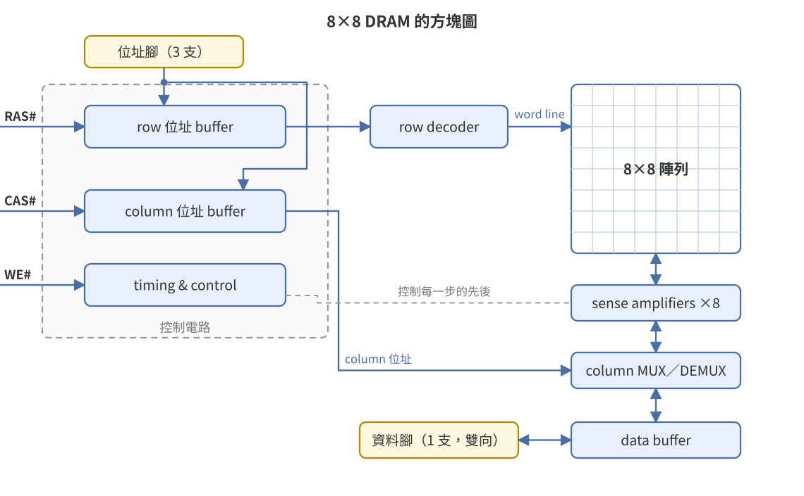
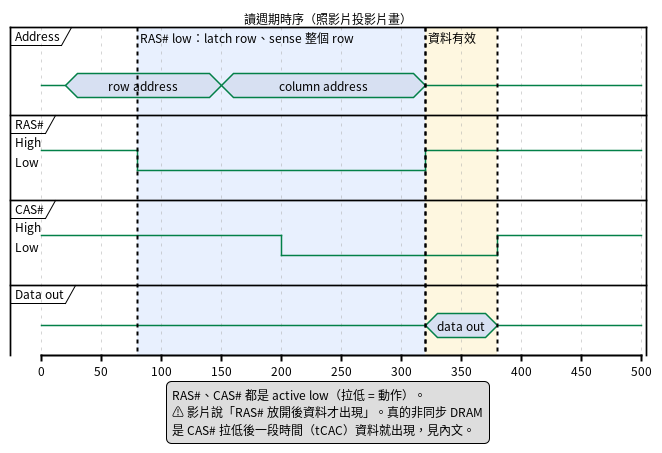
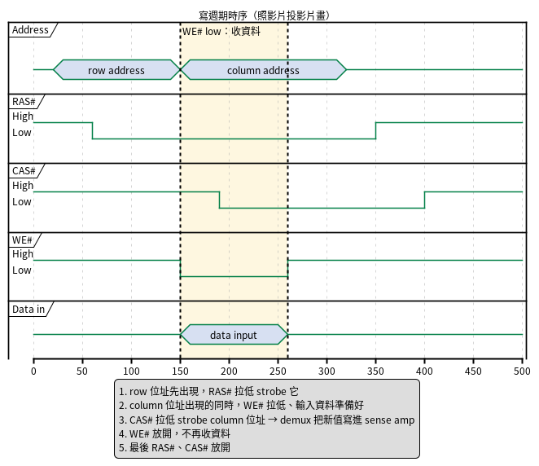

# DRAM 系列第二支影片筆記：讀與寫的週期（Part 2: Read and Write Cycles）

> **課程**：Dynamic Random Access Memory (DRAM) — Part 2: Read and Write Cycles（播放清單第 2 支）
> **講者**：YouTube 頻道 Computer Science Lessons（旁白，沒有露臉）
> **來源**：YouTube 影片（10:36，whisper 轉錄）＋ 投影片截圖
> **標記說明**：
> - `【口頭】`：旁白講了、投影片上沒寫的內容
> - `【補充】`：影片沒講，從本 repo 其他筆記或 DRAM 通用知識補的
> - `【實測】`：在本機（Intel i7-13650HX、Ubuntu、Python 3.10）實際執行的結果
> - `⚠️`：影片說法跟實際 DRAM 不一致、或逐字稿不清楚的地方
> - `[mm:ss]`：影片時間點

---

## 目錄

- [0. 本講地圖](#0-本講地圖)
- [1. 複習與這支要做什麼](#1-複習與這支要做什麼)
- [2. 8×8 的模型](#2-88-的模型)
- [3. 位址、row／column 位址 buffer](#3-位址rowcolumn-位址-buffer)
- [4. 位址多工：省腳](#4-位址多工省腳)
- [5. 控制腳：RAS#、CAS#、WE#](#5-控制腳rascaswe)
- [6. 讀週期](#6-讀週期)
- [7. 讀週期的時序圖](#7-讀週期的時序圖)
- [8. 寫週期](#8-寫週期)
- [9. 寫週期的時序圖](#9-寫週期的時序圖)
- [10. 【實測】](#10-實測)
- [11. 一頁速查表](#11-一頁速查表)
- [12. 與其他講次的連結](#12-與其他講次的連結)
- [附：本講一句話總結](#附本講一句話總結)

---

## 0. 本講地圖



- 讀：precharge → row 位址 + RAS# → 整個 row 進 sense amp → column 位址 + CAS# → mux 選一個 → 資料腳 → 寫回 row → precharge
- 寫：同上，但在 CAS# 之前放好資料、拉低 WE# → demux 改一個 sense amp → 寫回 row

---

## 1. 複習與這支要做什麼

- [00:00] DRAM = 幾百萬個 cell 排成的長方形陣列；[00:13] 每個 cell 一個電晶體＋一個電容，[00:17] 有電是 1、沒電是 0。
- [00:24] 電晶體接一條橫的 word line、一條直的 bit line。
- [00:31] 一排差動 sense amplifier 把陣列分成兩半，[00:39] 負責偵測整個 row 的值、latch 住、再寫回去。
- [00:47] 這支：**怎麼選出陣列裡的某一個 cell** 來讀或寫。

---

## 2. 8×8 的模型

- [00:53] 為了簡單，用 **8 row × 8 column** 的陣列。
- [01:00] 圖再簡化：每個 cell 畫成一個方塊。[01:06] 紅 = 1、藍 = 0。
- [01:16] 目標：把**黃框那個 1** 讀出來。

投影片 [01:06] 的內容（row 0 在最上面）：

```
row 0: 1 0 0 0 0 0 0 0
row 1: 0 0 1 1 1 1 1 0
row 2: 0 1 1 1 1 1 0 1
row 3: 0 0 0 0 0 1 0 0
row 4: 0 0 0 0 0 0 0 0
row 5: 1 1 0 1 0 0 1 1     ← 要讀的是 row 5、column 3
row 6: 0 0 1 0 1 0 0 0
row 7: 0 0 0 0 0 0 0 1
```

---

## 3. 位址、row／column 位址 buffer

- [01:27] 要指定記憶體裡的一個位置，需要**記憶體位址**；[01:32] 傳位址要用 **address bus**。
- [01:37] 8×8 = 64 個 cell → [01:45] 6 條線，2⁶ = 64 種值，[01:54] 剛好每個 cell 一個。
- [01:59] 其中 3 條進 **row address buffer**（一組 latch），[02:06] 再接 **row address decoder**。[02:11] 這 3 bit 指定一個 row，叫 **row address**。
- [02:26] 另外 3 條進 **column address buffer**，[02:29] 再接 **column multiplexer／demultiplexer**。[02:34] 這 3 bit 指定一個 column，叫 **column address**。
- [02:44] buffer 裡的 latch 就是暫時**存住** row 位址和 column 位址。[02:56] latch 在另一個系列講。

---

## 4. 位址多工：省腳

- [03:02] 有了這兩個 buffer，row 位址和 column 位址可以**分兩次**送進記憶體：[03:07] 叫做 **memory address multiplexing**。
- [03:15] 好處：外部的腳變少。[03:21] 位址越多越重要。

| 位址寬度 | 不多工 | 多工 |
|---|---|---|
| [03:30] 6 bit（這個模型） | 6 支 | **3 支** |
| [03:35] 32 bit | 32 支 | **16 支** |

- [03:40] 這個記憶體一次只讀寫 1 bit → [03:46] **1 支資料腳**（圖右下角）。[03:52] 資料腳是**雙向**的，讀寫都用它。
- [03:58] 真的 DRAM 資料腳多很多，[04:01] 之後的影片會把模型放大。

---

## 5. 控制腳：RAS#、CAS#、WE#

[04:06] 除了位址和資料，還要控制訊號和電源的腳：

| 腳 | 意思 | 時間 |
|---|---|---|
| **RAS#** | Row Address Strobe：讓 row 位址 buffer 收下位址 | [04:22] |
| **CAS#** | Column Address Strobe：讓 column 位址 buffer 收下位址 | [04:22] |
| **WE#** | Write Enable：這次是寫還是讀 | [04:44] |

- [04:14] 每個 buffer 一支腳，位址送進來時**一個接一個**打開。
- [04:31] 現在 RAS、CAS 都是高的。[04:34] **拉低才算啟用** → [04:38] **active low**，[04:41] 名字上面那條橫線就是這個意思（本筆記寫成 `#`）。[04:53] WE 也是 active low。
- [04:55] 時序非常重要，所以模組裡還有一塊 **timing and control** 電路，確保每件事在對的時間發生。

---

## 6. 讀週期

[05:06] 讀週期的步驟（投影片上紅字是每一步的名字）：

| # | 時間 | 步驟 | 投影片紅字 |
|---|---|---|---|
| 1 | [05:11] | bit line precharge 到約供電電壓的一半 | Bit lines pre-charged |
| 2 | [05:18] | memory controller 把 **row 位址**（101）放到位址腳，**RAS# 拉低**。[05:26] 這一下就觸發整個讀週期 | Row Address Strobe |
| 3 | [05:30] | bit line 跟 precharge 電路斷開，浮著 | — |
| 4 | [05:35] | row 位址被 decode（3 bit → 8 選 1，decoder 見[第 3 支](lecture03_note.md)），[05:51] 對應的 word line asserted | Word line asserted |
| 5 | [05:55] | **整個 row** 的值 latch 進 sense amplifier（`1 1 0 1 0 0 1 1`） | Row values latched |
| 6 | [06:04] | 讀是破壞性的：存 1 的電容放掉一些、存 0 的充進一些（圖上整個 row 變紫色）。但值已經安全存在 sense amp 裡 | Destructive read |
| 7 | [06:23] | **column 位址**（011）放到位址腳，**CAS# 拉低**，[06:30] latch 進 column 位址 buffer | Column Address Strobe |
| 8 | [06:35] | column multiplexer 用 column 位址從 8 個 sense amp 選一個（mux 見[第 4 支](lecture04_note.md)），[06:55] 這個 1 送往 data buffer | Output data selected |
| 9 | [07:01] | **RAS# 放開**，輸出出現在資料腳 | Row Address Strobe disabled／Output available |
| 10 | [07:11] | 用 sense amp 的內容**寫回這個 row** | Row refreshed |
| 11 | [07:18] | **CAS# 放開**，word line 關掉，輸出不再有效 | Column Address Strobe disabled／Word line released |
| 12 | [07:27] | bit line 再 precharge，準備下一次 | — |

⚠️ 旁白和時序圖都說「RAS# 放開後資料才出現」。【補充】真的非同步 DRAM 不是這樣：資料在 **CAS# 拉低後一段時間**（tCAC）就出現在資料腳，RAS# 可以一直保持低（這正是 fast page mode 能連續換 column 的原因）；資料在 **CAS# 拉高**時才消失，這點影片說對了。寫回 row 也不是最後才做：sense amp 把 bit line 推到滿電壓時，cell 就同時被寫回了。見 [Advanced 第 42 支 §2–3](../../../cs-note/computer-architecture/advanced/lecture42_note.md#2-非同步-dramras-與-cas)。

---

## 7. 讀週期的時序圖

- [07:35] 讀週期要非常精準的時序。[07:42] 有些事可以同時做，有些要排隊。[07:46] 要快，也要對。
- [07:51] 投影片 [07:36] 的 1 bit 讀週期：



| 時間 | 說明 |
|---|---|
| [07:57] | row 位址**先**出現在位址腳 |
| [08:02] | 留一點時間給傳遞延遲，然後 RAS# 拉低（記得是 active low），[08:11] 週期開始 |
| [08:13] | 再留時間給 latch、decode，還有**最慢的部分：sense 和 latch 整個 row** |
| [08:21] | column 位址出現在位址腳，[08:25] 然後也被 strobe、latch |
| [08:29] | RAS# 放開時資料出現，一直到 CAS# 放開為止（⚠️ 見上節） |

---

## 8. 寫週期

- [08:43] 寫週期跟讀週期很像。
- [08:47] 例子：把 **row 100、column 110** 這個 cell 從 0 改成 1。

| # | 時間 | 步驟 |
|---|---|---|
| 1 | [08:54] | bit line precharge |
| 2 | [08:57] | memory controller 放 row 位址（100），RAS# 拉低 |
| 3 | [09:04] | decode，word line asserted，跟讀一樣 |
| 4 | [09:10] | 整個 row 的舊值 latch 進 sense amp（`0 0 0 0 0 0 0 0`），跟讀一樣 |
| 5 | [09:17] | **不一樣的地方**：把要寫的資料放到資料腳，**WE# 拉低**（Write enable） |
| 6 | [09:25] | column 位址（110）放到位址腳，CAS# 拉低 |
| 7 | [09:29] | 這次觸發的是 **demultiplexer**，把新值載進對應的那個 sense amp（`0 0 0 0 0 0 1 0`，投影片紅字 New value loaded） |
| 8 | [09:38] | 跟之前一樣寫回 row，但這次是**改過的**資料（Row refreshed） |
| 9 | [09:46] | WE# 放開，然後 RAS#、CAS# 放開，bit line 再 precharge |

- 改一個 bit 也要先讀整個 row、改 sense amp 裡的一格、再寫回整個 row（[第 1 支 §8](lecture01_note.md#8-讀完要寫回) 說的事）。

⚠️ 投影片上位址腳由上往下畫成 `0 1 1`，column 位址 buffer 卻顯示 `1 1 0`；讀的時候也是腳 `1 1 0`、buffer `0 1 1`。看起來腳是**低位在上**畫的，以 buffer 的值為準（讀 column 3、寫 column 6，跟實測一致）。

---

## 9. 寫週期的時序圖

投影片 [09:57]：



- [10:03] row 位址先出現、被 strobe。
- [10:09] column 位址出現在腳上的**同時**，WE# 拉低、輸入資料準備好。
- [10:19] 然後 column 位址被 strobe。
- [10:22] WE# 放開，不再收資料。
- [10:27] 最後 RAS#、CAS# 放開。

【補充】WE# 在 CAS# 之前就拉低，這種叫 early write：CAS# 一拉低就直接拿資料腳上的值寫進去，資料腳不會先輸出舊值。

---

## 10. 【實測】

`experiments/lecture02/dram8x8.py` 照影片的步驟做一個 8×8、1 bit 寬的 DRAM：

- `ras()`（`dram8x8.py:30`）：整個 row 複製進 sense amp，cell 標成 `?`（破壞性讀）。
- `cas_read()`／`cas_write()`（`dram8x8.py:36`、`:41`）：只碰 sense amp 的一格。
- `close()`（`dram8x8.py:45`）：sense amp 整排寫回 row。

結果（`dram8x8.out`）：

```
打開 row 後的 cell（? = 電被分掉）：
...
00000000
????????          ← row 5 整排被「讀壞」
00101000
...
RAS# low, row=101: precharge -> float -> word line 5 開
CAS# low, col=011: mux 選第 3 個 sense amp -> data out = 1
sense amp 寫回 row 5（refresh），word line 關，precharge
讀到 row 5 col 3 = 1
讀完整個陣列跟原來一樣：OK

寫之前 row 4 = 00000000
WE# low, CAS# low, col=110: demux 把 1 寫進第 6 個 sense amp
寫之後 row 4 = 00000010
```

- 讀出 1，跟投影片 [07:03] 的「Output available: 1」一樣；寫完 row 4 = `00000010`，跟 [09:27] 的 sense amp 一樣。
- 中間有一段時間整個 row 都是 `?`：如果這時候斷電、或沒寫回，整排資料就沒了。這就是為什麼 sense amp 一定要負責寫回。
- 位址多工：6 bit → 3 支腳、24 bit → 12 支、32 bit → 16 支（`dram8x8.py:84`）。

---

## 11. 一頁速查表

| 觀念 | 重點 |
|---|---|
| 位址 | 8×8 = 64 cell → 6 bit；高 3 bit = row、低 3 bit = column |
| Row 路徑 | row 位址 buffer（latch）→ row decoder → word line |
| Column 路徑 | column 位址 buffer（latch）→ column mux（讀）／demux（寫）→ sense amp |
| 位址多工 | row、column 分兩次送；32 bit 位址只要 16 支腳 |
| 資料腳 | 雙向；這個模型只有 1 支 |
| RAS#／CAS#／WE# | 都是 active low（拉低 = 啟用） |
| 讀 | precharge → row + RAS# → 整 row 進 sense amp → column + CAS# → mux → 資料腳 → 寫回 → precharge |
| 寫 | 同讀，但資料放好、WE# 拉低，再 CAS# → demux 改一格 sense amp → 寫回整 row |
| 最慢的一步 | sense 和 latch 整個 row |
| ⚠️ 影片的時序 | 實際 DRAM 資料在 CAS# 拉低後就出來，不用等 RAS# 放開 |

---

## 12. 與其他講次的連結

| 本講觀念 | 在哪裡繼續 |
|---|---|
| row decoder 裡面長什麼樣 | [第 3 支](lecture03_note.md)：3-to-8 decoder |
| column mux／demux 裡面長什麼樣 | [第 4 支](lecture04_note.md) |
| 一次讀寫 1 bit → 一次 1 byte、64 bit | [第 5 支](lecture05_note.md)：bank、chip、DIMM |
| RAS# 不放開、連續換 column | [第 6 支](lecture06_note.md)：burst；[Advanced 第 42 支 §3](../../../cs-note/computer-architecture/advanced/lecture42_note.md#3-fast-page-mode-與-edo)：fast page mode |
| 非同步 → 同步 DRAM、DDR 的命令 | [Advanced 第 42 支](../../../cs-note/computer-architecture/advanced/lecture42_note.md)、[第 43 支](../../../cs-note/computer-architecture/advanced/lecture43_note.md) |

---

## 附：本講一句話總結

> **8×8 的 DRAM 用 6 bit 位址選一個 cell，但為了省腳把位址分兩次送：先把 row 位址放在 3 支位址腳上、拉低 RAS#，row decoder 打開一條 word line，整個 row 被讀進 sense amplifier（cell 本身被讀壞）；再放 column 位址、拉低 CAS#，讀的時候 column multiplexer 從 8 個 sense amp 選一個送到雙向資料腳，寫的時候先把資料放好、拉低 WE#，由 demultiplexer 改掉那一格 sense amp；最後 sense amp 把整個 row 寫回去、bit line 重新 precharge。RAS#、CAS#、WE# 都是 active low，整個週期最慢的是 sense 整個 row。影片說資料要等 RAS# 放開才出現，實際 DRAM 是 CAS# 拉低後就出現。**

---

*筆記依據 YouTube 頻道 Computer Science Lessons「Dynamic Random Access Memory (DRAM). Part 2: Read and Write Cycles」（10:36）的 whisper 逐字稿與投影片截圖整理。實測為本機（Intel i7-13650HX、Ubuntu、Python 3.10）結果。*
