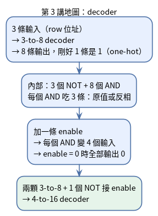
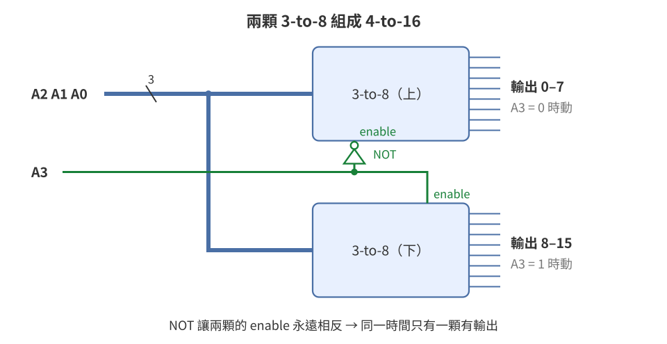

# DRAM 系列第三支影片筆記：Binary decoder（Part 3: Binary Decoders）

> **課程**：Dynamic Random Access Memory (DRAM) — Part 3: Binary Decoders（播放清單第 3 支）
> **講者**：YouTube 頻道 Computer Science Lessons（旁白，沒有露臉）
> **來源**：YouTube 影片（3:50，whisper 轉錄）＋ 投影片截圖
> **標記說明**：
> - `【口頭】`：旁白講了、投影片上沒寫的內容
> - `【補充】`：影片沒講，從本 repo 其他筆記或通用知識補的
> - `【實測】`：在本機（Intel i7-13650HX、Ubuntu、Python 3.10）實際執行的結果
> - `⚠️`：影片說法跟實際不一致、或逐字稿不清楚的地方
> - `[mm:ss]`：影片時間點

---

## 目錄

- [0. 本講地圖](#0-本講地圖)
- [1. Decoder 是什麼](#1-decoder-是什麼)
- [2. 用 NOT 和 AND 組出來](#2-用-not-和-and-組出來)
- [3. 用 decoder 選 word line](#3-用-decoder-選-word-line)
- [4. Enable 輸入](#4-enable-輸入)
- [5. 兩顆 3-to-8 組成 4-to-16](#5-兩顆-3-to-8-組成-4-to-16)
- [6. 【實測】](#6-實測)
- [7. 一頁速查表](#7-一頁速查表)
- [8. 與其他講次的連結](#8-與其他講次的連結)
- [附：本講一句話總結](#附本講一句話總結)

---

## 0. 本講地圖



---

## 1. Decoder 是什麼

- [00:00] **Binary decoder**：吃多條輸入，用它們**啟動多條輸出中的一條**。
- [00:15] 3 條輸入選 8 條輸出之一 → **3-to-8 decoder**。

投影片 [00:27]～[01:03] 一個一個試（「Denary」是英式說法的十進位）：

| 輸入代表的十進位 | 被啟動的輸出 | 時間 |
|---|---|---|
| 0（全低） | 第 1 條（最上面） | [00:24] |
| 1 | 第 2 條 | [00:34] |
| 2 | 第 3 條 | [00:39] |
| 3 | 第 4 條 | [00:48] |
| 4、5、6、7 | 第 5、6、7、8 條 | [00:54] |

⚠️ 方塊圖上 [00:36]「Denary 1」時是**最上面那條輸入**為 1，所以方塊圖的輸入是**低位在上**；後面閘級電路圖 [02:06] 寫成 `0 0 1`，是**高位在左**。兩張圖的 bit 順序不同，值是一樣的。

---

## 2. 用 NOT 和 AND 組出來

- [01:06] decoder 可以用**組合邏輯**做。
- [01:11] 3-to-8 = **3 個 NOT ＋ 8 個 AND**。
- [01:44] 每條輸入分成兩條：一條原樣、一條經過 NOT。[01:52] 所以每個 bit 都有「原值」和「反相」兩種可用。
- 每個 AND 接 3 條線，正好組成一種位址的樣子：

| AND | 接的三條線 | 什麼時候輸出 1 |
|---|---|---|
| 0 | ¬A2 · ¬A1 · ¬A0 | 位址 000 |
| 1 | ¬A2 · ¬A1 · A0 | 位址 001 |
| 2 | ¬A2 · A1 · ¬A0 | 位址 010 |
| … | … | … |
| 7 | A2 · A1 · A0 | 位址 111 |

---

## 3. 用 decoder 選 word line

- [01:18] decoder 的用途之一：照 row 位址，從記憶體陣列選一條 **row（= word line）**。
- [01:29] 三條位址線都是 0 V → 只有最上面那個 row 是高電壓。[01:38] 也就是只有 **word line 0** asserted。
  - [01:52] 三個 NOT 的輸出都是高的。
  - [01:55] 只有最上面那個 AND 接到的三條線**全是高的** → 只有它輸出高。
- [02:07] 位址 001：內部換了一組線是高的，[02:15] 只有第二個 AND 三條輸入全高 → **word line 1**。
- [02:24]～[02:53] 依序：010 → word line 2、011 → 3、100 → 4、101 → 5、110 → 6、111 → 7（最下面）。

【補充】真的 DRAM array 有 16384 個 row（[第 5 支](lecture05_note.md)），要 14-to-16384 decoder。直接照這張圖做就是 16384 個 14 輸入 AND，實際上會分兩級（先 predecode 幾個 bit 一組，再組合），這裡只看原理。

---

## 4. Enable 輸入

- [03:02] 3-to-8 decoder 可以多加一條 **enable** 輸入，負責「開關整顆 decoder」。
- [03:09] 每個 AND 從 3 個輸入變成 **4 個**（多接 enable）。
- [03:14] 只有 enable 是高的時候，decoder 才會照選擇輸入去啟動某一條；enable 低時**什麼都不輸出**。

---

## 5. 兩顆 3-to-8 組成 4-to-16

- [03:22] decoder 可以組合成更大的。
- [03:28] 例：兩顆 3-to-8 組成 **4-to-16**。
  - 低 3 bit 同時接到兩顆。
  - 第 4 個 bit（最高位）直接接**下面那顆**的 enable，經過一個 NOT 接**上面那顆**的 enable。
- [03:35] 這個 NOT 確保一顆的 enable 永遠是另一顆的反相，[03:44] 所以**只有一顆會有輸出**。



【補充】這就是 [第 4 支](lecture04_note.md#5-demultiplexer-的電路) 會看到的 demultiplexer：把 enable 當成資料輸入，decoder 就變成 1-to-8 demux。

---

## 6. 【實測】

`experiments/lecture03/decoder.py` 照影片的閘級電路寫（`decoder.py:8` 是 3-to-8，`:16` 是兩顆組成的 4-to-16），窮舉所有輸入，檢查輸出是不是 one-hot（剛好一條是 1）。結果（`decoder.out`）：

```
addr  word line（3-to-8）
000   10000000
001   01000000
010   00100000
...
111   00000001
3-to-8、enable、4-to-16 全部 one-hot 正確： OK
```

- enable = 0 時 8 條全是 0，4-to-16 的 16 種位址也都只有一條是 1。
- 閘數長得很快：n-to-2ⁿ 要 n 個 NOT、2ⁿ 個 n 輸入 AND。DRAM row 位址 14 bit → 16384 個 14 輸入 AND（`decoder.py:38`），這也是 [第 5 支](lecture05_note.md#2-更大的陣列長方形而不是正方形) 說「每個 row 只貢獻一點點周邊電路」裡的那「一點點」。

---

## 7. 一頁速查表

| 觀念 | 重點 |
|---|---|
| Binary decoder | n 條輸入 → 2ⁿ 條輸出，剛好一條是 1 |
| 3-to-8 | 3 個 NOT ＋ 8 個 3 輸入 AND |
| 原理 | 每個 AND 接每個 bit 的原值或反相，組成一種位址 |
| 在 DRAM | row 位址 → decoder → 只 assert 一條 word line |
| Enable | 每個 AND 多一個輸入；enable = 0 時全部輸出 0 |
| 4-to-16 | 兩顆 3-to-8；最高位接一顆的 enable，NOT 之後接另一顆 |
| Denary | 英式英文的「十進位」 |

---

## 8. 與其他講次的連結

| 本講觀念 | 在哪裡繼續 |
|---|---|
| decoder 在讀週期的哪一步 | [第 2 支 §6](lecture02_note.md#6-讀週期) 第 4 步 |
| enable 當資料 → demultiplexer | [第 4 支](lecture04_note.md) |
| bank 位址也要 decode | [第 5 支](lecture05_note.md#4-bank一次一個-byte) |
| 組合邏輯、CMOS 閘 | [Basic 第 18 支](../../../cs-note/computer-architecture/basic/lecture18_note.md) |

---

## 附：本講一句話總結

> **3-to-8 binary decoder 用 3 個 NOT 和 8 個 AND 組成：每條輸入分成原值和反相，每個 AND 挑一種組合，所以任何位址都只會讓一個 AND 輸出 1；在 DRAM 裡它把 row 位址變成「只 assert 一條 word line」。多加一條 enable 接到每個 AND，enable 為 0 時整顆不輸出；兩顆 3-to-8 用最高位和它的反相分別當 enable，就組成只有一顆會動的 4-to-16 decoder。**

---

*筆記依據 YouTube 頻道 Computer Science Lessons「Dynamic Random Access Memory (DRAM). Part 3: Binary Decoders」（3:50）的 whisper 逐字稿與投影片截圖整理。實測為本機（Intel i7-13650HX、Ubuntu、Python 3.10）結果。*
