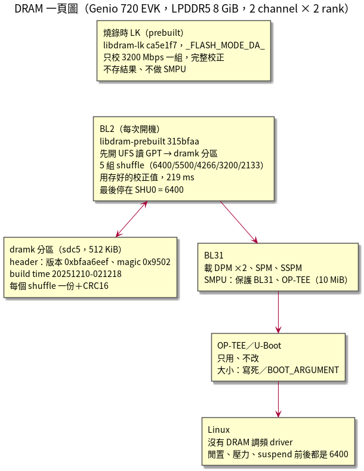

# DRAM 一頁總結（Genio 720 EVK，UFS 版）

2026-10-17。完整內容在四份筆記：[入門](dram-intro.md)、[初始化](dram-init.md)、[執行時](dram-runtime.md)、[配置和保護](dram-layout-protect.md)。範圍和規則見 [BRIEF.md](BRIEF.md)。

## 一句話

板子上是 **LPDDR5 8 GiB（2 channel × 2 rank，每 rank 4 GiB）**，最高 6400 Mbps。

- **初始化**：只有兩個地方會初始化 DRAM。
  - 燒錄時的 **LK**：每次完整校正，但只校 3200 Mbps 一組。
  - 每次開機的 **BL2**：5 組速度都設好，最後停在 6400。BL2 第一次開機會整套校正，結果存進 UFS 的 `dramk` 分區。之後熱開機、冷開機都直接拿來用，219 ms 做完。
  - 兩邊用的是**同一套 libdram 原始碼**，只差編譯旗標。
- **執行時**：之後每一棒都只「用」DRAM。BL31 把 DPM／SPM 韌體載進去，大小靠 `BOOT_ARGUMENT` 往下傳，保護靠 BL31 的 SMPU。Linux 沒有任何 DRAM 調頻的 driver，實測一直是 6400。

## 總表

| 棒 | 初始化？ | 執行時改頻率／電壓？ | 大小從哪來 | 保護 | 證據 |
|---|---|---|---|---|---|
| LK（燒錄） | **有**：libdram-lk `ca5e1f7`，`_FLASH_MODE_DA_`，只校 3200，不存 | — | 自己量（MR8） | 不設 | D1 |
| BL2 | **有**：libdram-prebuilt `315bfaa`，5 組 shuffle，用 `dramk` 的校正值，218.8 ms | 開機時設好 5 組，停在 SHU0 | 自己量 → 寫 `BOOT_ARGUMENT` | 不設（`CONFIG_SMPU 0`） | D0、D2、D3、D4 |
| BL31 | 否 | 不直接改；載 DPM×2、SPM、SSPM、MCUPM；`MTK_SIP_VCORE_CONTROL` 沒實作 | 編譯時寫死位址 | **SMPU region 1（BL31）、2（OP-TEE 10 MiB）** | D5 |
| OP-TEE | 否 | 否 | Yocto 寫死 `CFG_DRAM_SIZE=0x200000000` | 不設 | code |
| U-Boot | 否 | 否 | 讀 `BOOT_ARGUMENT`；開 kernel 時改 dts `/memory`、加 `dramc-rk0/1` | 不設 | D6 |
| Linux | 否 | 否：沒有 DVFSRC／DRAM devfreq driver；`vcore` regulator 沒有使用者 | dts | 碰不到 SMPU（DEVAPC） | D7、D8 |

## 9 個重點發現

1. **LK 和 BL2 的 libdram 是同一份 code**。`315bfaa`（BL2）、`ca5e1f7`（LK）、HEAD `1913f22` 在 `src/mt8391` 之間只差一行。prebuilt `libdram.a` 的 77 個 `.o` 名字和順序跟 `meson.build` 一模一樣（去掉重複列的一項，`logs/d12-libdram-objlist.log`）。差別只在旗標：LK `-D_FLASH_MODE_DA_`，BL2 `-DCFG_DRAM_CALIB_OPTIMIZATION=1`。
2. **LK 只校一組速度（3200）**：`dramc_pi_main.c:2414` 的 `#if DUAL_FREQ_K && !defined(__DRAM_FLASH_TOOL_DA__)` 把其他頻率跳過。LK 也沒呼叫 `pmic_init()`，所有電壓讀回 `-1`。
3. **BL2 要先開 UFS、讀 GPT，才初始化 DRAM**，因為校正結果在 UFS 的 `dramk` 分區（`0x4880000`，512 KiB，用約 6 KiB）。這時讀儲存只能用 SRAM 裡的小 buffer。
4. **冷開機也不重新校正**。冷開機和熱開機，BL2 的 DRAM log 逐行相同。`dramk` 的 md5（`19a518c8…`）在所有實驗前後都沒變。
5. **只有 `dramk` 被清掉或換了 libdram 才會整套校正**。
   - 比的是 libdram 的版本和 build time（`20251210-021218`），不是 BL2 的編譯時間，所以改 BL2 不會觸發重新校正。
   - 燒整顆會 erase `mmc0`，`dramk` 跟著清掉。第一次開機整套校正約 1.2 s，log 多 4 行（`erase the DRAM shu_data` ×2、`Larger WL R2R PI`、`RankNumberDetection`）。
   - header 的 `calib_err_code = 4`（`ERR_PL_UPDATED`）記下了這件事。
6. **BL2 時間**：PMIC＋時脈 129.3 ms、UFS＋GPT 53～95 ms、`mt_mem_init()` 218.8 ms（兩次一樣）。`cntfrq_el0` 在 BL2 是 0，要自己用 13 MHz 換算。
7. **開機後沒有人換頻**：
   - Linux 唯讀讀 DDRPHY `DVFS_STATUS`（`0x10238C7C`／`0x10248C7C`）：閒置 40 筆、壓力 60 筆、壓力後 20 筆（兩個 channel 各算一筆）、suspend 睡醒後，**全部 SHU0 = 6400**。
   - BL31 載 DPM 前後也是 SHU0。
   - `MTK_SIP_VCORE_CONTROL` 只有編號、沒有 handler。kernel 沒有 DVFSRC driver。
8. **保留區有三個來源**：
   - kernel dts 寫死的。
   - BL2 libdram 用 mblock 保留、經 `BOOT_ARGUMENT` 和 U-Boot `ft_board_setup()` 加進 kernel dts 的 `dramc-rk0/1`（每個 rank 最上面 8 KiB，給 DRAMC dummy read）。
   - kernel 自己的 CMA 32 MiB、swiotlb 64 MiB。
9. **OP-TEE 12 MiB vs SMPU 10 MiB 不是矛盾**：10 MiB 是 TZDRAM（secure，SMPU 擋住），後面 2 MiB 是 Linux 和 OP-TEE 共用的 SHMEM。

## 實驗清單

| 編號 | 做什麼 | 改 code？ | log |
|---|---|---|---|
| D0 | 熱開機 UART；Linux dts、dmesg、`/proc/iomem` | 否 | `d0-warm-boot-uart.log`、`d0-linux-basic.log`、`d11-linux-iomem.log` |
| D1 | `aiot-bootrom` 只載 prebuilt `lk.bin`（不燒）→ 錄 LK 的 DRAM log → `fastboot reboot` | 否 | `d1-lk-uart.log`、`d1-lk-host.log` |
| D2 | 冷開機（`systemctl poweroff` → `genio-board power`） | 否 | `d2-cold-boot-uart.log` |
| D3 | 唯讀讀 `dramk`（`/dev/sdc5`）header 和 md5；裝置權限、有無檔案系統 | 否 | `d3-dramk-part.log`、`d3b-dramk-access.log` |
| D4 | BL2 加 `DRAMEXP`：各段時間、初始化後暫存器、`BOOT_ARGUMENT`、mblock | **是**（`patches/d4-bl2-dramexp.diff`），燒 `mmc0boot0` | `d45-flash-uart.log`、`d6-uboot.log` |
| D5 | BL31 加 `DRAMEXP`：`dpm_init` 前後、SMPU 讀回 | **是**（`patches/d5-bl31-dramexp.diff`），燒 `bootloaders` | 同上 |
| D6 | U-Boot `bdinfo`、`fdt print /memory`、`fdt list /reserved-memory`、`md.l 0x40000100` | 否 | `d6-uboot.log` |
| D7 | Linux 唯讀取樣 shuffle（閒置、壓力）；devfreq、regulator、driver | 否 | `d7-*.log`、`d7b-*.log`、`d7c-vcore.log` |
| D8 | suspend 前後取樣 shuffle | 否 | `d8-*.log`、`d8-notes.txt`、`restore-suspend-check.log` |
| D9 | `bitbake -c unpack optee-os`，讀 OP-TEE 平台 code | 否 | `d9-unpack-optee.log` |
| D10 | 引用 2026-10-02 燒整顆後第一次開機的 UART（整套校正） | 否 | `d10-fullk-after-fullflash-uart.log` |
| D12 | prebuilt `libdram.a` 成員 vs `meson.build` 清單；三個版本之間 `src/mt8391` 的差異 | 否 | `d12-libdram-objlist.log` |

**沒有寫過任何 DRAMC／EMI／DVFSRC／SMPU 暫存器**：Linux 用 `PROT_READ` mmap，BL2／BL31 的 patch 只有 `mmio_read_32`／`smpu_read`。**沒有寫過 `dramk`**：只用 `dd if=` 讀。**LK 沒改**，D1 只是把現成的 `lk.bin` 載進去跑。

## 踩到的坑

- **D8 第一次 suspend 卡死**：`rtcwake -m mem -s 10` 後，adb、UART、電源鍵都沒反應，只能 `genio-board reset`。journald 不存檔，看不到原因。同一個版本再試、原版再試都正常。只發生一次，原因未知。
- **背景等待迴圈自己卡住**：`until ! pgrep -f "[u]art_cap.py"` 寫在**同一個指令裡又出現 `uart_cap.py`** 時，`pgrep` 會比對到自己的 shell，永遠等不完。CLAUDE.md 已經有這條，又踩了一次：等 UART 錄音結束要單獨下指令。
- **BL2 `cntfrq_el0` = 0**：用它換算時間會除以 0（AArch64 得 0）。
- **BL2 的 libdram log 比 LK 少很多**：不能只用「沒有校正 log」判斷沒校正，要看 `dramk` md5、那 4 行、時間。
- **TF-A `smpu.c` 沒有 include `<common/debug.h>`**：在那裡加 `NOTICE` 要自己補。
- **UART 時間戳是主機時間**，FT232 一批一批送，誤差約 0.1 s。量 BL2 用 `cntpct_el0`；LK 不能改，只能粗估。

## 待深挖

- DPM 韌體（`dpm.pm`／`dpm.dm`）實際做什麼：閒置時會不會讓 DRAM self-refresh、會不會換頻。
- Linux 讀到的 `vcore` 693.75 mV（BL2 結束是 725 mV）是誰設的、是不是真正的輸出。
- `SA_RESERVE` CHA bit 15、`DVFSRC +0x0 = 0x9` 等暫存器的意義（無 TRM）。
- SMPU 的 AID 對照（8、52、240 是誰）。
- `dramc-rk*` 的 dummy read 什麼時候發生。
- `mt_base_init()`（prebuilt `libbase.a`）做了什麼。
- D8 第一次 suspend 卡死的原因。

## 還原

- D4／D5：
  - BL2、TF-A 兩棵樹 `git checkout -- .`（`git status` 乾淨）。
  - `bitbake -C compile bl2 trusted-firmware-a` ＋ `bitbake rity-demo-image`。
  - `bl2.img` = `4c434e208d70c0a1f7e2794339101619`、`fip.bin` = `d506658b72f6f6fc76710cf2158c442d`，跟實驗前一樣。
  - `genio-flash … mmc0boot0 bootloaders` 燒回，開機 UART 沒有 `DRAMEXP`（`logs/restore-uart.log`）。
- D6：只在 U-Boot 下讀取指令，沒 `setenv`／`saveenv`。
- D7／D8：只讀暫存器；`/proc/sys/kernel/printk` 改回 `1 4 1 7`；板子 `/tmp` 的腳本刪掉。
- D9：`optee-os` 的原始碼留在 `build/tmp/work/…/optee-os/3.19/git`（只是解開，沒改）。
- 最後確認（`logs/restore-check.log`，07:52 UTC）：
  - `uname -r` = `6.6.137-mtk+ga246e0c68c39-g720e989065cc`（沒有 `-dirty`）。
  - USB gadget `configured`、Weston `active`。
  - `/proc/cmdline` 是原本的。
  - `dramk` md5 `19a518c8a297ddf3b7bfbbbf9fd6654a` 不變。
  - 原版 suspend 正常（`restore-suspend-check.log`）。
- kernel、U-Boot、OP-TEE、rootfs 都沒改過，不需要整顆燒。
