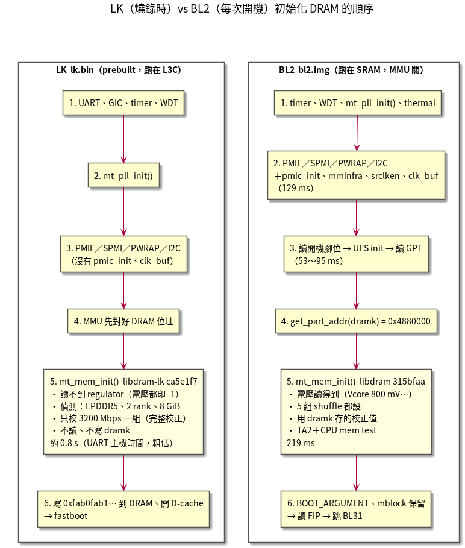
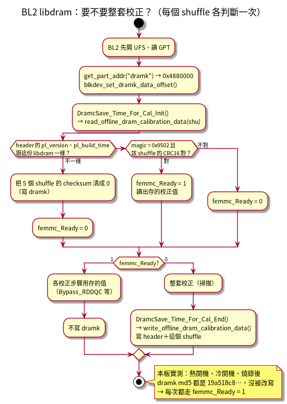

# DRAM 初始化：LK（燒錄時）vs BL2（每次開機）

Genio 720 EVK（UFS 版），2026-10-17。名詞和路徑簡寫看 [dram-intro.md](dram-intro.md)。

證據：

- `logs/d0-warm-boot-uart.log`：熱開機 UART 全程（原版）
- `logs/d1-lk-uart.log`、`logs/d1-lk-host.log`：**D1**，只用 `aiot-bootrom` 把 prebuilt `lk.bin` 送進去跑，**不燒任何分區**，再 `fastboot reboot`
- `logs/d2-cold-boot-uart.log`：**D2**，冷開機（`systemctl poweroff` → `genio-board power`）
- `logs/d3-dramk-part.log`：**D3**，Linux 唯讀讀 `dramk` 分區
- `logs/d45-flash-uart.log`、`logs/d6-uboot.log`：**D4**，BL2 加 `DRAMEXP` log（`patches/d4-bl2-dramexp.diff`，已還原）後的兩次開機
- `logs/d10-fullk-after-fullflash-uart.log`：2026-10-02 燒整顆之後第一次開機的 UART（從 `notes/ufs-emmc-notes/logs/e22/full-restore-uart.log` 原樣複製一段）

## 0. 一句話

**LK 和 BL2 用的是同一套 libdram 原始碼，只差編譯旗標。**LK 版（`_FLASH_MODE_DA_`）每次都**完整校正**，但只校 3200 Mbps 一組，夠燒錄用就好，結果不存。BL2 版（`CFG_DRAM_CALIB_OPTIMIZATION=1`）要設好全部 5 組速度。第一次開機時整套校正，結果存進 UFS 的 `dramk` 分區；之後每次開機（熱開機、冷開機都一樣）都直接拿存好的值，`mt_mem_init()` 只要 **219 ms**。BL2 為了讀 `dramk`，**要先把 UFS 和 GPT 弄好，才初始化 DRAM**。



## 1. 誰的 libdram？其實是同一份

| | LK | BL2 |
|---|---|---|
| 燒錄、開機用的 binary | `lk.bin`，recipe `lk-prebuilt`（prebuilt，不是從 `lk/lk` build 的；`notes/ufs-emmc-notes/lk-flash-emmc.md` 第 6 節） | `bl2.img`，recipe `bl2`（從原始碼 build） |
| 連的 libdram | 打包在 prebuilt 裡 | `libdram-prebuilt`（SRCREV `2db459fe`）的 `genio-720-evk/libdram.a`（`src/meta-mediatek-bsp/recipes-bsp/libdram/libdram-prebuilt.bb`；BL2 的 `do_compile` 用 `LIBDRAM=…/libdram.a`） |
| UART 印的版本 | `[MEM] libdram version: ca5e1f7`（`d1` L22） | `[MEM] libdram version: 315bfaa6eef, build time: 20251210-021218`（`d0` L339） |
| 為什麼 BL2 是 prebuilt | — | `trusted-firmware-a-mtk.inc:11`：沒有 `nda-mtk` 這個 DISTRO_FEATURE 就用 `libdram-prebuilt`。`build/tmp/work/…` 底下只有 `libdram-prebuilt` |

兩個版本都在 `lk/libdram-lk` 這個 git 裡：

- `315bfaa`（2025-12-10，"mt8391: Reserve memory for DPM when DQSG_RETRY is enabled"）
- `ca5e1f7`（2026-07-01）
- HEAD `1913f22`

`git diff 315bfaa ca5e1f7 -- src/mt8391` 只差一行（`dramc_top.c:1970` 的 `return;` → `return -1;`），`ca5e1f7..HEAD` 在 `src/mt8391` 完全沒變。另外，`ar t libdram.a` 列出的 77 個 `.o`，名字和順序跟 `src/mt8391/meson.build` 的檔案清單一模一樣（清單 78 項，`dramc_utility.c` 重複列了一次；`logs/d12-libdram-objlist.log`）。

**所以讀 `lk/libdram-lk/src/mt8391` 就等於讀 LK 和 BL2 實際在跑的 code。**（`mt_base_init`／`mt_base_probe` 在另一個 prebuilt `libbase.a` 裡，沒有原始碼。）

差別只在編譯旗標（`lk/libdram-lk/src/mt8391/meson.build:88-92`）：

```
if get_option('lk')
	add_global_arguments('-D_FLASH_MODE_DA_', language : 'c')
else
	add_global_arguments('-DCFG_DRAM_CALIB_OPTIMIZATION=1', language : 'c')
endif
```

`libdram-lk.bb` 用 `-Dlk=true`，所以 LK 版有 `_FLASH_MODE_DA_`（DA = Download Agent，燒錄工具）。BL2 版有 `CFG_DRAM_CALIB_OPTIMIZATION=1`，它會打開：

- `SUPPORT_SAVE_TIME_FOR_CALIBRATION`
- `EMMC_READY`
- 一整串 `BYPASS_*`

（`libdram/dramc/inc/dramc_pi_api.h:894-912`）。名字雖然叫 EMMC，實際讀寫走的是 `blkdev`，本板是 UFS。

## 2. 呼叫 `mt_mem_init()` 之前，各自做了什麼

### LK（`lk/platform/mediatek/mt8189/platform.c:114` 起，`platform_early_init()`）

1. `uart_init_port(921600)`、GIC、timer、WDT
2. `mt_pll_init()`
3. `pmifclkmgr_init()`、`pmif_spmi_init()`、`pwrap_init_preloader()`、`i2c_hw_init()`
4. `arch_mmu_map(DRAM_BASE_VIRT, …, 16 GiB)`：先把 DRAM 的位址對進 MMU
5. **`mt_mem_init()`**（:139）
6. 寫 `0xfab0fab1fab2fab3` 到 `SCRATCH_ADDR`（DRAM），開 D-cache

**LK 沒呼叫 `pmic_init()`、`clk_buf_init()`**，也沒有初始化任何儲存裝置。

### BL2（`bl2/plat/mediatek/mt8391/bl2_plat_setup.c:151-200`，`bl2_platform_setup()`）

1. `generic_delay_timer_init()`、`mtk_wdt_init()`、`mt_pll_init()`、`thermal_init()`
2. PMIF／SPMI／PWRAP／I2C、**`pmic_init()`、`pmic_initial_setting()`**、`mminfra_init()`、`srclken_rc_init()`、**`clk_buf_init()`**
3. `mt_get_storage_type()` → UFS → `mtk_ufs_init()` → `load_partition_table()`（讀 GPT）
4. `blkdev_set_dramk_data_offset(get_part_addr("dramk"))`（:192）
5. **`mt_mem_init()`**（:193）
6. `BOOT_ARGUMENT->dram_size = platform_memory_size()`、magic（:195-196）
7. 把讀儲存的 buffer 從 SRAM 換到 DRAM `0x41000000`（:199-200）

**順序的重點：BL2 先開 UFS、讀 GPT，再初始化 DRAM。**因為 DRAM 的校正結果存在 UFS 的 GPT 分區 `dramk` 裡，要先知道它在哪。這時還沒有 DRAM，讀 UFS 只能用 SRAM 裡的小 buffer。

### 各段花多久（D4）

BL2 加 log，讀 `cntpct_el0`（13 MHz，`bl2/plat/mediatek/mt8189/include/platform_def.h:103`）：

| 區段 | D4 第 1 次（燒錄後第一次開機） | D4 第 2 次（`systemctl reboot`） |
|---|---|---|
| `start` → PMIC／時脈做完 | 1681149 tick = **129.3 ms** | 1680771 = **129.3 ms** |
| → UFS＋GPT 做完 | 1239234 = 95.3 ms | 684647 = 52.7 ms |
| → **`mt_mem_init()` 做完** | 2844346 = **218.8 ms** | 2844470 = **218.8 ms** |

- 原始 tick：`logs/d45-flash-uart.log` L931、1095、1099、1205；`logs/d6-uboot.log` L163、327、331、437。
- patch 想印「微秒」，結果都印 0。**BL2 階段 `cntfrq_el0` 是 0**，除以 0 在 AArch64 得 0。所以改用 tick 自己除 13 MHz。
- `mt_mem_init()` 兩次都是 218.8 ms，非常穩定。

LK 沒有加 log（LK 不改，見 BRIEF），只能用主機收到 UART 的時間粗估：從 `Pll init start` 到 `mt_mem_init(): done` 約 **0.77 s**（`d1` L13 → L800：2.179 → 2.947；`d45-flash-uart.log` 的燒錄那段 2.262 → 3.035 一樣）。FT232 會把資料一批一批送上來，所以誤差大約 0.1 s。

## 3. libdram 裡面：`mt_mem_init()` 一路往下

BL2 版是 `libdram/memory.c:790-852`。LK 版是同一個檔案 `:854-889`，用 `#ifdef _FLASH_MODE_DA_` 分開。

```
mt_mem_init()                          memory.c:790（BL2）／:854（LK）
├─ exception_detection_start()         :796  只有 BL2
├─ print "libdram version"
├─ mt_base_probe()、mt_base_init()     libbase.a（沒有原始碼），印 "base init: MT8391 platform"
├─ normal_mem_init()                   :167
│   ├─ check_pl_build_time_updated()   :177  只有 BL2：比對 dramk header 的 build time
│   └─ mt_set_emi()                    dramc_top.c:2236
│       ├─ setup_dramc_voltage_by_pmic()          :2273  設 Vcore、VMDDR、VDDQ、VDD2H、VIO18
│       ├─ dram_auto_detection()                  :2117
│       │   └─ Init_DRAM(..., GET_MDL_USED)       讀 MR5～MR8：型號、rank、密度
│       │      → update_dram_setting／decode_emi_info／update_emi_setting
│       ├─ Init_DRAM(..., NORMAL_USED)            :2312  真正的初始化＋校正
│       │   └─ Init_DramcCalibrationAllFreq()     dramc_pi_main.c:2358
│       ├─ 校正失敗 → clean_dram_calibration_data() → reset   :2314-2325
│       └─ switch_dramc_voltage_to_auto_mode()、restore_vcore_vddq_setting()、
│          check_dramc_voltage_after_k()
├─ mem_test()                          :839  只有 BL2：complex_mem_test 0x2000 bytes
├─ exception_detection_end()           只有 BL2
├─ emi_init3()                         :844
├─ print "DDR frequency"、"Memory size"
├─ aoc_init()                          :850  只有 BL2
└─ reserve_dramc_dummy_read()          :851  只有 BL2：mblock 保留 dramc-rk0／rk1
```

### 校正：LK 只校一組，BL2 五組

`Init_DramcCalibrationAllFreq()`（`dramc_pi_main.c:2358`）：

1. 第一個頻率是頻率表最後一項：`gFreqTbl[u1DFSTableSize - 1]` = index 4 = **3200 Mbps**（:2784）。
2. `vDramCalibrationAllChannel(p)`：在這個頻率把兩個 channel、兩個 rank 都校一次。
3. `DramcSaveSameFreqShuffleSRAM()`：同頻率的 shuffle 直接複製。
4. **`#if DUAL_FREQ_K && !defined(__DRAM_FLASH_TOOL_DA__)`**（:2414）：對其他每個頻率，`vSetDFSFreqSelByTable()` 換過去再校一次。

`_FLASH_MODE_DA_` 會順便定義 `__DRAM_FLASH_TOOL_DA__`（`dramc_pi_api.h:45-47`），所以 **LK 跳過第 4 步，只有 3200 這一組**。實測對得上：

- LK：所有 `Dram Type=` 都是 `FreqGroup= 1600`（＝3200 Mbps）。另外有一行 `Freq= 3200` 和一行 `Freq= 1066`，是阻抗校正（`d1` 用 `grep "Dram Type="` 統計）。記憶體測試是 `Real Frequency = 3088, Ideal Frequency = 3200`（`d1` L774）。
- BL2：5 組都設了（`vSetVddqForLP5: … freq = 1600, shu = 3`、`1066, shu = 4`、`3200, shu = 0`、`2750, shu = 1`、`2133, shu = 2`，`d0` L351-401），最後 `FINAL_SHU = 0`（L422）、`DDR frequency: 6400MHz`（L438）。

LK 還有兩個不同：

- **讀不到電壓**：`get vcore fail`、`mtk_regulator_get vcore fail`（`d1` L26-27），之後所有電壓都印 `-1`（`Setup Read voltage: Vdd1 = -1, Vcore = -1 …`）。原因推測是 LK 沒呼叫 `pmic_init()`，regulator 沒註冊（看 §2 的順序；libdram 呼叫的 `mtk_regulator_get` 在 `libdram/mtk_regulator_core.c`）。**但它還是有呼叫 `dramc_set_vcore_voltage :800000` 這些設定函式**（`d1` L35-39），所以設定有沒有生效，只能說「未知」。
- **不跑 `mem_test()`、`reserve_dramc_dummy_read()`、`aoc_init()`**（`memory.c:854-889` 的 DA 版沒有這幾行）。

## 4. 校正結果存在哪：`dramk` 分區

### 位置

| 項目 | 值 | 證據 |
|---|---|---|
| GPT 名字 | `dramk`，Linux 上是 `/dev/sdc5` | `logs/d0-linux-basic.log` |
| 起點 | sector 148480 × 512 = **`0x4880000`** | 同上；BL2 `init partition address is 0x4880000`（`d0` L338）；D4 `DRAMEXP dramk part addr=0x4880000`（`d6-uboot.log` L332） |
| 大小 | 1024 sector = **512 KiB** | 同上。libdram 定義 `PART_DRAM_DATA_SIZE 0x100000`（1 MiB，`dramc_top.h:509`），但分區只有 512 KiB；實際只用了約 6 KiB |
| 燒錄時 | `partitions.json` 裡 `"dramk": null` → **不寫**。但 `all` 群組會先 erase 整個 `mmc0`（LU2），所以燒整顆後 `dramk` 會被清掉 | `build/tmp/deploy/images/genio-720-evk-ufs/partitions.json` |

### 內容（D3，唯讀）

`dd if=/dev/sdc5 bs=4096 count=1 | od`（`logs/d3-dramk-part.log`）：

```
000000 ef 6e aa bf 02 95 00 00 04 00 00 00 32 30 32 35
000010 31 32 31 30 2d 30 32 31 32 31 38 00 00 00 00 00
```

對照結構（`libdram/dramc/inc/mt8189/dramc_top.h:523-549`）：

| 欄位 | 值 | 意思 |
|---|---|---|
| `pl_version`（u32） | `0xbfaa6eef` | `PL_VERSION = (u32)LIBDRAM_VERSION`（`libdram/../../common/inc/blkdev.h:43`），也就是 git hash `0x315bfaa6eef` 的低 32 bit |
| `magic_number`（u16） | `0x9502` | `DRAM_CALIBRATION_DATA_MAGIC` |
| `calib_err_code`（u32） | `0x4` | `ERR_PL_UPDATED`（`dramc_top.h:561`），放在「讀取 API」的 bit 3:0。意思是：**寫這份資料的那次開機，一開始讀到的 header 版本不對**（因為分區是空的），所以才整套校正 |
| `pl_build_time[16]` | `"20251210-021218"` | libdram 的 `BUILD_TIME`（meson build 時的時間），**不是** BL2 的編譯時間 |
| 後面 | `mrr_info`＋`data[5]`（每個 shuffle 一份＋CRC16） | 有資料的部分到 `0x1836` 為止（約 6 KiB），後面全 0 |

整個分區的 md5 是 `19a518c8a297ddf3b7bfbbbf9fd6654a`。這個值在以下每一次之後都沒變：

- 熱開機（`d3`，07:05）
- LK 跑過一次（D1）、冷開機前（`d2-dramk-md5-before.log`）
- BL2／BL31 patch 燒錄後兩次開機、suspend、燒回原版（`restore-check.log`，07:52）

### 從 Linux 讀 `dramk`

`dramk` 在 Linux 裡就是一般的 block device（`logs/d3b-dramk-access.log`）：

| 項目 | 值 |
|---|---|
| 裝置 | `/dev/sdc5`（`/dev/disk/by-partlabel/dramk` 指過去） |
| 權限 | `brw-rw---- root disk`；`/sys/class/block/sdc5/ro` = `0`，**核心沒有把它設成唯讀** |
| 位置 | `start=148480`、`size=1024`（512 B sector）→ `0x4880000`，512 KiB |
| 檔案系統 | 沒有。`blkid` 只認得 `PARTLABEL`、`PARTUUID`，內容是 BL2 寫的原始資料 |
| 掛載 | 沒有 |

讀的方法（root）：

```sh
# 看 header（前 32 byte 就是第 4 節那張表）
adb -s 0123456789 shell 'dd if=/dev/sdc5 bs=4096 count=1 2>/dev/null | od -Ax -tx1 | head -4'

# 整個分區的 md5（拿來判斷 BL2 有沒有重新校正、改寫過）
adb -s 0123456789 shell 'dd if=/dev/sdc5 bs=64k 2>/dev/null | md5sum'

# 有資料的部分到哪裡（去掉全 0 的行，看最後幾行）
adb -s 0123456789 shell 'dd if=/dev/sdc5 bs=64k 2>/dev/null | od -Ax -tx1 -v | grep -v " 00 00 00 00 00 00 00 00 00 00 00 00 00 00 00 00$" | tail -3'

# 存一份到 host
adb -s 0123456789 shell 'dd if=/dev/sdc5 bs=64k 2>/dev/null' > dramk.bin
```

**只讀，不要寫。**

- 技術上 root 可以寫（`ro=0`）。
- 照 code 看，寫壞了 BL2 會在 magic／CRC 檢查失敗，然後整套重新校正、重寫一份（上一節）。但這沒實測過。
- 如果寫進去的是「格式對、數值錯」的資料，BL2 會照用，DRAM 可能不穩定。

想讓 BL2 重新校正，用燒整顆（`genio-flash -P build/tmp/deploy/images/genio-720-evk-ufs`，會先 erase `mmc0`），不要自己 `dd of=/dev/sdc5`。

### 什麼時候整套校正、什麼時候用存的值



每個 shuffle 開始時，`DramcSave_Time_For_Cal_Init()`（`dramc_pi_main.c:672`）呼叫 `read_offline_dram_calibration_data()`（`dramc_top.c:3195`）：

1. 讀 header。`pl_version` 或 `pl_build_time` 跟這份 libdram 不一樣，就把 5 個 shuffle 的 checksum 寫成 0，回錯誤（`ERR_PL_UPDATED`）。
2. `magic` 不是 `0x9502` → 錯誤。
3. 讀這個 shuffle 的資料，CRC16 不對 → 錯誤。
4. 都對 → `femmc_Ready = 1`，把存的值拿來用。各校正步驟改成「套用存的值」（`Bypass_RDDQC`、`Bypass_RXWINDOW`… :754-772）。

`femmc_Ready = 0` 的 shuffle 會整套掃描。最後 `DramcSave_Time_For_Cal_End()`（:645）呼叫 `write_offline_dram_calibration_data()`，把 header 和這個 shuffle 寫回 `dramk`。

另外，`normal_mem_init()` 一開始的 `check_pl_build_time_updated()`（`memory.c:123`）也會比對 build time，不一樣就清掉 shuffle 資料。

**會讓 BL2 重新整套校正的情況**（從 code 看）：

- `dramk` 被清掉：燒整顆（`mmc0` 被 erase）
- 換了 libdram（版本或 build time 不同）。**只改 BL2 自己的 code 不會**，因為比的是 libdram 的 build time。D4 改了 BL2 也沒有觸發，`dramk` md5 沒變
- 資料壞掉（magic、CRC）
- 校正失敗：`gCalibrationFailFlag_PL` → `clean_dram_calibration_data()` → reset（`dramc_top.c:2314-2325`）

LP5 有一個例外：`dram_auto_detection()` 只有 LP4 會讀、寫存好的 MR 資料（`is_lp4_family_dramc_top(dram_type)`，`dramc_top.c:2142-2147`）。所以 **LP5 每次開機都會真的去讀 MR5～MR8**（`dram_info.u8MR8Densit …`，`d0` L352-361）。

## 5. 冷開機、熱開機、燒完第一次開機

| 情況 | BL2 做什麼 | 證據 |
|---|---|---|
| 熱開機（`systemctl reboot`） | 用存的值 | `d0` L338-437：沒有 `RankNumberDetection`、沒有 `erase` |
| **冷開機**（斷電再開，DRAM 內容全掉） | **一樣用存的值** | `d2-cold-boot-uart.log`：PMIC `PONSTS=0x4`、`POFFSTS=0x80`（熱開機是 `0x16`、`0x20`），但從 `libdram version` 到 `mt_mem_init(): done` 跟 `d0` **逐行相同**（去掉時間戳 `diff` 沒差） |
| 燒整顆後第一次開機 | 整套校正，寫 `dramk` | `logs/d10-fullk-after-fullflash-uart.log` L184、L194：`PL BUILD_TIME is updated, erase the DRAM shu_data`；從 `libdram version`（L182，144.151）到 `done`（L284，145.353）約 **1.2 s**（主機時間） |
| 只燒 `mmc0boot0`／`bootloaders` | 用存的值 | D4 兩次開機都是 218.8 ms，`dramk` md5 不變 |

整套校正和用存的值，log 只差 4 行（`d10` 和 `d0` 的 DRAM 段去掉時間戳 `diff`）：

```
< [MEM] [dramc] PL BUILD_TIME is updated, erase the DRAM shu_data
< [MEM] [dramc] PL_VERSION or BUILD_TIME is updated, erase the DRAM shu_data
< [MEM] [WARNING] Larger WL R2R PI!!          ← write leveling 真的跑了
< [MEM] [RankNumberDetection] 2               ← 真的去偵測 rank（dramc_pi_main.c:813）
```

用存的值時，rank 數直接從存的資料拿（`p->support_rank_num = p->pSavetimeData->support_rank_num`，`dramc_pi_main.c:2839-2841`），所以不會印 `RankNumberDetection`。

**注意：BL2 的 log 比 LK 少很多**（LK 會印每一步的 `Dram Type=`、`RXGating` 等），不能只看「沒有校正 log」就說沒校正。上面用的是三個更硬的證據：`dramk` md5 不變、少了那 4 行、時間 0.22 s vs 1.2 s。

## 6. 初始化之後的狀態（D4）

`mt_mem_init()` 一做完，BL2 唯讀讀暫存器（`logs/d6-uboot.log` L438-439）：

| 暫存器 | 值 | 解讀 |
|---|---|---|
| CHA／CHB `DDRPHY DVFS_STATUS`（`0x10238C7C`／`0x10248C7C`） | `0x02000000` | bit 22:19 = 0 → **SRAM shuffle 0（6400）**；bit 25 `PLL_SEL` = 1（`Register_DDRPHY_AO.h:4564-4577`） |
| CHA `DRAMC SA_RESERVE`（`0x1023000C`） | `0x00208000` | bit 7:4 `DRM_SHU_SRAM_LEVEL` = 0。其他位元意義未知（無 TRM） |
| CHB `SA_RESERVE`（`0x1024000C`） | `0x00200000` | CHA 多了 bit 15，意義未知 |
| `DVFSRC +0x0`（`0x1C00F000`） | `0x9` | 未知（無 TRM；上游 kernel 的 DVFSRC driver 沒支援 mt8189） |
| `DVFSRC +0x290`（`DVFSRC_RSRV_4`） | `0x0` | libdram 會依條件清或設 `V_OPP_TYPE_SHIFT` 位元（`dramc_pi_main.c:3117-3119`） |

同樣的值在 BL31 開頭（`d6` L453）、Linux 執行中（[dram-runtime.md](dram-runtime.md)）都一樣。

## 7. LK vs BL2 對照表

| 項目 | LK（燒錄時） | BL2（每次開機） |
|---|---|---|
| 跑在 | L3C（`0x2001000`） | SRAM，MMU 關 |
| libdram | `ca5e1f7`，`_FLASH_MODE_DA_` | `315bfaa`，`CFG_DRAM_CALIB_OPTIMIZATION=1` |
| 之前有沒有開儲存 | 沒有 | 有（UFS＋GPT，為了讀 `dramk`） |
| PMIC | 沒 `pmic_init()`，電壓讀回 -1 | 有，電壓讀得到 |
| 校正 | 每次完整，**只有 3200 一組** | 第一次完整、之後用存的值，**5 組** |
| 結果存不存 | 不存 | 存 `dramk` |
| 最後速度 | 3200（`Ideal Frequency = 3200`） | 6400（SHU0） |
| mem test | `emi_simple_cpu_mem_test` ×3 | 同上，再加 `complex_mem_test` |
| mblock 保留 | 沒有 | `dramc-rk0`、`dramc-rk1` 各 8 KiB |
| 花多久 | 約 0.77 s（主機時間粗估） | 218.8 ms（`cntpct`） |

為什麼 LK 這樣做（推測）：LK 只是燒錄工具，用 3200 就夠讓 USB 收資料、寫 UFS。它不能依賴 `dramk`（燒錄時可能剛被 erase），也不該寫它（`dramk` 是給 BL2 用的）。

## 8. 待確認

- `mt_base_init()`／`mt_base_probe()` 在 prebuilt `libbase.a` 裡，看不到做了什麼。
- LK 沒有 regulator 時，`dramc_set_*_voltage` 有沒有真的改到 PMIC。
- `SA_RESERVE` bit 15、bit 21，`DVFSRC +0x0 = 0x9` 的意義（無 TRM）。
- BL2 最後 `Restore Vcore = 725000`（`d0` L435），可是停在 6400（log 裡 6400 用的是 800000）。之後 Vcore 是誰、什麼時候拉上去的，看不到。Linux 沒有可讀的 Vcore regulator（MSDC 用 dummy，見 [dram-runtime.md](dram-runtime.md)）。
