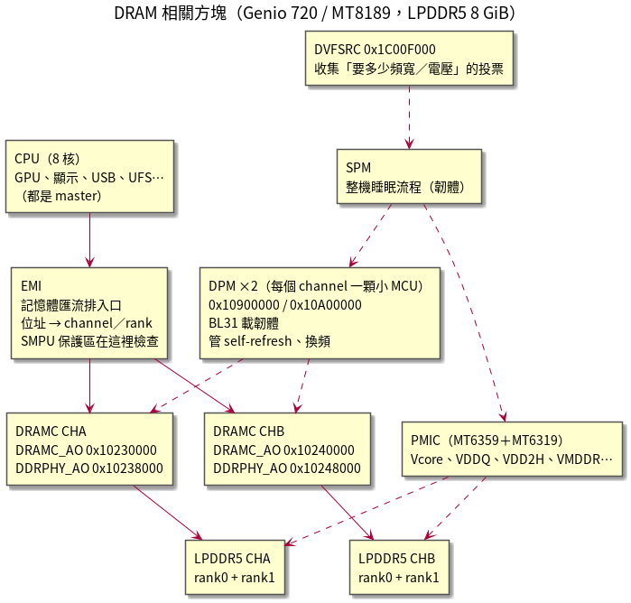

# DRAM 入門：名詞、方塊、本板的實際值

Genio 720 EVK（UFS 版），2026-10-17。範圍看 [BRIEF.md](BRIEF.md)。後面三份筆記會用到這裡的名詞：[初始化](dram-init.md)、[執行時](dram-runtime.md)、[配置和保護](dram-layout-protect.md)。

## 路徑簡寫

| 簡寫 | 實際路徑 |
|---|---|
| `libdram/` | `lk/libdram-lk/src/mt8391/drivers/`（BL2 和 LK 用的都是這一份 code，見 [dram-init.md](dram-init.md) 第 1 節） |
| `lk/` | `lk/lk/` |
| `bl2/` | `build/tmp/work/genio_720_evk_ufs-poky-linux/bl2/2.6/git/` |
| `tfa/` | `build/tmp/work/genio_720_evk_ufs-poky-linux/trusted-firmware-a/2.6/git/`（BL31） |
| `uboot/` | `build/tmp/work/genio_720_evk_ufs-poky-linux/u-boot/2022.10/git/` |
| `optee/` | `build/tmp/work/genio_720_evk_ufs-poky-linux/optee-os/3.19/git/` |
| `kernel/` | `build/tmp/work-shared/genio-720-evk-ufs/kernel-source/` |

`logs/` 指的是這個資料夾裡的 `logs/`。

## 1. 為什麼 DRAM 要「初始化」

晶片裡的 SRAM 一上電就能用：給位址，就讀得到。DRAM 不行，它要先做好幾件事：

1. **給電**：LPDDR5 要好幾組電壓（VDD1、VDD2H、VDDQ），SoC 這邊的 DRAM 控制器也要 Vcore、VMDDR。這些都由 PMIC 供應，要先設好。
2. **給時脈**：DRAM 介面跑得很快，本板最高 6400 Mbps（每支腳每秒 64 億個位元）。時脈要由 PLL 產生。
3. **認識對方**：讀 DRAM 的 **MR（mode register，模式暫存器）**，知道廠商、容量、有幾個 rank。
4. **校正（calibration，也叫 training）**：板子上每條線的長度都不一樣，晶片的製程也有差異，所以每一支資料腳「什麼時候取樣」要一支一支量出最好的位置。要校正的項目很多：阻抗、命令匯流排、寫入對齊、讀取閘門、讀／寫資料窗……
5. **測試**：寫一些 pattern 再讀回來比對，確定真的能用。

做完這些，CPU 才能把 DRAM 當一般記憶體用。在這之前，程式只能跑在 SRAM 裡。所以 **BL2 和 LK 都跑在 SRAM**（LK 跑在 L3C，一塊可以當 SRAM 用的 cache），它們的第一件大事就是把 DRAM 叫醒。

## 2. 名詞

| 名詞 | 意思 | 本板 |
|---|---|---|
| LPDDR5 | 手機和嵌入式常用的低功耗 DRAM 規格 | `dram_tpye: TYPE_LPDDR5`（`logs/d0-warm-boot-uart.log` L174；`tpye` 是原始碼裡的錯字） |
| channel | 一組獨立的 DRAM 匯流排，各自有控制器 | 2 個：CHA、CHB |
| rank | 同一個 channel 上，用 chip select 分開的一組 DRAM | 2 個（`[RankNumberDetection] 2`，`logs/d1-lk-uart.log` L59） |
| 容量 | MR8 讀出來的密度 | 每 rank 4 GiB，共 8 GiB（`dram_info.u8MR8Densit 0x100000000` ×2、`dram_total_density 0x200000000`，`d0` L352-354） |
| data rate | 每支腳每秒傳幾個位元，單位 Mbps（MT/s） | 最高 6400。log 寫 `DDR frequency: 6400MHz`（`d0` L438），其實是 data rate，不是時脈 |
| 時脈（log 裡的 `freq`） | libdram log 的 `freq = 1600` 是時脈 MHz，data rate 是它的 2 倍 | `freq = 3200, shu = 0` ＝ 6400 Mbps |
| shuffle（SHU） | DRAMC 裡存好的一整組「某個頻率要用的設定」。換頻時切換 shuffle，不用重新設定幾百個暫存器 | 5 組，見第 4 節 |
| self-refresh | DRAM 自己定時刷新、保住資料的省電狀態。這時控制器可以關掉 | suspend 時用（[dram-runtime.md](dram-runtime.md)） |
| DVFS | 動態調電壓、調頻率 | 硬體支援；本板 Linux 沒用（[dram-runtime.md](dram-runtime.md)） |
| fast calibration（fast K） | 把校正結果存在儲存裝置裡，下次開機直接拿來用，省時間 | BL2 有；存在 UFS 的 `dramk` 分區（[dram-init.md](dram-init.md)） |

## 3. SoC 這邊的方塊

| 方塊 | 做什麼 | 位址／證據 |
|---|---|---|
| **EMI**（External Memory Interface） | 所有 master（CPU、GPU、顯示、UFS…）存取 DRAM 的入口。決定實體位址對到哪個 channel、哪個 rank，也在這裡做保護檢查 | `EMI_APB_S`、`EMI_MPU_APB_S`（`tfa/plat/mediatek/drivers/devapc/mt8189/devapc.h`） |
| **DRAMC**（DRAM controller） | 每個 channel 一個。送命令、排程、刷新 | CHA `0x10230000`、CHB `0x10240000`（`libdram/dramc/inc/mt8189/x_hal_platform.h:140`） |
| **DDRPHY** | 每個 channel 一個。類比和數位的實體層，校正調的大多是這裡的延遲 | CHA `0x10238000`、CHB `0x10248000`（同檔 :142） |
| **DPM**（DRAM Power Manager） | 每個 channel 一顆小 MCU。README：「DRAM low power，例如 self refresh、不用時關 PLL／DLL」 | `0x10900000`、`0x10A00000`（同檔 :147）；韌體由 BL31 載（`tfa/plat/mediatek/mt8189/drivers/dpmfw/README.md`） |
| **DVFSRC**（DVFS Resource Collector） | 收集各個 master「要多少頻寬、多少電壓」的投票，決定 Vcore 和 DRAM 檔位 | `0x1C00F000`（`libdram/../inc/mt8189.h:99`） |
| **SPM**（System Power Manager） | 整機睡眠、喚醒的流程（跑一份韌體） | 見 `notes/power-notes/suspend-resume.md` |
| **SMPU** | EMI 裡的保護單元：哪些 master 能讀寫哪一段 DRAM | `0x10351000`（`tfa/plat/mediatek/drivers/smpu/mt8189/mt_smpu.h:9`） |
| PMIC | MT6359＋MT6319，供應各組電壓 | `setup_dramc_voltage_by_pmic` log（`d0` L341-347） |

**沒有 DRAM／EMI 的 TRM**，上面每個方塊的位址和功能，都是從 libdram 原始碼、TF-A 原始碼的名字和註解推出來的。

### 權限：Linux 能不能讀這些暫存器

BL31 用 DEVAPC 設定「哪個 domain 能存取哪個 slave」。AP（domain 0）的設定（`tfa/plat/mediatek/drivers/devapc/mt8189/devapc.h`，`DAPC_INFRA_AO1_SYS0_ATTR` 那一段）：

| slave | domain 0 權限 | 意思 |
|---|---|---|
| `DRAMC_CH0/CH1_TOP0_APB_S` | `NO_PROTECTION` | 誰都能讀寫 |
| `DRAMC_CH0/CH1_TOP1～6_APB_S` | `SEC_RW_NS_R` | secure 讀寫，non-secure（Linux）**只能讀** |
| `EMI_APB_S` | `NO_PROTECTION` | |
| `EMI_MPU_APB_S` | `SEC_RW_ONLY` | 只有 secure（BL31）能碰 |
| `DRAMC_MD32_S0/S1_APB_S`（DPM） | `FORBIDDEN` | AP 不能碰 |

所以這次 Linux 只讀 DRAMC／DDRPHY 的狀態暫存器（`scripts/dram_shu.py`，`PROT_READ` 的 mmap），DPM 和 SMPU 都不從 Linux 讀。SMPU 的值是在 BL31 裡加 log 印出來的（D5）。

## 4. 本板的 5 組 shuffle

MT8189 的 LPDDR5 頻率表（`libdram/dramc/lpddr_cal/dramc_pi_main.c:330-341`）：

| 表的 index | data rate | 存在哪個 SRAM shuffle | log 裡的 `freq`（時脈） | BL2 log 看到的 Vcore |
|---|---|---|---|---|
| 0 | 4266 | SHU2 | 2133 | 725000 µV |
| 1 | 5500 | SHU1 | 2750 | 762500 µV |
| 2 | **6400** | **SHU0** | 3200 | 800000 µV |
| 3 | 2133 | SHU4 | 1066 | 675000 µV |
| 4 | 3200 | SHU3 | 1600 | 700000 µV |

- 「BL2 log 看到的 Vcore」是 `d0` L362-405 裡，每個 shuffle 前面印的 `dramc_set_vcore_voltage`。頻率越高、電壓越高。
- 表的最後一個（index 4，3200）是**開機第一個頻率**（`dramc_pi_main.c:2784`：`gFreqTbl[p->u1DFSTableSize - 1]`）。LK 只校這一組。
- BL2 最後停在 **SHU0 = 6400**：`FINAL_SHU = 0`（`d0` L422），Linux 讀 `DVFS_STATUS` 也是 SHU0（[dram-runtime.md](dram-runtime.md)）。

## 5. 每一棒在哪裡跑、什麼時候才有 DRAM

| 棒 | 程式在哪 | DRAM |
|---|---|---|
| ROM | 晶片內 | 沒有 |
| LK（燒錄時） | ROM 把 `lk.bin` 送到 `0x2001000`（L3C）（`notes/ufs-emmc-notes/lk-flash-ufs.md`） | 自己叫醒（`lk/platform/mediatek/mt8189/platform.c:139`） |
| BL2 | SRAM，MMU 和 D-cache 都關（CLAUDE.md） | 自己叫醒（`bl2/plat/mediatek/mt8391/bl2_plat_setup.c:193`）。叫醒之前，讀儲存的 buffer 只有 512 B |
| BL31 | DRAM `0x54600000`（`tfa/plat/mediatek/mt8189/include/platform_def.h:122`） | 已經可用 |
| OP-TEE | DRAM `0x43200000` | 已經可用 |
| U-Boot | DRAM，搬到 `0xffef0000`（`bdinfo` 的 `relocaddr`，`logs/d6-uboot.log`） | 已經可用 |
| Linux | DRAM | 已經可用 |

所以 **DRAM 初始化只發生在 LK 和 BL2**，之後每一棒都只是「用」它。執行時能改 DRAM 狀態的，是 BL31 載進去的 DPM／SPM 韌體（[dram-runtime.md](dram-runtime.md)）。
