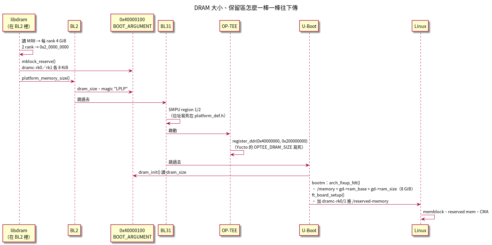
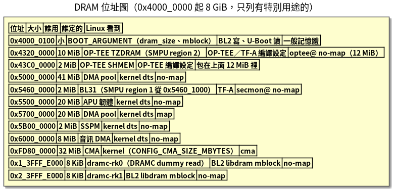

# DRAM 的配置和保護：大小怎麼傳、誰保留了哪一段、誰保護

Genio 720 EVK（UFS 版），2026-10-17。名詞看 [dram-intro.md](dram-intro.md)。

證據：

- `logs/d6-uboot.log`：**D6**，停在 U-Boot 下 `bdinfo`、`fdt print /memory`、`fdt list /reserved-memory`、`md.l 0x40000100 8`。同一次開機也有 D4／D5 的 `DRAMEXP` log
- `logs/d0-linux-basic.log`、`logs/d11-linux-iomem.log`：Linux 的 dts、dmesg、`/proc/iomem`
- 原始碼：BL2、TF-A、U-Boot、OP-TEE、kernel dts

## 0. 一句話

**DRAM 大小只量一次**：BL2 裡的 libdram 讀 DRAM 的 MR8，算出 8 GiB，寫進 `0x40000100` 的 `BOOT_ARGUMENT`。U-Boot 讀它，開機時改寫 kernel dts 的 `/memory`。OP-TEE 不讀，它的 8 GiB 是 Yocto 編譯時寫死的。

**保留區有三個來源**：

1. kernel dts 寫死的：OP-TEE、BL31、DMA pool、APU、SSPM、音訊。
2. BL2 libdram 用 mblock 保留、經 U-Boot 加進 dts 的：`dramc-rk0`／`rk1` 各 8 KiB。
3. kernel 自己切的：CMA 32 MiB、swiotlb 64 MiB。

**保護**：只有 BL31 的 SMPU 設了兩個區，BL31（`0x54601000`～）和 OP-TEE 的 TZDRAM（10 MiB）。BL2 的 libdram 有 EMI MPU 的 code，但沒編進流程（`CONFIG_SMPU 0`）。



## 1. 大小怎麼量出來

libdram 讀每個 rank 的 MR8（密度），加起來（`libdram/dramc/common/mt8189/dramc_top.c:2151-2157`）：

```
dram_info.u8MR8Densit  0x100000000, i 0        ← rank0 4 GiB
dram_info.u8MR8Densit  0x100000000, i 1        ← rank1 4 GiB
dram_total_density  0x200000000
```

（`logs/d0-warm-boot-uart.log` L352-354）。LP5 每次開機都真的讀 MR，不用存的值（[dram-init.md](dram-init.md) §4）。BL2 再印 `Memory size: 0x200000000(8192MB)`（`d0` L439）。

## 2. 往下傳

### BL2 → `BOOT_ARGUMENT`

```c
struct boot_argument {               // bl2/plat/mediatek/common/mtk_plat_common.h
	unsigned int magic_number;       // 0x504c504c ("LPLP")
	uint64_t dram_size;
	struct mblock_info_t mblock_info; // CONFIG_MTK_MBLOCK_SUPPORT
};
#define BOOT_ARGUMENT ((struct boot_argument *)BOOT_ARGUMENT_LOCATION)   // 0x40000100
```

- `BOOT_ARGUMENT_LOCATION` 是 `0x40000100`，BL2（`bl2/plat/mediatek/mt8189/include/platform_def.h:142`）和 U-Boot（`uboot/arch/arm/include/asm/arch-mediatek/misc.h:19`）各定義一次，值一樣。
- BL2 在 `mt_mem_init()` 之後寫 `dram_size`、`magic_number`（`bl2_plat_setup.c:195-196`）。
- mblock 是 libdram 自己呼叫 `mblock_reserve()` 寫的（`reserve_dramc_dummy_read()`，`dramc_top.c:1770`）。

D6 在 U-Boot 用 `md.l` 直接看（`logs/d6-uboot.log`）：

```
40000100: 504c504c 00000041 00000000 00000002  LPLPA...........
40000110: 4d424c4f 00000002 3fffe000 00000001  OLBM.......?....
```

| 位移 | 值 | 欄位 |
|---|---|---|
| +0x00 | `0x504c504c` | `magic_number`（"LPLP"） |
| +0x04 | `0x00000041` | 補齊用的空位（`uint64_t` 要 8 byte 對齊），內容沒意義 |
| +0x08 | `0x00000002_00000000` | `dram_size` = 8 GiB |
| +0x10 | `0x4d424c4f` | `mblock_info.magic_number`（`MBLOCK_MAGIC`） |
| +0x14 | `2` | `reserved_num` |
| +0x18 | `0x1_3fffe000` | `reserved[0].start`（dramc-rk0） |

D4 在 BL2 印的也一樣：`DRAMEXP BOOT_ARGUMENT@0x40000100 dram_size=0x200000000`、`mblock … reserved_num=2`、`dramc-rk0 0x13fffe000 size 0x2000`、`dramc-rk1 0x23fffe000 size 0x2000`（`d6` L440-443）。

### U-Boot

1. `dram_init()`：`magic == BOOT_ARGUMENT_MAGIC` 就用 `BOOT_ARGUMENT->dram_size`，否則才讀 dts（`uboot/arch/arm/mach-mediatek/mt8391/init.c:20-30`）。所以 U-Boot 印 `DRAM:  8 GiB`（`d0` L466）。
2. `bdinfo`：`DRAM bank 0 start 0x40000000 size 0x200000000`、`relocaddr 0xffef0000`（`d6`）。
   - U-Boot 把自己搬到 4 GiB 以下：`dram_init()` 調了 `mon_len`，註解說 MMC 的 DMA buffer 要在 4 GiB 以下（init.c:37-46）。
3. 開 kernel 時改 dts：
   - `arch_fixup_fdt()` → `fdt_fixup_memory_banks()`：用 `bi_dram` 改寫 `/memory`（`uboot/arch/arm/lib/bootm-fdt.c:35-55`）。
   - `ft_board_setup()` → `mtk_reserved_memory_init(blob, BOOT_ARGUMENT)`：把 mblock 一筆一筆用 `fdtdec_add_reserved_memory()` 加進 `/reserved-memory`（`uboot/board/mediatek/genio-720-evk/mt8391_evk.c:269`、`uboot/arch/arm/mach-mediatek/cpu.c:104-128`）。

kernel dts 本來就寫了 `memory@40000000 { reg = <0 0x40000000 0x2 0x00000000>; }`（`kernel/arch/arm64/boot/dts/mediatek/mt8391-genio-720-evk.dts:75-78`），跟 U-Boot 改寫的值一樣，所以看不出改寫有沒有作用。可以確定的是：**`dramc-rk0/rk1` 兩個節點不在 kernel dts 裡，是 U-Boot 加的**（kernel 原始碼搜不到 `dramc-rk`；Linux 上節點名字是 `dramc-rk0@1,3fffe000`，`d0-linux-basic.log`）。

### OP-TEE

`register_ddr(CFG_DRAM_BASE, CFG_DRAM_SIZE)`（`optee/core/arch/arm/plat-mediatek/main.c:27`）。`CFG_DRAM_SIZE=0x200000000` 是 Yocto 傳進去的：

- `genio-720-evk-ufs.conf:15` 寫 `OPTEE_DRAM_SIZE = "0x200000000"`，蓋掉 `mt8391.inc:13` 的 `0x80000000`。
- `optee-os-mtk.inc:24` 把它變成 `CFG_DRAM_SIZE=`（`optee-os/3.19/temp/run.do_compile`）。

**OP-TEE 不讀 `BOOT_ARGUMENT`。**換一塊 DRAM 大小不一樣的板子，要記得改這個值。

### Linux

- `Memory: 7952800K/8388608K available`：8388608K = 8 GiB。
- `Zone ranges: DMA [0x40000000-0xffffffff]、DMA32 empty、Normal [0x100000000-0x23fffffff]`（`d11-linux-iomem.log`）。

## 3. 位址圖和保留區



Linux 的 `reserved mem`（`d0-linux-basic.log`）＋`/proc/iomem`（`d11`）：

| 範圍 | 大小 | 名字 | map？ | 來源 |
|---|---|---|---|---|
| `0x43200000-0x43dfffff` | 12 MiB | `optee@43200000` | no-map | kernel dts（`mt8391-genio-720-evk.dts:85-98`，註解畫了 TEE_RAM 2 MiB＋TA_RAM 8 MiB＋SHMEM 2 MiB） |
| `0x50000000-0x528fffff` | 41 MiB | `memory@50000000`（`scp_mem`） | no-map | kernel dts |
| `0x54600000-0x547fffff` | 2 MiB | `secmon@54600000`（BL31） | no-map | kernel dts（:106-110） |
| `0x55000000-0x563fffff` | 20 MiB | `memory@55000000`（`apu_mem`） | no-map | kernel dts |
| `0x57000000-0x583fffff` | 20 MiB | `memory@57000000` | **map** | kernel dts（在 iomem 裡算 System RAM） |
| `0x5b000000-0x5b1fffff` | 2 MiB | `sspm-reserved-memory` | no-map | kernel dts |
| `0x60000000-0x607fffff` | 8 MiB | `snd-dma-mem-region` | no-map | kernel dts |
| `0x13fffe000-0x13fffffff` | 8 KiB | `dramc-rk0@1,3fffe000` | no-map | **BL2 libdram → U-Boot** |
| `0x23fffe000-0x23fffffff` | 8 KiB | `dramc-rk1@2,3fffe000` | no-map | **BL2 libdram → U-Boot** |
| `0xf9800000-0xfd7fffff` | 64 MiB | swiotlb | — | kernel（`software IO TLB: mapped …`） |
| `0xfd800000-` | 32 MiB | CMA | — | kernel（`CONFIG_CMA_SIZE_MBYTES=32`） |

### `dramc-rk0`／`rk1` 是什麼

`reserve_dramc_dummy_read()`（`libdram/dramc/common/mt8189/dramc_top.c:1770`）：

1. 每個 rank 用 `get_dramc_addr(rank, offset 0)` 算出「這個 rank 在系統位址的上界」。
2. 從那裡往下保留 `0x2000`（LP5；LP4X 是 `0x1000`）。

rank0 的上界是 `0x140000000`、rank1 的上界是 `0x240000000`（BL2 log `limit: 0x140000000` / `0x240000000`，`d0` L440-441）。從這兩個值看，**rank0 對到 `0x40000000-0x13fffffff`，rank1 對到 `0x140000000-0x23fffffff`**，各 4 GiB，跟 MR8 的密度一致。

名字叫 dummy read：DRAMC 在某些情況（推測是 DVFS 換頻或 self-refresh 進出時）會去讀這塊，所以它不能被別人用。實際什麼時候讀，看不到（無 TRM）。

### U-Boot 自己的保留區

U-Boot 的 `bdinfo` 裡 `lmb_dump_all` 列了 4 個 reserved（`d6`）。前 3 個來自 **U-Boot 自己的 dts**（`fdt list /reserved-memory`：`secmon@54600000`、`optee@43200000`、`dsi@60000000` 32 MiB）。第 4 個是 U-Boot 自己從 `0xff9e1320` 到頂端。U-Boot 的 dts 裡沒有 `dramc-rk*`，那兩個只加到 kernel 的 dts。

## 4. 保護：SMPU

### 誰設的

| 棒 | 有沒有設 DRAM 保護 | 證據 |
|---|---|---|
| BL2 libdram | **沒有**。`emi_mpu_v3.c` 有編進去，但 `CONFIG_SMPU` 是 0（`lk/libdram-lk/src/mt8391/inc/emi_mpu_mt.h:7`），`normal_mem_init()` 裡的 `smpu_init()` 不會跑（`memory.c:187-189`）；`bl2.img` 裡也沒有 `mpu`／`smpu` 字串 | code、`strings` |
| LK libdram | 反過來關掉：`ddr_reserve_emi_init()` 在 DA 模式印 `EMI SMPU DISABLED for DA flow` 並清 `EMI_BASE+0xf0` bit 18（`libdram/emi.c:742-745`）。但這個函式只在 DDR reserve mode 走到，一般燒錄流程會不會跑到，未知 | code |
| **BL31** | **有**。`smpu_init()`（PLAT_SETUP_0） | `tfa/plat/mediatek/drivers/smpu/smpu.c:111-121` |
| OP-TEE | 沒有（plat-mediatek 沒有 MPU code） | code |
| Linux | 沒有（`EMI_MPU_APB_S` 對 non-secure 是 `SEC_RW_ONLY`，Linux 碰不到） | DEVAPC 表 |

### BL31 設了什麼

`set_smpu_regions()`（`tfa/plat/mediatek/drivers/smpu/mt8189/mt_smpu.c`）：

```c
emi_mpu_set_protection(BL31_BASE, BL31_LIMIT, 1);               // region 1
emi_mpu_set_protection(BL32_BASE, BL32_BASE + BL32_LIMIT, 2);   // region 2
```

- `BL31_BASE = 0x54601000`、`BL31_LIMIT = 0x54800000`（`platform_def.h:122-134`）
- `BL32_BASE = 0x43200000`、`BL32_LIMIT = 0x00a00000`（:147-148）
- 位址先右移 12 bit，再減掉 `DRAM_OFFSET`（`0x40000`）

D5 讀回來（`logs/d6-uboot.log` L462-466）：

| region | SA | EA | 換回位址 | 是什麼 |
|---|---|---|---|---|
| 1 | `0x14601` | `0x14800` | `0x54601000` ～ `0x54800000` | BL31（TZRAM 2 MiB，扣掉開頭 4 KiB） |
| 2 | `0x3200` | `0x3c00` | `0x43200000` ～ `0x43c00000` | OP-TEE TZDRAM **10 MiB** |
| 3、4 | 0 | 0 | — | 沒用 |

- `ENABLE0 = 0x3`：region 1、2 打開。
- `+0x2a0 = 0x101`：bit 0 是 `set_smpu_regions()` 設的，bit 8 是 `smpu_setting()` 設的，意義未知（無 TRM）。
- `IOMMU_MPU_EN = 0`（`smpu_setting()` 寫 0）。

權限表（`tfa/plat/mediatek/drivers/smpu/mt8189/mt_smpu_region_table.c`）：

- region 1、2：只有 AID 8、52、240 可以讀寫。
- region 0（其他所有 DRAM）：一長串 AID 可以讀寫。

AID 是發出存取的 master 的編號，**哪個 AID 是哪個 master（CPU secure、GPU、顯示…）未知（無 TRM）**。

### 10 MiB vs 12 MiB：不是矛盾

kernel dts 保留 12 MiB 給 OP-TEE（`0x43200000-0x43dfffff`），SMPU 只保護 10 MiB（到 `0x43c00000`）。對照 OP-TEE 的設定：

- `CFG_TZDRAM_START=0x43200000`、`CFG_TZDRAM_SIZE=0x00a00000`（10 MiB，`run.do_compile`；`optee/core/arch/arm/plat-mediatek/conf.mk:153-154`）
- `CFG_SHMEM_START = TZDRAM 之後`、`CFG_SHMEM_SIZE = 0x00200000`（:155-156）

所以 12 MiB = TZDRAM 10 MiB（secure，SMPU 擋住）＋ SHMEM 2 MiB（Linux 和 OP-TEE 共用，**不能**擋）。kernel dts 的註解也是這樣畫的。

## 5. 待確認

- AID 對照表（哪個 master 是 8、52、240）。
- `dramc-rk*` 那 8 KiB 什麼時候被 DRAMC 讀。
- LK 的 `ddr_reserve_emi_init()` 在一般燒錄流程會不會跑（DA 模式關 SMPU 那一行）。
- U-Boot 改寫 `/memory` 的值跟 kernel dts 一樣，換成大小不同的板子才能驗證改寫真的有用。
