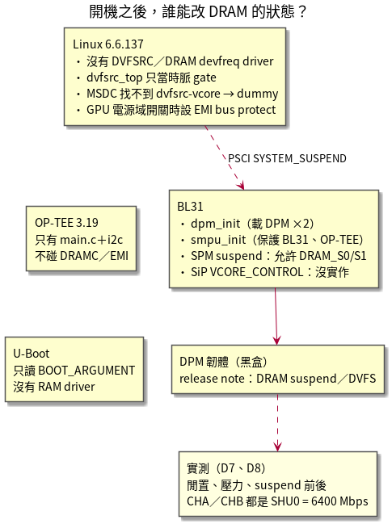

# 開機之後：誰會改 DRAM 的狀態

Genio 720 EVK（UFS 版），2026-10-17。名詞看 [dram-intro.md](dram-intro.md)，初始化看 [dram-init.md](dram-init.md)。

證據：

- `logs/d6-uboot.log`、`logs/d45-flash-uart.log`：**D5**，BL31 加 `DRAMEXP` log（`patches/d5-bl31-dramexp.diff`，已還原）
- `logs/d7-shuffle-idle-load.log`：**D7**，Linux 唯讀讀目前的 shuffle（閒置、壓力），腳本 `scripts/dram_shu.py`、`scripts/d7.sh`
- `logs/d7b-linux-dvfs-sysfs.log`、`logs/d7c-vcore.log`：Linux 的 devfreq／driver／regulator（唯讀）
- `logs/d8-suspend-shuffle.log`、`logs/d8-notes.txt`、`logs/restore-suspend-check.log`：**D8**，suspend 前後讀 shuffle
- suspend 的完整流程不重做，引用 `notes/power-notes/suspend-resume.md`

## 0. 一句話

**開機以後，沒有任何一棒的軟體主動改 DRAM 的頻率或電壓。**

- BL31 只是把兩份 **DPM** 韌體（每個 channel 一份）和 SPM、SSPM、MCUPM 韌體載進去。DPM 的 release note 寫「DRAM suspend／DVFS support」，但它內部做什麼看不到。
- OP-TEE、U-Boot 不碰 DRAM 控制器。
- Linux 沒有 DVFSRC／DRAM devfreq driver，BL31 的 `MTK_SIP_VCORE_CONTROL` 也沒實作。

實測：閒置、記憶體壓力、suspend 睡醒之後，兩個 channel 都一直是 **SHU0 = 6400 Mbps**。suspend 時讓 DRAM 進 self-refresh 是 SPM／DPM 韌體的事（從 flag 推測，沒有直接證據）。

## 1. 怎麼知道「目前是哪個速度」

libdram 自己判斷目前 shuffle 的方法，是讀 DDRPHY 的 `DVFS_STATUS`（`libdram/dramc/inc/mt8189/Register_DDRPHY_AO.h:4564-4577`）：

| 欄位 | bit | 意思 |
|---|---|---|
| `SC_DR_SHU_LEVEL_SRAM_MUX_OUT` | 22:19 | 目前用的 SRAM shuffle（0～4） |
| `SC_DR_SHU_LEVEL_MUX_OUT` | 24:23 | 目前用哪一組暫存器 shuffle（0／1，換頻時兩組輪流） |
| `OTHER_SHU_GP` | 15:14 | libdram 讀這個當 `ShuRGAccessIdx`（`libdram/dramc/common/dramc_utility.c:630`） |
| `PLL_SEL` | 25 | 用哪一顆 PLL |

位址是 DDRPHY_AO＋`0xC7C`：CHA `0x10238C7C`、CHB `0x10248C7C`。

- DEVAPC 讓 non-secure 可以讀 DRAMC 這些 slave（`SEC_RW_NS_R`，見 [dram-intro.md](dram-intro.md) §3），所以 Linux 用 `/dev/mem` **唯讀** mmap 就能讀（`scripts/dram_shu.py`）。
- DPM 的 `LPIF_STATUS_10`（libdram 換頻時讀的另一個狀態，`dvfs.c:729`）在 `0x10900000` 那塊，DEVAPC 對 AP 是 `FORBIDDEN`，所以不讀。

## 2. 每一棒

### BL31

開機時做的事（`logs/d6-uboot.log` L444-466，括號是 init 等級，`tfa/plat/mediatek/include/lib/mtk_init/mtk_init.h:37-41`）：

| 順序 | 做什麼 | 跟 DRAM 的關係 | 原始碼 |
|---|---|---|---|
| 1 | `spmfw_init`（ARCH）：載 `spm_firmware.bin` 14504 B | suspend 時的整機流程 | `tfa/plat/mediatek/mt8189/drivers/spmfw/mt_spm.c:1029` |
| 2 | `sspm_init`（ARCH）：載 `sspm.bin` 70144 B | 未知（黑盒） | `…/sspmfw/mt_sspm.c:56` |
| 3 | **`dpm_init`**（ARCH）：`dpm.dm`＋`dpm.pm` 各載兩次，CH0 到 `DPM_*_SRAM_BASE`、CH1 到 `*_BASE2`，再放開 reset | README：「DRAM low power，例如 self refresh、不用時關 PLL／DLL」；release note：「Add DRAM suspend/DVFS support」 | `…/dpmfw/mt_dpm.c:12-71`、`README.md`、`dpm_release_notes.txt` |
| 4 | `mcupm_init`（ARCH）：載 `mcupm.bin` 131936 B | CPU 電源管理，跟 DRAM 無直接關係 | `…/mcupmfw/mt_mcupm.c:120` |
| 5 | **`smpu_init`**（PLAT_SETUP_0）：設 DRAM 保護區 | 見 [dram-layout-protect.md](dram-layout-protect.md) | `tfa/plat/mediatek/drivers/smpu/smpu.c:121` |

D5 在 `dpm_init` 前後讀 `DVFS_STATUS`：前後都是 `0x2000000`（SHU0），載 DPM 不會換頻（`d6` L453、L458）。

**執行時的 SiP 呼叫**：`MTK_SIP_VCORE_CONTROL`（0x506）在表裡有編號（`tfa/plat/mediatek/include/mtk_sip_def.h:15`），但整個 `plat/mediatek` 沒有一個 `DECLARE_SMC_HANDLER(MTK_SIP_VCORE_CONTROL, …)`。實際有 handler 的只有 APUSYS、AUDIO、BL_LPM、DISP、DP、IOMMU、DFD、MTK_LPM、PLAT_BINFO（`grep DECLARE_SMC_HANDLER`）。**所以 Linux 就算想透過 BL31 調 Vcore／DRAM，也沒有入口。**

**suspend 時**（引用 `notes/power-notes/suspend-resume.md`）：

- BL31 選「bus26m」睡法，`cmd = 0xc6f`，裡面有 `DRAM_S0 | DRAM_S1`（允許 DRAM 進低功耗）。
- `res_req = 0x40`：只留 Vcore，DRAM 不用保持。
- `pcm_flags = 0xf60`：關掉 DDR／EMI DFS。

（那份筆記 L211、L222-223、L238-240。）那份筆記的結論是「DRAM **應該**有進 self-refresh，沒有直接證據」。這次也沒有更直接的證據：DPM、SPM 的狀態暫存器 AP 都讀不到。

### OP-TEE

- `optee/core/arch/arm/plat-mediatek/` 只有 `main.c`、`mtk_i2c/`（`sub.mk`）。`main.c` 只註冊 console、GIC，以及 `register_ddr(CFG_DRAM_BASE, CFG_DRAM_SIZE)`（:27），沒有 DRAMC、EMI、DVFSRC 相關的 code。
- `grep -i "emi\|mpu\|dramc\|dvfs"` 在 plat-mediatek 底下找不到東西。
- DRAM 大小是 Yocto 寫死的，見 [dram-layout-protect.md](dram-layout-protect.md)。

### U-Boot

- 沒有 RAM driver：`.config` 沒有 `CONFIG_RAM`／`CONFIG_DM_RAM`，只有 `CONFIG_NR_DRAM_BANKS=1`（`uboot/../build/.config`）。
- `dram_init()` 只讀 BL2 留下的 `BOOT_ARGUMENT->dram_size`（`uboot/arch/arm/mach-mediatek/mt8391/init.c:20-50`）。

### Linux

| 查什麼 | 結果 | 證據 |
|---|---|---|
| DVFSRC driver | **沒有**。kernel 的 `.config` 沒有 `MTK_DVFSRC`、`REGULATOR_MTK_DVFSRC`、`INTERCONNECT_MTK*` | `.config`、`d7b` 沒有 `/sys/class/interconnect` |
| `dvfsrc_top` 這個 dts 節點 | 只被時脈 driver 當 syscon，註冊一個 gate `dvfsrc_dvfsrc_en`（26 MHz，enable 1） | `kernel/arch/arm64/boot/dts/mediatek/mt8189.dtsi:1625-1629`、`kernel/drivers/clk/mediatek/clk-mt8189.c:3040-3041, 3452`、`d7b` clk_summary |
| DRAM devfreq | **沒有**。`/sys/class/devfreq` 只有 GPU（`13000000.gpu`） | `d7b` |
| MSDC 的 `dvfsrc-vcore` | `supply dvfsrc-vcore not found, using dummy regulator` | dmesg（`d7b`） |
| PMIC `vcore` regulator | 讀到 **693.75 mV**，閒置、壓力都一樣；**沒有任何 consumer**（regulator_summary 底下沒有裝置） | `d7c-vcore.log` |
| EMI | `scpsys` 開關 GPU 電源域（`mfg1`）時，設 `EMICFG_AO_MEM` 的 bus protection（擋住 GPU 到 EMI 的路） | `kernel/drivers/pmdomain/mediatek/mtk-scpsys-mt8189.c:335-336` |
| SSPM | `sspm` driver 只做 mailbox 和 reserved memory（`sspm-mem-tbl is not defined, skip read`） | dmesg（`d7b`） |

`vcore` 693.75 mV 這件事要小心看：

- BL2 結束時印的是 `Restore Vcore = 725000`（`logs/d0-warm-boot-uart.log` L435）。
- 6400 那組 shuffle 校正時用的是 800000（`d0` L382、L431）。
- Linux regulator driver 讀的是 PMIC 的電壓設定暫存器。如果 Vcore 被硬體（SPM／DVFSRC 經 PMIC 的另一組控制）接管，這個值就不一定是真正的輸出電壓。

**是誰把 Vcore 從 725 調到 693.75、這是不是真正的 Vcore，都未知（無 TRM）**。可以確定的是：Linux 沒有任何 consumer 去改它。

## 3. 實測：shuffle 有沒有變（D7、D8）

### D7：閒置和壓力

`scripts/d7.sh`：

1. 閒置時每 0.5 s 讀 20 次。
2. 開 4 個 `dd if=/dev/zero of=/dev/null bs=64M`，再讀 20 次。
3. 用 Python 複製 2.5 GiB，同時每 0.3 s 讀 10 次。
4. 結束後再讀 10 次。

結果（`logs/d7-shuffle-idle-load.log`，兩個 channel 各算一筆）：**120 筆全部是 `sram_shu=0(6400)`**，`DVFS_STATUS` 一直是 `0x02000000`。

限制：每次讀相隔 0.3～0.5 s。如果硬體換頻又在幾毫秒內換回來，這種讀法抓不到。不過 `DBG_LATCH_SHU_LEVEL_SRAM`（bit 11:8）一直是 0，也沒有其他跡象顯示換過。

### D8：suspend 前後

`rtcwake -m mem -s 10`，前後各讀一次（用 `systemd-run` 跑，因為 suspend 時 adb 會斷）：

| | 睡前 | 睡醒 | `suspend_stats/success` |
|---|---|---|---|
| D8 第 2 次（patch 版 BL2／BL31） | SHU0 | SHU0 ×3 次 | 0 → 1 |
| 燒回原版後（`restore-suspend-check.log`） | SHU0 | SHU0 ×3 次 | 0 → 1 |

睡醒後一樣是 6400。DPM／SPM 在 suspend 中間可能把 DRAM 放進 self-refresh、換頻再換回來，但醒來時回到同一個 shuffle。

**D8 第 1 次卡住了**（`logs/d8-notes.txt`）：

- `rtcwake` 之後，adb 沒回來，UART 沒任何輸出，按 `genio-board power` 也沒反應。
- 最後用 `genio-board reset` 救回來。
- journald 不存檔，所以看不到發生了什麼。
- 之後同一個 patch 版再試一次成功，原版也成功。

只發生一次，原因未知，不能說跟 BL31 的 log patch 有關（patch 只在開機時印 log，不在 suspend 路徑上）。

## 4. 結論表

| 棒 | 執行時改 DRAM 頻率／電壓？ | 讓 DRAM self-refresh？ | 證據等級 |
|---|---|---|---|
| BL31 | 不直接改；載 DPM／SPM 韌體 | 經 SPM／DPM（suspend 時），推測 | code＋power 筆記 |
| DPM 韌體 | release note 說支援 DVFS；本板沒看到換頻 | README 說會管 self-refresh | 黑盒 |
| OP-TEE | 否 | 否 | code |
| U-Boot | 否 | 否 | code |
| Linux | 否（沒有 driver、沒有 SiP 入口） | 只透過 PSCI `SYSTEM_SUSPEND` 交給 BL31 | code＋sysfs＋實測 |
| 硬體自己 | 實測沒換：閒置、壓力、suspend 後都是 6400 | — | D7、D8 |

## 5. 待確認

- DPM 韌體實際做什麼：有沒有在閒置時讓 DRAM 進 self-refresh（不換頻的那種省電）？
- Vcore 693.75 mV 是誰設的、是不是真正的輸出。
- SSPM 韌體跟 DRAM 有沒有關係。
- D8 第一次 suspend 卡住的原因。
