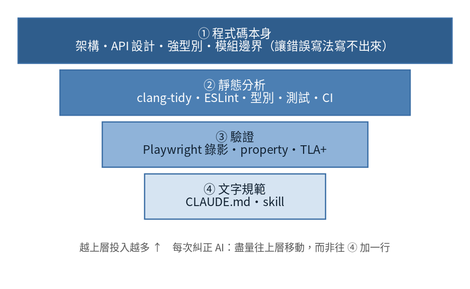

# AI 自動化開發 × 軟體工程

> 用 AI agent 開發一個約十萬行的英文單字卡平台，並在過程中學會：**當專案大到 AI 無法一次掌握時，如何靠軟體工程原則讓 AI 持續可靠地開發。**
>
> 任務定義見 [`BRIEF.md`](./BRIEF.md)。

---

## 核心問題：為什麼「十萬行」會讓軟體工程變成必要

幾千行的專案，AI 一次就能看完全部程式碼，隨便寫也跑得動，軟體工程原則顯不出價值。到了十萬行，AI 每次只能看到一小部分，這時候：

| 缺少的東西 | AI 會出現的問題 | 對應章節 |
|---|---|---|
| 清楚的模組邊界與介面 | 改 A 壞 B，把不該依賴的模組拉進來 | [04 軟體設計](./notes/04-design.md) |
| 自動化測試 | 不知道自己改壞了東西 | [06 軟體測試](./notes/06-testing.md) |
| 需求文件與決策紀錄 | 每次重新猜意圖，越做越偏 | [02 需求工程](./notes/02-requirements.md)、[`decisions.md`](./decisions.md) |
| 審查與 CI 關卡 | 品質隨行數增加逐步下滑 | [07 品質](./notes/07-quality.md)、[08 建構管理](./notes/08-configuration-management.md) |

圖源：[`diagrams/src/inverted-pyramid.dot`](./diagrams/src/inverted-pyramid.dot)

這個專案的做法是把軟體工程原則從「寫在文件裡的建議」變成「**CI 裡會擋下 PR 的檢查**」，詳見 [`quality-strategy.md`](./quality-strategy.md)。

---

## 決策摘要

| 項目 | 決策 | 紀錄 |
|---|---|---|
| 專案類型 | 產品型應用（E 類） | [D-001](./decisions.md#d-001-專案類型選擇產品型應用e-類) |
| 題目 | 英文數位單字卡，並追蹤學習進度 | [D-002](./decisions.md#d-002-題目英文數位單字卡) |
| 範圍 | 九個子系統，分階段開發 | [D-003](./decisions.md#d-003-九個子系統全部保留分階段開發) |
| 技術棧 | C++20（UI 以外全部）＋ TypeScript UI，透過 WASM 連接 | [D-004](./decisions.md#d-004-技術棧方案-bc-核心--typescript-ui)、[D-005](./decisions.md#d-005-c-標準採用-c20) |
| 品質策略 | Lauren Tan 倒金字塔，單人縮小版 | [D-006](./decisions.md#d-006-品質策略倒金字塔單人縮小版) |
| 授權 | 不複製 Anki 原始碼 | [D-007](./decisions.md#d-007-不複製-anki-原始碼) |
| 工作流沉澱 | 可重用的工作流做成 skill，放在 [`skill/`](./skill/README.md)，以外掛形式載入 | [D-008](./decisions.md#d-008-可重用工作流做成-skill以外掛形式載入) |

---

## 閱讀順序

1. [`BRIEF.md`](./BRIEF.md)：目的、限制、完成條件
2. [`quality-strategy.md`](./quality-strategy.md)：整個專案靠什麼守住品質
3. [`project/roadmap.md`](./project/roadmap.md)：分階段要做什麼
4. 進入某個階段時，回頭讀該階段對應的章節筆記（見下表）
5. [`project/phase-1-mvp.md`](./project/phase-1-mvp.md)：開工用的詳細計畫

---

## 章節 × 階段對照表

● 主要練習　○ 次要練習

| 章節 | P0 環境護欄 | P1 MVP | P2 後端匯入 | P3 同步 | P4 語音 | P5 AI 製卡 | P6 多平台 |
|---|:-:|:-:|:-:|:-:|:-:|:-:|:-:|
| [01 流程](./notes/01-process.md) | ● | ○ | | | | | |
| [02 需求工程](./notes/02-requirements.md) | | ● | ○ | ○ | ○ | ● | ○ |
| [03 物件導向開發](./notes/03-object-oriented.md) | | ● | ○ | ○ | | | |
| [04 軟體設計](./notes/04-design.md) | ● | ● | ● | ● | ○ | ○ | ● |
| [05 專案計畫與管理](./notes/05-project-management.md) | ○ | ○ | ○ | ● | ○ | ○ | ○ |
| [06 軟體測試](./notes/06-testing.md) | ○ | ● | ● | ● | ● | ● | ● |
| [07 品質管理與保證](./notes/07-quality.md) | ● | ● | ○ | ○ | ○ | ● | ○ |
| [08 建構管理](./notes/08-configuration-management.md) | ● | ○ | ● | | | | ● |
| [09 正規方法](./notes/09-formal-methods.md) | | ○ | | ● | | | |
| [10 流程改善](./notes/10-process-improvement.md) | ○ | ● | ● | ● | ● | ● | ● |

> 第 10 章在每個階段結束時都會用到（階段回顧）。

---

## 撰寫進度

| 檔案 | 狀態 |
|---|---|
| [`BRIEF.md`](./BRIEF.md) | ✅ 完成 |
| [`OUTLINE.md`](./OUTLINE.md) | ✅ 完成（檢查點 1） |
| `README.md` | ✅ 完成（檢查點 2） |
| [`decisions.md`](./decisions.md) | ✅ 完成（檢查點 2） |
| [`project/roadmap.md`](./project/roadmap.md) | ✅ 完成（檢查點 2） |
| [`quality-strategy.md`](./quality-strategy.md) | ✅ 完成（檢查點 3） |
| [`project/overview.md`](./project/overview.md) | ✅ 完成（檢查點 3） |
| [`project/phase-1-mvp.md`](./project/phase-1-mvp.md) | ✅ 完成（檢查點 3） |
| `notes/01`–`10` | ✅ 完成（檢查點 3） |
| [`diagrams/`](./diagrams/render.sh) | ✅ 13 張圖（PlantUML / graphviz / Pillow 原始檔在 `diagrams/src/`，執行 `diagrams/render.sh` 重新渲染） |
| [`skill/`](./skill/README.md) | ✅ 外掛骨架已建立（尚無 skill，開發中逐步加入） |

---

## 相關筆記

- [`../recommended-books.md`](../recommended-books.md)：軟體工程經典書目，以李允中十章為骨架
- [`../uml-and-ai-workflow.md`](../uml-and-ai-workflow.md)：UML 建模工具與 AI 協作流程
