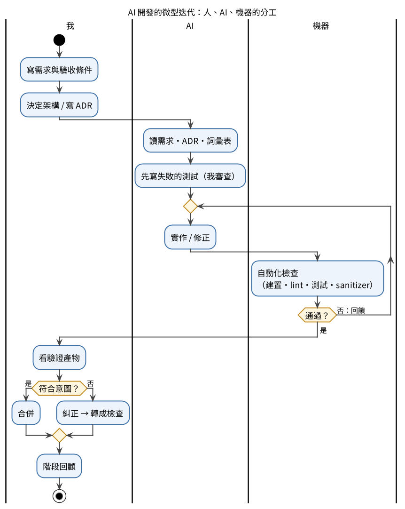

# 01 軟體危機與流程

> 李允中《軟體工程》第 1 章（僅作目錄）。主要依據：Sommerville 9e Ch.1–3、Pressman 9e Ch.1–4、Farley《Modern Software Engineering》Part II。

---

## ① 核心原則

| 原則 | 說明 | 出處 |
|---|---|---|
| 軟體流程是一組結構化的活動 | 規格、設計與實作、驗證、演進，不論採用哪種模型都包含這四類活動 | Sommerville Ch.2 §2.2 |
| 流程模型各有適用情境 | 瀑布、增量、整合重用等模型，依需求穩定度與風險選擇 | Sommerville Ch.2 §2.1；Pressman Ch.2 |
| 為變更做準備 | 需求必然改變；原型與增量交付可以降低變更成本 | Sommerville Ch.2 §2.3；Pressman Ch.3 §3.2 |
| 計畫驅動與敏捷是光譜，不是二選一 | 依系統規模、法規、團隊等因素在兩者間取捨 | Sommerville Ch.3 §3.2 |
| 為學習而最佳化 | 迭代、回饋、增量、經驗主義、實驗：工程的本質是快速從回饋中學習 | Farley Part II（Ch.4–8） |

---

## ①-1 原文引用

### 流程模型各有適用情境
> **原文引用（Sommerville, Software Engineering 9e, Ch.2 §2.1, p.30）**
> "These models are not mutually exclusive and are often used together, especially for large systems development. ... Parts of the system that are well understood can be specified and developed using a waterfall-based process. Parts of the system which are difficult to specify in advance, such as the user interface, should always be developed using an incremental approach."

→ 瀑布、增量、重用三種模型不是互斥的；依「需求能否事先講清楚」決定各部分用哪一種。

### 為變更做準備
> **原文引用（Sommerville, Software Engineering 9e, Ch.2 §2.3, p.43）**
> "Change is inevitable in all large software projects. The system requirements change as the business procuring the system responds to external pressures and management priorities change. ... Therefore whatever software process model is used, it is essential that it can accommodate changes to the software being developed."

→ 變更是必然的，所以任何流程都必須能容納變更；同節接著提出原型（避免變更）與增量交付（容忍變更）兩種做法。

### 計畫驅動與敏捷是光譜，不是二選一
> **原文引用（Sommerville, Software Engineering 9e, Ch.3 §3.2, p.63）**
> "In fact, most software projects include practices from plan-driven and agile approaches. To decide on the balance between a plan-based and an agile approach, you have to answer a range of technical, human, and organizational questions:"

→ 多數專案兩種做法都有，問題是「比例」；Sommerville 隨後列出規格需求、交付方式、系統規模、系統類型、壽命等問題來決定平衡點。

### 為學習而最佳化
> **原文引用（Farley, Modern Software Engineering, Ch.4, p.43）**
> "Fundamentally, iteration is a procedure that drives learning. Iteration allows us to learn, react, and adapt to what we have learned. Without iteration, and the closely related activity of collecting feedback, there is no opportunity to learn on an ongoing basis."

→ Part II 以迭代開篇：迭代與回饋是持續學習的前提，沒有它們就無法從錯誤中修正。

---

## ② AI 開發中如何落地

**AI agent 的工作迴圈本身就是一個微型迭代流程。**

圖源：[`diagrams/src/agent-loop.puml`](../diagrams/src/agent-loop.puml)

這個迴圈要可靠，取決於兩件事：
1. **回饋的品質**：檢查越精確，AI 修正的方向越對。這就是 Farley 所說的「回饋」原則，在 AI 開發中被放大：AI 每一輪都依賴回饋，人類可以靠經驗補足的部分，AI 沒辦法。
2. **人在迴圈中的位置**：要事先決定哪些步驟必須由人確認。

| 步驟 | 人的角色（本專案） |
|---|---|
| 需求與驗收條件 | **由我決定**，AI 只能協助整理 |
| 架構與 ADR | **由我決定**，AI 提出選項 |
| 實作與測試 | AI 執行，自動化檢查把關 |
| 合併 | 我看驗證產物（測試結果、錄影）後決定 |
| 階段回顧 | 我主導，AI 協助統計 |

**單人加 AI 的流程模型選擇**：本專案採用**增量式**（七個階段，每階段交付可用版本）搭配敏捷的短迭代（每個 2 小時時段完成一個小任務），符合 Sommerville 所說「需求會變、要為變更做準備」的情境。

---

## ③ 對應的自動化檢查

| 檢查 | 目的 |
|---|---|
| **CI pipeline 就是流程本身** | 流程不寫在文件裡，而是寫在 CI 設定中，每個 PR 都強制走一遍 |
| PR 範本 | 要求填寫對應的需求 ID 與驗證方式 |
| Claude Code hooks | 在 AI 的工作迴圈中插入強制步驟（例如修改前必須先有失敗的測試） |

---

## ④ 專案連結

- **P0 環境與護欄**：建立 CI pipeline，把流程變成機器強制（[`roadmap.md#p0`](../project/roadmap.md#p0環境與護欄)）
- 整體分階段結構：[`roadmap.md`](../project/roadmap.md)
- 相關決策：[D-003 分階段開發](../decisions.md#d-003-九個子系統全部保留分階段開發)
