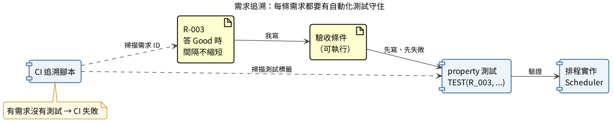

# 02 需求工程

> 李允中《軟體工程》第 2 章（僅作目錄）。主要依據：Sommerville 9e Ch.4、Pressman 9e Ch.7–8、Wiegers & Beatty《Software Requirements》3e、Smart & Molak《BDD in Action》2e。

---

## ① 核心原則

| 原則 | 說明 | 出處 |
|---|---|---|
| 功能需求與非功能需求 | 系統要做什麼 vs. 要做到什麼程度（效能、可靠度等），後者常常更難滿足 | Sommerville Ch.4 §4.1；Wiegers Ch.14〈Beyond functionality〉 |
| 需求要可驗證 | 每條需求都要能判斷「有沒有做到」，否則無法測試 | Sommerville Ch.4 §4.6；Wiegers Ch.11、Ch.17 |
| 寫出好需求 | 完整、正確、可行、必要、可排序、明確、可驗證 | Wiegers Ch.11〈Writing excellent requirements〉 |
| 需求排序 | 先做最重要的 | Wiegers Ch.16〈First things first〉 |
| 需求管理與追溯 | 需求會變；要能追蹤每條需求對應到哪些設計、程式碼、測試 | Sommerville Ch.4 §4.7；Wiegers Ch.27–29 |
| 用範例描述需求 | 以具體範例（Given / When / Then）作為需求與驗收測試的共同語言 | Smart & Molak《BDD in Action》2e Ch.2 §2.3.4 |

---

## ①-1 原文引用

### 需求要可驗證
> **原文引用（Sommerville, Software Engineering 9e, Ch.4 §4.6, p.110）**
> "Verifiability To reduce the potential for dispute between customer and contractor, system requirements should always be written so that they are verifiable. This means that you should be able to write a set of tests that can demonstrate that the delivered system meets each specified requirement."

→ 「可驗證」的操作定義就是：寫得出一組測試，證明交付的系統滿足每一條需求。

### 寫出好需求
> **原文引用（Wiegers & Beatty, Software Requirements 3e, Ch.11, p.204）**
> "In an ideal world, every individual business, user, functional, and nonfunctional requirement would exhibit the qualities described in the following sections."

→ 這句之後的小節依序是 Complete、Correct、Feasible、Necessary、Prioritized、Unambiguous、Verifiable，正是表格列出的七項特性。

### 需求排序
> **原文引用（Wiegers & Beatty, Software Requirements 3e, Ch.16, p.314）**
> "Prioritization is a way to deal with competing demands for limited resources. Establishing the relative priority of each product capability lets you plan construction to provide the highest value at the lowest cost. Because prioritization is relative, you can begin prioritization as soon as you discover your second requirement."

→ 資源有限，所以要排序；排序是相對的，從第二條需求出現就可以開始。

### 需求管理與追溯
> **原文引用（Sommerville, Software Engineering 9e, Ch.4 §4.7, p.112）**
> "Requirements management is the process of understanding and controlling changes to system requirements. You need to keep track of individual requirements and maintain links between dependent requirements so that you can assess the impact of requirements changes."

→ 需求管理的核心是追蹤每條需求及其依賴關係，才能評估變更的影響範圍。

### 用範例描述需求
> **原文引用（Smart & Molak, BDD in Action 2e, Ch.2 §2.3.4, p.21）**
> "In particular, the users help define a set of concrete examples that illustrate key outcomes of the feature (see figure 2.3). These examples use a common vocabulary and can be readily understood by both end users and members of the development team. They're usually expressed using the Given . . . When . . . Then notation you saw in section 2.2."

→ 範例使用使用者與開發團隊都看得懂的共同詞彙，通常以 Given / When / Then 表達。

---

## ② AI 開發中如何落地

**AI 會把模糊的需求用「最普通的方式」補完，而且不會告訴你它猜了。** 這是 AI 開發中需求工程變得更重要的原因。

做法：**需求寫成可執行的規格**。

| 不好的需求 | AI 會怎麼做 | 好的需求（可執行） |
|---|---|---|
| 「排程要合理」 | 隨便寫一個間隔加倍的演算法 | 「對相同複習紀錄，排程結果與 FSRS 參考實作一致」 |
| 「資料不能遺失」 | 加個 try/catch 就當作完成 | 「重開瀏覽器後，所有卡片與紀錄都在」→ E2E 測試 |
| 「換卡要快」 | 忽略 | 「回答後顯示下一張卡的延遲 < 100ms」→ 效能測試 |

**工作分工**
- 需求與驗收條件**由我寫**。這是 BRIEF 中「人決定意圖」的部分，不交給 AI。
- AI 可以協助：找出需求中的模糊之處、提出邊界情況、把驗收條件轉成測試程式碼。
- **先有失敗的驗收測試，再讓 AI 實作。** 測試就是 AI 的需求規格。

**單人專案的需求來源**：我就是使用者。每天使用時遇到的痛點直接記成需求，每階段回顧時排序。

---

## ③ 對應的自動化檢查

圖源：[`diagrams/src/traceability.puml`](../diagrams/src/traceability.puml)

| 檢查 | 做法 |
|---|---|
| **需求追溯檢查** | 每條需求有 ID（`R-001`），測試名稱或標籤引用這個 ID；CI 腳本檢查「每條需求至少有一個測試」 |
| 驗收測試先行 | hook 或 PR 檢查：新功能的 PR 必須同時包含對應的測試 |
| 需求變更紀錄 | 需求文件放在 git 中，變更走 PR，留下歷史 |

---

## ④ 專案連結

- **P1**：MVP 需求表與驗收條件（[`phase-1-mvp.md#需求與驗收條件`](../project/phase-1-mvp.md#需求與驗收條件)）
- **P4**：「發音好不好」如何定義成可驗證條件
- **P5**：「好的例句」如何定義，用評估集處理主觀品質（[`roadmap.md#p5`](../project/roadmap.md#p5ai-製卡與進階分析)）

---

## 出處修正紀錄

| 原本 | 修正後 |
|---|---|
| 《BDD in Action》【章節待查】 | Smart & Molak《BDD in Action》2e Ch.2 §2.3.4 |
