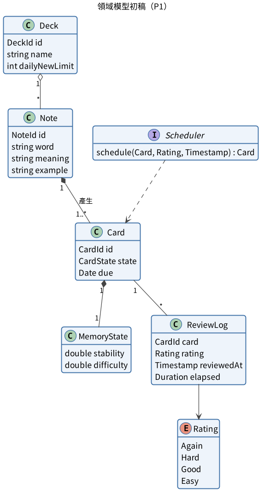

# 03 物件導向軟體開發

> 李允中《軟體工程》第 3 章（僅作目錄）。主要依據：Sommerville 9e Ch.5、Ch.7 §7.1、Larman《Applying UML and Patterns》3e、Khononov《Learning Domain-Driven Design》。既有筆記：[`uml-and-ai-workflow.md`](../../uml-and-ai-workflow.md)。

---

## ① 核心原則

| 原則 | 說明 | 出處 |
|---|---|---|
| 系統建模的多種視角 | 情境、互動、結構、行為模型各自回答不同問題 | Sommerville Ch.5 §5.1–5.4 |
| OOA → OOD | 先建立問題領域的概念模型（分析），再決定軟體物件與職責（設計） | Larman Ch.1 §1.4；Sommerville Ch.7 §7.1 |
| 領域模型 | 用領域中的概念與關聯描述問題，不是描述軟體類別 | Larman Ch.3 §3.6 |
| GRASP 職責分配 | Information Expert、Creator、Low Coupling、High Cohesion 等原則，決定「哪個物件負責什麼」 | Larman Ch.14 §14.4 |
| 通用語言（Ubiquitous Language） | 領域專家與開發者使用同一套詞彙，並直接反映在程式碼中 | Khononov Ch.2 |

---

## ①-1 原文引用

### OOA → OOD
> **原文引用（Larman, Applying UML and Patterns 3e, Ch.1 §1.4, p.5）**
> "During object-oriented analysis there is an emphasis on finding and describing the objects—or concepts—in the problem domain. ... During object-oriented design (or simply, object design) there is an emphasis on defining software objects and how they collaborate to fulfill the requirements."

→ 分析找的是「問題領域的概念」，設計定義的是「軟體物件及其協作」，兩者的對象不同，順序是先分析後設計。

### 領域模型
> **原文引用（Larman, Applying UML and Patterns 3e, Ch.3 §3.6, p.96）**
> "In the UP, the term "Domain Model" means a representation of real-situation conceptual classes, not of software objects. The term does not mean a set of diagrams describing software classes, the domain layer of a software architecture, or software objects with responsibilities."

→ Larman 明確定義：領域模型畫的是真實情境中的概念類別，不是軟體類別，也不是架構中的 domain layer。

### GRASP 職責分配
> **原文引用（Larman, Applying UML and Patterns 3e, Ch.14 §14.4, p.367）**
> "It is possible to name and explain the detailed principles and reasoning required to grasp basic object design, assigning responsibilities to objects. The GRASP principles or patterns are a learning aid to help you understand essential object design and apply design reasoning in a methodical, rational, explainable way. This approach to understanding and using design principles is based on patterns of assigning responsibilities."

→ GRASP 是一組「如何把職責分配給物件」的命名原則，讓設計推理可以有條理、說得出理由。

### 通用語言（Ubiquitous Language）
> **原文引用（Khononov, Learning Domain-Driven Design, Ch.2, p.24）**
> "Using a ubiquitous language is the cornerstone practice of domain-driven design. The idea is simple and straightforward: if parties need to communicate efficiently, instead of relying on translations, they have to speak the same language."

→ 通用語言是 DDD 的基石：與其在領域知識、需求、設計、程式碼之間層層翻譯，不如大家講同一套語言。（「程式碼也要使用通用語言」在本書 Ch.6 p.92 才明確提出。）

---

## ② AI 開發中如何落地

**領域模型與詞彙表是約束 AI 的單一事實來源。**

沒有詞彙表時，AI 會在不同地方用不同名稱稱呼同一件事（`Card` / `Flashcard` / `Item`），十萬行之後程式碼庫就變得難以理解，AI 自己也會混淆。

做法（延續 [`uml-and-ai-workflow.md`](../../uml-and-ai-workflow.md) 的流程）：
1. **我主導 OOA**：從需求推導領域概念與關聯，可以用 AI 協助找出遺漏，但結論由我決定。
2. **領域模型存成 PlantUML 或 StarUML**，放在專案 repo 中，AI 實作前必須讀取。
3. **詞彙表**放在 `docs/`，定義每個術語；CLAUDE.md 連到它。
4. **OOD 時用 GRASP 檢查 AI 的設計**：例如 AI 把排程邏輯放進 UI 元件，違反 Information Expert，因為排程所需的資訊在 Card 與 ReviewLog 上。

P1 的領域模型初稿：

圖源：[`diagrams/src/domain-model.puml`](../diagrams/src/domain-model.puml)

可直接使用的 Claude Code skill：`domain-modeling`（建立詞彙表與 ADR）。

---

## ③ 對應的自動化檢查

| 檢查 | 做法 |
|---|---|
| **命名符合詞彙表** | clang-tidy `readability-identifier-naming` 管格式；另寫腳本檢查領域型別名稱是否都在詞彙表中（工具【待決】） |
| 禁用同義詞 | lint 規則禁止 `Flashcard`、`Item` 等非詞彙表名稱出現在核心型別中 |
| 模型與程式碼同步 | 階段回顧時以逆向工程（StarUML 或工具產生類別圖）比對；能否自動化【待查】 |

---

## ④ 專案連結

- **P1 第 2 週**：OOA 推導領域模型、定稿詞彙表（[`phase-1-mvp.md#領域模型初稿`](../project/phase-1-mvp.md#領域模型初稿)）
- **P2、P3**：新增 User、Device、SyncOperation 等概念時更新模型

---

## 出處修正紀錄

| 原本 | 修正後 |
|---|---|
| Larman〈Domain Models〉等章【章號待查】 | Larman Ch.1 §1.4 |
| Larman〈Domain Models〉【章號待查】 | Larman Ch.3 §3.6 |
| Larman〈GRASP〉相關章【章號待查】 | Larman Ch.14 §14.4 |
| Khononov【章節待查】 | Khononov Ch.2 |

> 注：本地 PDF 為 2015 年重排的 3e（共 18 章），章號可能與其他版本不同；以上章號以本地 PDF 為準。
