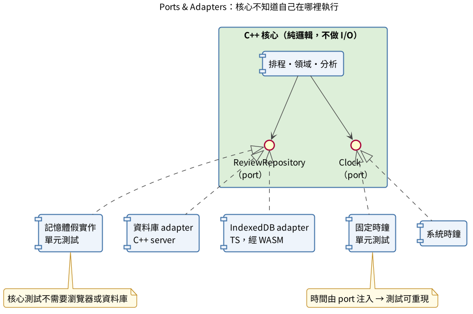
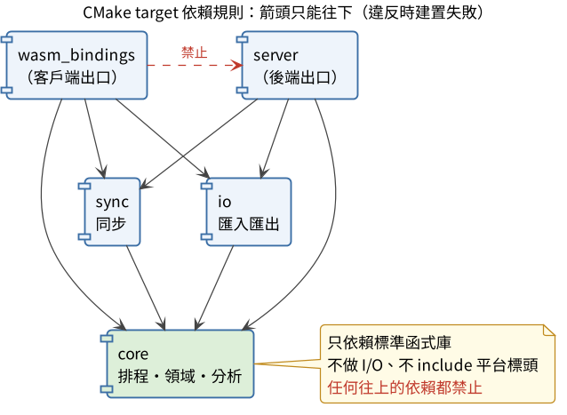

# 04 軟體設計

> 李允中《軟體工程》第 4 章（僅作目錄）。主要依據：Sommerville 9e Ch.6–7、Pressman 9e Ch.9–11、Farley《Modern Software Engineering》Part III、Meyer《Object-Oriented Software Construction》2e、Gaczkowski《Software Architecture with C++》2e。

---

## ① 核心原則

| 原則 | 說明 | 出處 |
|---|---|---|
| 架構決策要明確記錄 | 架構是一連串的決策，要有理由 | Sommerville Ch.6 §6.1 |
| 架構模式 | 分層、MVC、儲存庫、管線等，各有適用情境 | Sommerville Ch.6 §6.3 |
| 模組化 | 把系統切成可以獨立理解與修改的部分 | Farley Ch.9；Meyer Ch.3〈Modularity〉 |
| 高內聚 | 相關的東西放在一起 | Farley Ch.10 |
| 關注點分離 | 每個模組只處理一件事 | Farley Ch.11 |
| 資訊隱藏與抽象 | 隱藏實作細節，只暴露必要介面 | Farley Ch.12；Pressman Ch.9 |
| 管理耦合 | 降低模組之間的依賴 | Farley Ch.13 |
| 契約式設計（DbC） | 以前置條件、後置條件、不變式明確定義元件責任 | Meyer Ch.11〈Design by Contract〉 |
| 設計模式 | 可重用的設計解法 | Sommerville Ch.7 §7.2；Pressman Ch.14 |

---

## ①-1 原文引用

### 架構決策要明確記錄
> **原文引用（Sommerville, Software Engineering 9e, Ch.6 §6.1, p.151）**
> "Because it is a creative process, the activities within the process depend on the type of system being developed, the background and experience of the system architect, and the specific requirements for the system. It is therefore useful to think of architectural design as a series of decisions to be made rather than a sequence of activities."

→ Sommerville 把架構設計定義為「一連串決策」而非固定步驟；同頁列出的九個基本問題，最後一個就是 "How should the architecture of the system be documented?"。

### 架構模式
> **原文引用（Sommerville, Software Engineering 9e, Ch.6 §6.3, p.156）**
> "You can think of an architectural pattern as a stylized, abstract description of good practice, which has been tried and tested in different systems and environments. So, an architectural pattern should describe a system organization that has been successful in previous systems. It should include information of when it is and is not appropriate to use that pattern, and the pattern's strengths and weaknesses."

→ 架構模式是經過驗證的組織方式，而且本身就要說明「何時適用、何時不適用」，這正是表格中「各有適用情境」的依據。

### 模組化
> **原文引用（Farley, Modern Software Engineering, Ch.9, p.105）**
> "Modularity is of vital importance in managing the complexity of the systems that we create. Modern software systems are vast, complicated, and often genuinely complex things. Most modern systems exceed the capacity of any human being to hold all of the details in their heads. To cope with this complexity, we must divide the systems that we build into smaller, more understandable pieces—pieces that we can focus on without worrying too much about what is going on elsewhere in the system."

→ 模組化的理由是人腦裝不下整個系統，所以要切成「可以專注其中、不必擔心其他部分」的小塊。

### 高內聚
> **原文引用（Farley, Modern Software Engineering, Ch.10, p.121）**
> "To achieve this, we certainly need techniques that will allow us to "Pull the unrelated things further apart," but we also need to take seriously the need to "put the related things closer together." That is where cohesion comes in."

→ Farley 借用 Kent Beck 的說法：拆開無關的東西是模組化，把相關的東西放在一起則是內聚。

### 關注點分離
> **原文引用（Farley, Modern Software Engineering, Ch.11, p.135）**
> "Separation of concerns is the most powerful principle of design in my own work. I apply it everywhere. The simple colloquial description of separation of concerns is "One class, one thing. One method, one thing.""

→ 「一個類別做一件事，一個方法做一件事」就是表格中「每個模組只處理一件事」的原文版本。

### 資訊隱藏與抽象
> **原文引用（Farley, Modern Software Engineering, Ch.12, p.151）**
> "What I am talking about here is drawing lines, or seams, in our code so that when we look at those lines from the "outside," we don't care about what is behind them. As a consumer of a function, class, library, or module, I should not need, or care, to know anything about how it works, only how I use it."

→ 在程式碼中畫出邊界，讓使用者只需要知道「怎麼用」，不需要知道「怎麼運作」。

### 管理耦合
> **原文引用（Farley, Modern Software Engineering, Ch.13, p.171）**
> "Coupling is not something that we can, or should, aim to always wholly eliminate. ... However, coupling is the thing that impacts most directly on our ability to reliably, repeatably, and sustainably create and deliver software."

→ Farley 強調耦合無法、也不應該完全消除（完全解耦的元件無法彼此溝通），重點是「管理」它，因為它最直接影響交付能力。

### 契約式設計（DbC）
> **原文引用（Meyer, Object-Oriented Software Construction 2e, Ch.11, p.331）**
> "The key concept will be Design by Contract: viewing the relationship between a class and its clients as a formal agreement, expressing each party's rights and obligations. Only through such a precise definition of every module's claims and responsibilities can we hope to attain a significant degree of trust in large software systems."

→ Meyer 把類別與呼叫者的關係看成正式合約，雙方各有權利與義務；只有精確定義每個模組的責任，才能信任大型系統。

### 設計模式
> **原文引用（Sommerville, Software Engineering 9e, Ch.7 §7.2, p.189–190）**
> "The pattern is a description of the problem and the essence of its solution, so that the solution may be reused in different settings. The pattern is not a detailed specification. Rather, you can think of it as a description of accumulated wisdom and experience, a well-tried solution to a common problem."

→ 設計模式描述的是「問題＋解法的本質」，不是具體規格，所以能在不同情境重用。

---

## ② AI 開發中如何落地

**「程式碼庫就是最大的 prompt。」**（Lauren Tan，第三方摘要）AI 會模仿它看到的結構。好的設計不只是為了人，更是為了讓 AI 每次只需要看一小部分程式碼就能正確修改。

| 設計原則 | 對 AI 的意義 |
|---|---|
| 模組化與資訊隱藏 | AI 只要讀介面就能使用模組，不必讀實作 → **節省 context** |
| 低耦合 | AI 改 A 時不會意外影響 B |
| 契約式設計 | 前置與後置條件寫成 assert 或型別，AI 違反時立即失敗 |
| 架構決策記錄 | AI 不會「好心」把你刻意的設計改回常見寫法 |

**本專案的關鍵設計：Ports & Adapters**
- C++ 核心不做 I/O，不知道自己在 WASM 還是 server 中執行（見 [`overview.md`](../project/overview.md#c--ts-邊界設計)）。
- 好處：核心可以完全用單元測試驗證；同一份核心同時用在客戶端與 server。

圖源：[`diagrams/src/ports-adapters.puml`](../diagrams/src/ports-adapters.puml)

**讓錯誤寫法寫不出來**（倒金字塔第 1 層）
- 強型別 ID、`std::chrono` 時間、concepts 限制模板（見 [`quality-strategy.md`](../quality-strategy.md#二第-1-層程式碼本身)）。

可直接使用的 Claude Code skill：`codebase-design`（深模組設計詞彙）。

---

## ③ 對應的自動化檢查

圖源：[`diagrams/src/cmake-targets.puml`](../diagrams/src/cmake-targets.puml)

| 檢查 | 做法 |
|---|---|
| **CMake target 依賴規則** | `core` 不得連結外層 target，違反時建置失敗（[`overview.md`](../project/overview.md#專案目錄結構monorepo初稿)） |
| `#include` 方向檢查 | 自訂 clang-tidy 檢查或腳本：core 不得 include 平台標頭 |
| 契約 | 前置與後置條件用 assert 或型別表達，debug 建置與測試中啟用 |
| TS 架構邊界 | ESLint 規則限制 UI 目錄可以 import 的模組 |

---

## ④ 專案連結

- **P0**：CMake target 劃分、第一條自訂邊界檢查
- **P1**：強型別領域模型、儲存 port（[`phase-1-mvp.md`](../project/phase-1-mvp.md)）
- **P2**：API 設計、server 架構
- **P3**：同步引擎與核心的介面
- **P6**：客戶端擴充時維持 UI 與核心的邊界
