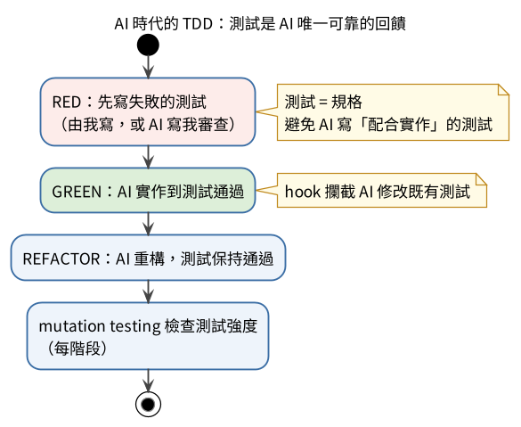

# 06 軟體測試

> 李允中《軟體工程》第 6 章（僅作目錄）。主要依據：Sommerville 9e Ch.8、Pressman 9e Ch.19–20、《Software Engineering at Google》Ch.11–14、Ammann & Offutt《Introduction to Software Testing》。

---

## ① 核心原則

| 原則 | 說明 | 出處 |
|---|---|---|
| 測試層級 | 開發測試（單元、元件、系統）、發布測試、使用者測試 | Sommerville Ch.8 §8.1、§8.3、§8.4 |
| 測試驅動開發（TDD） | 先寫失敗的測試，再寫剛好讓它通過的程式碼，然後重構 | Sommerville Ch.8 §8.2 |
| 測試規模與金字塔 | 多數是小而快的測試，少數是大而慢的測試 | Google Ch.11 |
| 單元測試要測行為，不要測實作 | 測試應透過公開介面驗證行為，重構時才不會大量失敗 | Google Ch.12 |
| 測試替身要謹慎使用 | 能用真實實作就用真實實作；過度 mock 會讓測試失去意義 | Google Ch.13 |
| 覆蓋率準則 | 圖形覆蓋、邏輯覆蓋、輸入空間切分、語法式測試 | Ammann & Offutt Ch.2–5 |
| Mutation testing | 故意在程式中植入小錯誤，檢查測試能否抓到，用來衡量測試本身的強度 | Ammann & Offutt §5.1.2 |
| AI 與回歸測試 | Pressman 9e 已有專節討論 AI 用於回歸測試 | Pressman Ch.20 §20.3 |

---

## ② AI 開發中如何落地

**測試是 AI 唯一可靠的回饋迴路。** AI 寫完程式碼後跑測試，通過就繼續，失敗就修正。測試的品質直接決定 AI 產出的品質。

### TDD 對 AI 特別重要

圖源：[`diagrams/src/tdd-ai.puml`](../diagrams/src/tdd-ai.puml)

1. **我（或 AI 在我審查下）先寫失敗的測試**，測試本身就是規格。
2. AI 實作，直到測試通過。
3. AI 重構，測試保證行為不變。

如果讓 AI 同時寫程式和測試，它很容易寫出「配合實作」的測試，而不是驗證需求的測試。

可直接使用的 Claude Code skill：`tdd`（red-green-refactor 流程）。

### 本專案各類測試的分工
| 測試類型 | 適用子系統 | 理由 |
|---|---|---|
| property-based | 排程（1）、同步（4） | 這兩者的正確性是「對任何輸入都成立的性質」 |
| 對照測試 | 排程（1） | 有 FSRS 參考實作可以比對 |
| golden test | 分析（3）、匯入（5）、語音（6） | 固定輸入有確定輸出 |
| E2E 加錄影 | UI（8） | 主觀部分交給人看錄影 |
| fuzzing | 匯入（5）、API（9） | 處理外部輸入，要能承受任何格式錯誤的資料 |

### 防止 AI 對測試作弊
AI 可能修改測試讓它通過、把測試標為 skip，或寫只檢查「有執行」的測試。對策見 [`quality-strategy.md#七防止-ai-作弊`](../quality-strategy.md#七防止-ai-作弊)。**Mutation testing 是抓出弱測試的客觀方法。**

---

## ③ 對應的自動化檢查

| 檢查 | 做法 |
|---|---|
| 所有測試在 CI 中執行 | 失敗就擋下合併 |
| 覆蓋率門檻 | 核心模組設定門檻（數值於 P1 依實際情況決定），只能升不能降 |
| **mutation testing** | C++ 用 Mull（可用性【待查】）、TS 用 Stryker；每階段記錄分數 |
| 測試檔保護 | hook 攔截 AI 修改既有測試；CI 檢查測試數量不得減少、skip 不得增加 |
| 測試不得依賴真實時間或亂數 | lint 規則（[`phase-1-mvp.md#第一批-lint-規則候選`](../project/phase-1-mvp.md#第一批-lint-規則候選)） |

---

## ④ 專案連結

- **P1**：排程的 property-based 與對照測試、E2E 主流程（[`phase-1-mvp.md`](../project/phase-1-mvp.md)）
- **P2**：API contract 測試、fuzzing
- **P3**：同步的 property-based 測試與故障注入
- **P4–P6**：golden 音檔、LLM 回應錄製、效能預算測試
- 各階段驗收清單：[`roadmap.md`](../project/roadmap.md)
