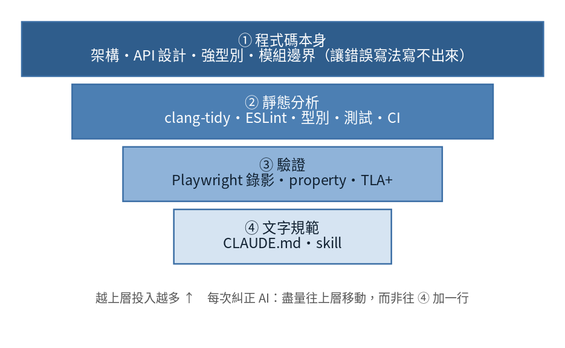

# 07 軟體品質管理與保證

> 李允中《軟體工程》第 7 章（僅作目錄）。主要依據：Sommerville 9e Ch.24、Ch.15 §15.1、Pressman 9e Ch.15–17、Ch.23、《Software Engineering at Google》Ch.8–9、Ch.20。

---

## ① 核心原則

| 原則 | 說明 | 出處 |
|---|---|---|
| 品質管理涵蓋標準、審查、度量 | 品質不是測出來的，而是由流程與標準建立的 | Sommerville Ch.24 §24.1–24.4 |
| 審查與檢視 | 由人檢查程式碼與文件，找出測試找不到的問題 | Sommerville Ch.24 §24.3；Pressman Ch.16 |
| 靜態分析 | 不執行程式就找出錯誤 | Sommerville Ch.15 §15.1 |
| SQA 是系統化的活動 | 有計畫、有目標、有度量 | Pressman Ch.17 |
| 度量 | 產品度量、流程度量、品質度量 | Pressman Ch.23；Sommerville Ch.24 §24.4 |
| 規則要有理由，且盡量自動執行 | 風格指南的規則要說明為什麼存在，並盡可能由工具強制 | Google Ch.8 |
| 靜態分析要整合進開發流程 | 分析結果要在開發者工作的地方出現（例如 code review），而且誤報率要低，否則會被忽略 | Google Ch.20（介紹 Tricorder） |

---

## ①-1 原文引用

### 審查與檢視
> **原文引用（Sommerville, Software Engineering 9e, Ch.24 §24.3, p.666）**
> "As I discussed in Chapter 8, inspections may be part of the software verification and validation processes. They complement testing as they do not require the program to be executed. This means that incomplete versions of the system can be verified and that representations such as UML models can be checked."

→ 檢視不需要執行程式，所以能檢查尚未完成的系統與 UML 模型，這些都是測試做不到的；因此它是測試的補充，而不是替代。

### 靜態分析
> **原文引用（Sommerville, Software Engineering 9e, Ch.15 §15.1, p.395）**
> "Static analysis techniques are system verification techniques that don't involve executing a program. Rather, they work on a source representation of the software—either a model of the specification or design, or the source code of the program."

→ 靜態分析的定義就是「不執行程式」，直接分析規格模型、設計模型或原始碼。

### SQA 是系統化的活動
> **原文引用（Pressman & Maxim, Software Engineering 9e, Ch.17 §17.1, p.341）**
> "Extending the definition presented earlier, software quality assurance is a "planned and systematic pattern of actions" [Sch01] that are required to ensure high quality in software."

→ SQA 被定義為「有計畫、有系統的一組行動」；同章 §17.4 進一步指出現代 SQA 通常是資料驅動的，由利害關係人訂定目標與品質度量。

### 度量
> **原文引用（Pressman & Maxim, Software Engineering 9e, Ch.23 §23.1, p.462）**
> "A software engineer collects measures and develops metrics so that indicators will be obtained. An indicator is a metric or combination of metrics that provides insight into the software process, a software project, or the product itself."

→ 度量的目的是產生「指標」，用來洞察流程、專案與產品；Ch.23 也依此分成產品度量（§23.3）、流程與專案度量（§23.6）、品質度量（§23.8）。

### 規則要有理由，且盡量自動執行
> **原文引用（Winters, Manshreck & Wright, Software Engineering at Google, Ch.8, p.159）**
> "Although some level of training is always necessary—engineers must, after all, learn the rules so that they can write code that follows them—when it comes to checking for compliance, rather than exclusively depending on engineer-based verification, we strongly prefer to automate enforcement with tooling."

→ Google 強烈偏好以工具自動檢查規則，而不是只靠工程師記得。（「規則要有理由」見同章 p.152：每條規則都附上權衡過的優缺點與決策說明。）

### 靜態分析要整合進開發流程
> **原文引用（Winters, Manshreck & Wright, Software Engineering at Google, Ch.20, p.420）**
> "At Google, we integrate static analysis into the core workflow via integration with code review tooling. Essentially all code committed at Google is reviewed before being committed; because developers are already in a change mindset when they send code for review, improvements suggested by static analysis tools can be made without too much disruption."

→ 分析結果出現在 code review 中，因為開發者送審時本來就處於「準備修改」的心態；同章 p.419–420 也強調低誤報率是開發者願意使用工具的關鍵。

---

## ② AI 開發中如何落地

**核心轉變：品質保證從「人檢查」轉向「機器檢查」，人只處理機器無法判斷的部分。**

這正是倒金字塔的精神（詳見 [`quality-strategy.md`](../quality-strategy.md)）：

圖源：[`diagrams/src/inverted-pyramid.dot`](../diagrams/src/inverted-pyramid.dot)

| 傳統品質活動 | AI 開發中的對應 |
|---|---|
| 人工 code review 逐行讀 | 機器檢查先過濾；人看驗證產物與設計決策 |
| 風格指南寫在 wiki | 寫成 lint 規則，由 CI 強制 |
| 審查時糾正錯誤 | **把糾正轉成檢查**（lint 規則紀錄簿） |
| 定期品質稽核 | 每個 PR 自動執行 |

**Google Ch.20 的提醒同樣適用於 AI**：誤報多的檢查會被忽略。對 AI 來說更嚴重，因為 AI 會想辦法繞過它，例如加 `NOLINT`。所以每條規則都要精準。

**人工審查的重點**（單人版）
- 設計是否符合 ADR 與架構邊界？
- 測試是否真的驗證需求？（AI 最容易在這裡偷懶）
- 有沒有新增抑制註解（`NOLINT`、`eslint-disable`）？

可直接使用的 Claude Code skill：`code-review`（依標準與規格兩個面向審查）。

---

## ③ 對應的自動化檢查

| 檢查 | 工具 |
|---|---|
| 編譯器警告視為錯誤 | GCC / Clang |
| 靜態分析 | clang-tidy（內建加自訂）、ESLint |
| 執行期錯誤偵測 | ASan、UBSan、TSan |
| 格式 | clang-format、Prettier |
| 抑制註解偵測 | CI 腳本 |
| **品質度量** | revert 率、CI 失敗原因統計、correction log 條數（[10 流程改善](./10-process-improvement.md)） |

---

## ④ 專案連結

- **P0**：建立所有靜態分析與 CI 關卡
- **P1**：第一批自訂 lint 規則（[`phase-1-mvp.md#第一批-lint-規則候選`](../project/phase-1-mvp.md#第一批-lint-規則候選)）
- **P5**：LLM 輸出品質的評估集
- **全階段**：lint 規則紀錄簿（[`quality-strategy.md#六lint-規則紀錄簿correction-log`](../quality-strategy.md#六lint-規則紀錄簿correction-log)）
