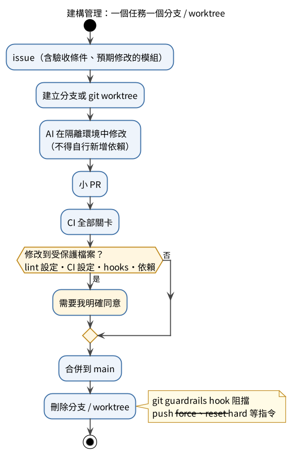

# 08 軟體建構管理

> 李允中《軟體工程》第 8 章（僅作目錄）。主要依據：Sommerville 9e Ch.25、Pressman 9e Ch.22、《Software Engineering at Google》Ch.16、18、21、23、24。

---

## ① 核心原則

| 原則 | 說明 | 出處 |
|---|---|---|
| 建構管理四大活動 | 變更管理、版本管理、系統建置、發布管理 | Sommerville Ch.25 §25.1–25.4 |
| 變更管理流程 | 變更要經過評估、核准、追蹤 | Sommerville Ch.25 §25.1；Pressman Ch.22 §22.5 |
| 版本控制 | 所有產出物都受版本控制 | Pressman Ch.22 §22.3；Google Ch.16 |
| 持續整合 | 頻繁整合並自動驗證 | Pressman Ch.22 §22.4；Google Ch.23 |
| 可重現的建置 | 相同輸入一定產生相同輸出 | Google Ch.18 |
| 依賴管理 | 外部依賴要有明確版本與更新策略 | Google Ch.21 |
| 持續交付 | 隨時可以發布 | Google Ch.24 |

---

## ② AI 開發中如何落地

| 原則 | AI 開發中的做法 |
|---|---|
| 變更管理 | **一個任務一個分支（或 git worktree）**，AI 的修改範圍被限制在一個 PR 內 |
| 小變更 | PR 越小，自動化檢查越容易定位問題，人審查也越快 |
| 版本控制一切 | 不只程式碼：需求、ADR、CLAUDE.md、lint 規則、TLA+ 規格、skill 都在 git 中 |
| 可重現建置 | AI 在任何時候執行建置都得到相同結果，CI 失敗時才能確定是程式碼的問題 |
| 依賴管理 | 依賴版本鎖定；AI 不得自行新增依賴（需要我同意） |

圖源：[`diagrams/src/branch-per-task.puml`](../diagrams/src/branch-per-task.puml)

**單人版的變更管理**：不需要 CCB（變更控制委員會），但需要：
- 需求變更走 PR，並更新需求文件。
- 架構變更要新增 ADR（[`decisions.md`](../decisions.md)）。

**防止破壞性操作**：AI 可能執行 `git push --force`、`git reset --hard` 等指令。可直接使用的 Claude Code skill：`git-guardrails-claude-code`（以 hook 阻擋危險的 git 指令）。

---

## ③ 對應的自動化檢查

| 檢查 | 做法 |
|---|---|
| CI | 每個 PR 都跑完整檢查（[`quality-strategy.md#ci-關卡會擋下合併的檢查`](../quality-strategy.md#ci-關卡會擋下合併的檢查)） |
| pre-commit hook | 本機提交前先跑格式檢查與快速測試（可參考 `setup-pre-commit` skill 的做法，但本專案是 C++ 加 TS，需調整） |
| git guardrails | Claude Code hook 阻擋危險 git 指令 |
| 依賴變更偵測 | CI 標記修改依賴清單的 PR，要求人審查 |
| 受保護檔案 | lint 設定、CI 設定、hook 本身的修改需要我明確同意 |

---

## ④ 專案連結

- **P0**：repo、CI、hooks、依賴管理工具（[`roadmap.md#p0`](../project/roadmap.md#p0環境與護欄)）
- **P2**：server 部署
- **P6**：發布流程
- skill 外掛也有版本號：[D-008](../decisions.md#d-008-可重用工作流做成-skill以外掛形式載入)
