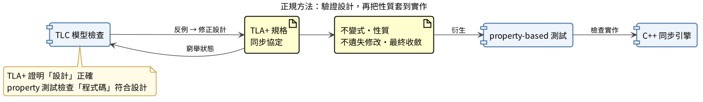

# 09 軟體正規方法論

> 李允中《軟體工程》第 9 章（僅作目錄）。主要依據：Sommerville 9e Ch.12 §12.5、Pressman 9e Ch.17 §17.5、Meyer《Object-Oriented Software Construction》2e Ch.11、Jackson《Software Abstractions》（Alloy）、TLA+ 官方文件。

---

## ① 核心原則

| 原則 | 說明 | 出處 |
|---|---|---|
| 形式規格 | 用數學化的語言精確描述系統應有的行為，消除自然語言的模糊 | Sommerville Ch.12 §12.5 |
| SQA 的形式化方法 | 以數學證明程式符合規格 | Pressman Ch.17 §17.5 |
| 契約式設計 | 前置條件、後置條件、類別不變式，是「輕量級」的形式規格 | Meyer Ch.11 |
| 輕量級正規方法 | 不追求完整證明，而是用自動分析工具在小範圍內窮舉，找出設計缺陷 | Jackson《Software Abstractions》Preface；§5.1.3 |
| 模型檢查 | 窮舉系統所有可能的狀態，驗證性質是否成立（TLA+ 的 TLC） | TLA+ 官方文件 |

---

## ①-1 原文引用

### SQA 的形式化方法
> **原文引用（Pressman & Maxim, Software Engineering 9e, Ch.17 §17.5, p.347）**
> "It can be argued that a computer program is a mathematical object. A rigorous syntax and semantics can be defined for every programming language, and a rigorous approach to the specification of software requirements is available. If the requirements model (specification) and the programming language can be represented in a rigorous manner, it should be possible to apply mathematic proof of correctness to demonstrate that a program conforms exactly to its specifications."

→ 程式是數學物件；只要規格與語言都能嚴格表達，就能用數學證明程式完全符合規格。（同節最後也指出商業開發者很少採用形式化方法。）

### 契約式設計
> **原文引用（Meyer, Object-Oriented Software Construction 2e, Ch.11 §11.14, p.400）**
> "Instead, the assertion mechanism is an engineering tradeoff: it includes enough formal elements to have a substantial effect on software quality; but stops at the point of diminishing return — the threshold beyond which the benefits of more formality might start being offset by the decrease of learnability, simplicity and efficiency."

→ Meyer 刻意不把完整的規格語言放進斷言機制，而是停在「報酬遞減點」：形式化程度足以顯著提升品質，又不犧牲易學與效率，這就是「輕量級」的意思。

### 輕量級正規方法
> **原文引用（Jackson, Software Abstractions 1e, Preface, p.xiii）**
> "I sometimes call my approach "lightweight formal methods" [37], because it tries to obtain the benefits of traditional formal methods at lower cost, and without requiring a big initial investment."

→ 目標是以較低成本取得傳統形式化方法的好處。「在小範圍內窮舉」的依據是 §5.1.3 p.141 的 small scope hypothesis："Most bugs have small counterexamples."

### 模型檢查
> 【待查】非書籍來源，本次不引（表格出處為 TLA+ 官方文件）

---

## ② AI 開發中如何落地

**AI 讓正規方法的成本降低。**（Lauren Tan，第三方摘要：她的團隊用 TLA+ 驗證跨裝置通知等流程，並表示 agent 能撰寫與維護這些驗證；她也提醒正規方法「不是銀彈」。）

過去正規方法昂貴，因為寫規格需要專業知識與大量時間。現在 AI 可以協助撰寫規格，而模型檢查器負責判斷規格是否正確。這是**機器驗證 AI 產出**的典型例子：
- AI 寫的 TLA+ 規格有錯 → TLC 會找出反例。
- AI 寫的實作與規格不符 → property-based 測試以規格中的性質檢查實作。

**本專案的使用範圍**（依 [D-006](../decisions.md#d-006-品質策略倒金字塔單人縮小版)）
| 方法 | 用在哪裡 | 階段 |
|---|---|---|
| 契約（assert、型別） | 全部 C++ 核心 | P1 起 |
| **TLA+ 模型檢查** | 同步協定（子系統 4） | P3 |
| Alloy | 視需要用於資料模型的約束分析 | 選用 |
| Lean 證明 | 不納入計畫 | — |

**為什麼同步最適合**：分散式系統的錯誤只在特定的訊息順序下才會出現，測試很難覆蓋，但模型檢查可以窮舉所有順序。

圖源：[`diagrams/src/formal-spec.puml`](../diagrams/src/formal-spec.puml)

**要注意**：規格與實作之間仍有落差。TLA+ 證明的是**設計**正確，不是**程式碼**正確，所以仍需要 property-based 測試把規格的性質套用到實作上。

---

## ③ 對應的自動化檢查

| 檢查 | 做法 |
|---|---|
| 契約 | debug 建置與測試中啟用 assert；前置條件違反時立即失敗 |
| **TLC 模型檢查放進 CI** | 修改同步規格或協定時自動執行，找到反例就擋下 |
| 規格與實作的對應 | 從 TLA+ 的不變式衍生 property-based 測試；對應關係寫成文件 |

---

## ④ 專案連結

- **P1**：領域模型的不變式與契約
- **P3**：同步協定的 TLA+ 規格與驗收（[`roadmap.md#p3`](../project/roadmap.md#p3多裝置同步)）

---

## 出處修正紀錄

| 原本 | 修正後 |
|---|---|
| Jackson《Software Abstractions》【章節待查】 | Jackson《Software Abstractions》Preface；§5.1.3 |
