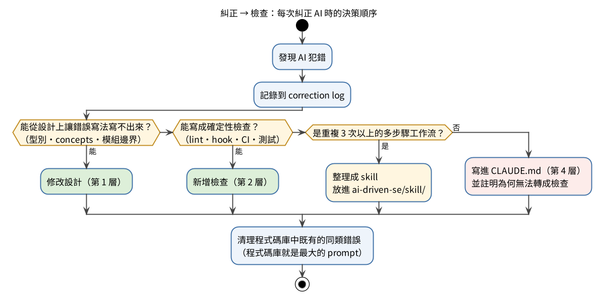

# 10 軟體流程改善

> 李允中《軟體工程》第 10 章（僅作目錄）。主要依據：Sommerville 9e Ch.26、Pressman 9e Ch.28、Ch.23 §23.6、《Software Engineering at Google》Ch.7。

---

## ① 核心原則

| 原則 | 說明 | 出處 |
|---|---|---|
| 流程改善是循環 | 度量 → 分析 → 變更 → 再度量 | Sommerville Ch.26 §26.1 |
| 流程度量 | 用數據了解流程現況，而不是憑感覺 | Sommerville Ch.26 §26.2；Pressman Ch.23 §23.6 |
| 流程分析 | 找出瓶頸與問題根源 | Sommerville Ch.26 §26.3 |
| CMMI | 以成熟度等級評估與改善組織流程 | Sommerville Ch.26 §26.5；Pressman Ch.28 §28.3 |
| 度量要回答具體問題 | 先決定要回答什麼問題，再選擇度量，避免為量而量 | Google Ch.7 |

---

## ①-1 原文引用

### 流程度量
> **原文引用（Sommerville, Software Engineering 9e, Ch.26 §26.2, p.711）**
> "Process measurements are quantitative data about the software process, such as the time taken to perform some process activity. For example, you may measure the time required to develop program test cases. Humphrey (1989), in his book on process improvement, argues that the measurement of process and product attributes is essential for process improvement."

→ 流程度量是關於流程的量化資料；Humphrey 主張度量流程與產品屬性是流程改善的必要條件。

### 流程分析
> **原文引用（Sommerville, Software Engineering 9e, Ch.26 §26.3, p.715）**
> "During process analysis you are trying to understand what is going on in a process. You are looking for information about that process's problems and inefficiencies."

→ 流程分析的目的是了解流程中實際發生了什麼，並找出問題與低效率之處。

### CMMI
> **原文引用（Sommerville, Software Engineering 9e, Ch.26 §26.5, p.722）**
> "The CMMI model (Ahern et al., 2001; Chrissis et al., 2007) is intended to be a framework for process improvement that has broad applicability across a range of companies. Its staged version is compatible with the Software CMM and allows an organization's system development and management processes to be assessed and assigned a maturity level from 1 to 5."

→ CMMI 是流程改善框架；階段式版本把組織的開發與管理流程評定為 1 到 5 級的成熟度。

### 度量要回答具體問題
> **原文引用（Winters, Manshreck & Wright, Software Engineering at Google, Ch.7, p.125）**
> "At Google, we've come up with a series of questions to help teams determine whether it's even worth measuring productivity in the first place. We first ask people to describe what they want to measure in the form of a concrete question; we find that the more concrete people can make this question, the more likely they are to derive benefit from the process."

→ 在度量之前，先把想知道的事寫成具體問題；問題越具體，度量越有價值。同頁接著問「如果資料支持你的預期，會採取什麼行動？」：如果不會有任何行動，就沒有度量的必要。

---

## ② AI 開發中如何落地

**單人版**：CMMI 是為組織設計的，評估流程對單人專案不適用。保留它的核心精神：**以數據驅動持續改善**。

### 每階段結束的回顧
回顧問題的範本見 [`phase-1-mvp.md#階段結束的回顧問題`](../project/phase-1-mvp.md#階段結束的回顧問題)，重點有四類：

| 類別 | 度量或問題 | 用來改善什麼 |
|---|---|---|
| 時程 | 實際小時數、行數 | 校準估算 |
| 品質 | CI 失敗原因、revert 次數、mutation 分數 | 加強哪類檢查 |
| AI 行為 | correction log：AI 最常犯哪類錯？轉成了幾條檢查？ | lint 規則、架構設計 |
| 工作流 | 哪些步驟重複出現？ | 做成 skill 或自動化 |

### lint 規則紀錄簿就是改善的引擎
- Lauren Tan 的「每次糾正都變成檢查」本質上就是**持續的流程改善**：每發現一個問題，就永久消除那一類問題。
- 這對應 CMMI 高成熟度等級所強調的「從量化數據中持續改善」【對應關係為個人詮釋，非 CMMI 原文】。

圖源：[`diagrams/src/correction-loop.puml`](../diagrams/src/correction-loop.puml)

### 工作流沉澱成 skill
- 重複 3 次以上、多步驟、無法改成確定性檢查的工作流，整理成 skill（[D-008](../decisions.md#d-008-可重用工作流做成-skill以外掛形式載入)、[`skill/`](../skill/README.md)）。
- 優先順序：設計消除問題 → 確定性檢查 → skill → CLAUDE.md。

---

## ③ 對應的自動化檢查

| 檢查 | 做法 |
|---|---|
| **度量自動收集** | 腳本從 git log 與 CI 紀錄統計：行數、PR 數、CI 失敗原因、revert 次數 |
| correction log 統計 | 每階段統計新增條數與分類 |
| CLAUDE.md 篇幅監控 | 行數超過設定值時 CI 提醒（數值待定），促使把內容轉成檢查 |

---

## ④ 專案連結

- **每個階段結束時**：回顧與時程校準（[`roadmap.md`](../project/roadmap.md)）
- **P1 結束**：第一次正式回顧，重新估算 P2–P6
- correction log：[`quality-strategy.md#六lint-規則紀錄簿correction-log`](../quality-strategy.md#六lint-規則紀錄簿correction-log)
