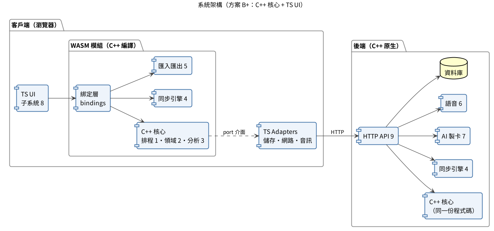
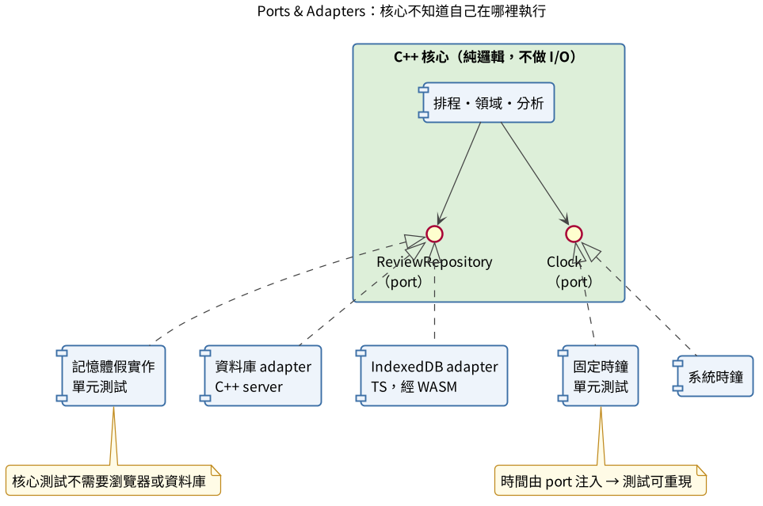
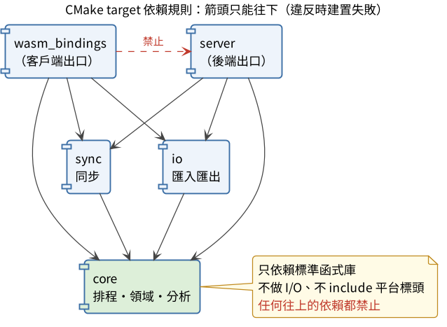

# 專案架構總覽

> 技術棧決策見 [D-004](../decisions.md#d-004-技術棧方案-bc-核心--typescript-ui)；分階段計畫見 [`roadmap.md`](./roadmap.md)。

---

## 產品願景

一個我每天都會打開的英文單字卡工具：依照記憶科學安排每天該複習的單字，在手機和電腦上都能離線使用，並讓我清楚看到自己的進步，包括記住了多少、哪些字老是忘記、離目標還有多遠。

使用者只有我自己，所以「好不好用」的唯一標準是：**我會不會每天用它。**

---

## 九個子系統

| # | 子系統 | 職責 | 語言 | 預估行數 | 主要驗證方式 | 階段 |
|---|---|---|---|---:|---|---|
| 1 | 間隔重複排程引擎 | 依據複習紀錄計算每張卡的下次複習時間 | C++ | 5–8k | property-based、與 FSRS 參考實作對照 | P1 |
| 2 | 卡片與牌組領域模型 | Card、Deck、Note、Review 等核心型別與規則 | C++ | 8–12k | 型別、單元測試、需求追溯 | P1 |
| 3 | 學習進度追蹤與分析 | 複習紀錄、保留率、熱圖、預測、弱點分析 | C++ | 10–15k | golden test | P1（基本）、P5（進階） |
| 4 | 多裝置離線同步 | 離線修改、重新連線後合併 | C++ | 12–18k | TLA+、property-based、故障注入 | P3 |
| 5 | 內容匯入匯出 | `.apkg`、CSV、字典 API | C++ | 8–12k | 真實檔案相容性、fuzzing、round-trip | P2 |
| 6 | 語音與發音 | TTS、錄音、發音比對 | C++ | 6–10k | golden 音檔、介面隔離 | P4 |
| 7 | AI 輔助製卡 | LLM 產生例句、解釋、記憶法 | C++ | 5–8k | JSON schema 驗證、評估集 | P5 |
| 8 | 客戶端 UI | 複習介面、卡片管理、統計頁 | **TS** | 20–30k | Playwright E2E 與錄影 | P1（最小）、P6（擴充） |
| 9 | 後端 API、帳號、儲存 | HTTP API、認證、資料庫 | C++ | 10–15k | API contract、sanitizer、fuzzing | P2 |

> 行數為估計值，包含測試程式碼。合計約 85k–130k。

---

## 架構圖



<sub>圖源：[`diagrams/src/architecture.puml`](../diagrams/src/architecture.puml)</sub>

**依賴方向規則**（由 CMake 與 lint 強制）：
- **C++ 核心不依賴任何外層**：不知道自己在 WASM 還是 server 中執行，不做 I/O，不 include 平台標頭。
- 核心需要外部能力（儲存、時間、亂數）時，透過 **port 介面**（抽象類別或 concept）宣告，由外層提供實作（adapter）。
- **同一份核心程式碼**同時編譯成 WASM（客戶端）與原生（server），確保兩端排程結果一致。

---

## C++ / TS 邊界設計

採用 **Ports & Adapters（六角形架構）**，邊界有兩條：



<sub>圖源：[`diagrams/src/ports-adapters.puml`](../diagrams/src/ports-adapters.puml)</sub>

### 邊界 1：C++ 核心 ↔ 外層（port 介面）
```
core 定義：  class ReviewRepository { virtual ... = 0; }   // port
外層實作：  WASM 端 → 呼叫 TS 提供的儲存函式
           server 端 → 呼叫資料庫
```
- 測試時以記憶體內的假實作替換，核心測試完全不需要瀏覽器或資料庫。

### 邊界 2：WASM ↔ TS（綁定層）
| 規則 | 理由 |
|---|---|
| 只傳遞**純資料**（數字、字串、簡單結構或 JSON） | 避免跨語言的記憶體所有權問題 |
| 綁定層**不含商業邏輯**，只做型別轉換 | 邏輯只存在一處（C++ 核心） |
| 綁定介面要有版本號與 contract 測試 | 任一側修改時，不一致會被 CI 抓到 |
| TS 型別定義由綁定自動產生，或由測試檢查一致 | 方案【待決】於 P0 |

綁定工具：Emscripten 的 Embind 或其他方案，【待決】於 P0。

---

## 專案目錄結構（monorepo，初稿）

> 專案程式碼放在 x86 開發機上的獨立 repo，不放在這個筆記 repo。

```
flashcards/                       # 專案名稱【待決】
├── CMakeLists.txt
├── CLAUDE.md                     # 精簡版，見 quality-strategy.md 第五節
├── docs/
│   ├── correction-log.md         # lint 規則紀錄簿
│   ├── requirements/             # 需求與驗收條件
│   └── adr/                      # 專案層級的架構決策
├── cpp/
│   ├── core/                     # CMake target: core（排程、領域、分析）
│   ├── sync/                     # target: sync（P3）
│   ├── io/                       # target: io（匯入匯出，P2）
│   ├── bindings/                 # target: wasm_bindings（只連結 core、sync、io）
│   └── server/                   # target: server（P2）
├── web/                          # TS UI
│   ├── src/
│   └── e2e/                      # Playwright
├── spec/                         # TLA+ 規格（P3）
└── tools/
    ├── clang-tidy/               # 自訂 clang-tidy 檢查
    ├── eslint-rules/             # 自訂 ESLint 規則
    └── hooks/                    # Claude Code hooks
```

**CMake target 依賴規則**



<sub>圖源：[`diagrams/src/cmake-targets.puml`](../diagrams/src/cmake-targets.puml)</sub>

| target | 可以依賴 | 不可依賴 |
|---|---|---|
| `core` | 標準函式庫、少數純計算函式庫 | 其他所有專案 target |
| `sync`、`io` | `core` | `server`、`wasm_bindings` |
| `wasm_bindings` | `core`、`sync`、`io` | `server` |
| `server` | `core`、`sync`、`io` | `wasm_bindings` |

---

## 技術選型清單

| 類別 | 選擇 | 理由 | 狀態 |
|---|---|---|---|
| C++ 標準 | C++20 | 見 [D-005](../decisions.md#d-005-c-標準採用-c20) | ✅ |
| 建置系統 | CMake | C++ 主流、Emscripten 支援 | ✅ |
| WASM 工具鏈 | Emscripten | 最成熟的 C++ → WASM 方案 | ✅ |
| C++ 套件管理 | vcpkg 或 Conan | 兩者皆支援 CMake | 【待決】P0 |
| C++ 測試框架 | GoogleTest 或 Catch2 | | 【待決】P0 |
| C++ property-based 測試 | RapidCheck | | 【待決】P1 |
| UI 框架 | React 或其他 | Web 經驗不多，要選資源最多的 | 【待決】P0 |
| TS 建置工具 | Vite | | 【待決】P0 |
| TS 測試框架 | Vitest | | 【待決】P0 |
| E2E 測試 | Playwright | 支援錄影與截圖，適合驗證產物 | ✅ |
| MVP 本機儲存 | 見 [`phase-1-mvp.md`](./phase-1-mvp.md#本機儲存方案) | | 【待決】P1 |
| HTTP server | Drogon 或 Boost.Beast | | 【待決】P2 |
| 資料庫 | SQLite 或 PostgreSQL | | 【待決】P2 |
| 同步模型 | CRDT 或事件溯源 | | 【待決】P3 |
| CI 平台 | GitHub Actions 或其他 | 取決於 repo 放在哪裡 | 【待決】P0 |
