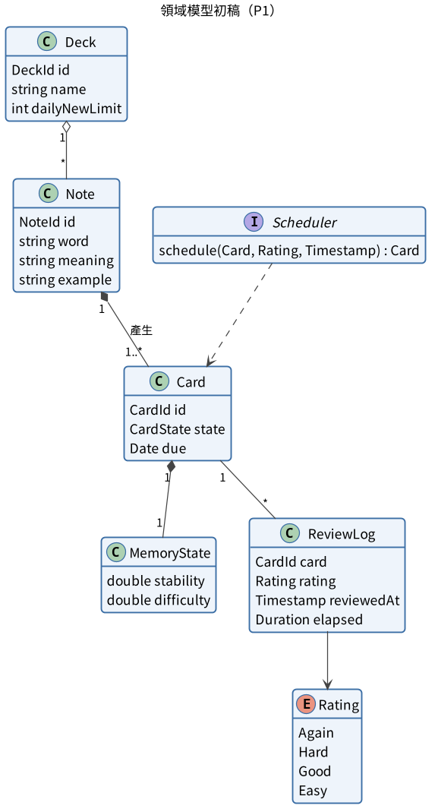

# 第一階段（P1）詳細計畫：MVP，每天能用

> 在 [`roadmap.md`](./roadmap.md) 中的位置：P0（環境與護欄）之後。**BRIEF 的成功標準在本階段驗收：連續每天用它背英文，並能說出每條原則由哪個自動化檢查守住。**
>
> 預估：12 週 × 8 小時。開工前必須先完成 P0。本文件同時附上 [P0 第一週](#開工p0-第一週任務清單)的任務，讓第一天就知道要做什麼。

---

## MVP 範圍

### 要做的
| 功能 | 子系統 | 說明 |
|---|---|---|
| 新增、編輯、刪除單字卡 | 2、8 | 正面：英文單字；背面：中文意思、例句（手動輸入） |
| 牌組 | 2、8 | 至少能分成多個牌組 |
| 每日複習 | 1、8 | 顯示今天到期的卡片，依回答（Again / Hard / Good / Easy）排定下次複習 |
| 每日新卡上限 | 1 | 避免一次學太多 |
| 基本統計 | 3、8 | 今日複習數、連續天數、記憶保留率 |
| 本機儲存 | 見下方 | 關掉瀏覽器再打開，資料還在 |
| 匯出備份 | — | 匯出成 JSON，避免資料遺失（完整匯入匯出在 P2） |

### 刻意不做的
帳號、伺服器、同步、Anki 匯入、語音、AI 製卡、手機版排版最佳化、進階統計圖表。

> 判斷標準只有一個：**沒有這個功能，我還會不會每天用？**會的話就不做。

---

## 需求與驗收條件

> 方法見 [02 需求工程](../notes/02-requirements.md)。每條需求有 ID，並至少對應一個自動化測試（追溯性）。以下為初稿，P1 第 1–2 週定稿。

| ID | 使用者故事 | 驗收條件（可執行） | 驗證方式 |
|---|---|---|---|
| R-001 | 身為學習者，我要新增單字卡，以便之後複習 | 新增後，卡片出現在所屬牌組中，且狀態為「新卡」 | 單元測試（C++）＋ E2E |
| R-002 | 我要看到今天該複習的卡 | 只顯示到期日 ≤ 今天的卡片；新卡數量不超過每日上限 | 單元測試＋ property-based |
| R-003 | 我回答後，系統要安排下次複習時間 | 答「Good」時，下次間隔 ≥ 上次間隔（新卡除外） | property-based |
| R-004 | 排程要符合記憶科學 | 對相同複習紀錄，排程結果與 FSRS 參考實作一致（容許誤差【待定】） | 對照測試 |
| R-005 | 我要知道自己的進度 | 統計頁顯示今日複習數、連續天數、保留率；以固定資料集驗算 | golden test ＋ E2E |
| R-006 | 資料不能遺失 | 重新整理或重開瀏覽器後，所有卡片與複習紀錄都在 | E2E |
| R-007 | 我要能備份 | 匯出的 JSON 能完整還原（round-trip） | 單元測試 |
| NFR-001 | 換卡要流暢 | 回答後顯示下一張卡的延遲 < 100ms（數值待實測後調整） | 效能測試 |

---

## 領域模型初稿

> 方法見 [03 物件導向開發](../notes/03-object-oriented.md)。以下為討論起點，P1 第 2 週用 OOA 推導後定稿，並同步到 StarUML 或 PlantUML（[`uml-and-ai-workflow.md`](../../uml-and-ai-workflow.md)）。

圖源：[`diagrams/src/domain-model.puml`](../diagrams/src/domain-model.puml)

**詞彙表（Ubiquitous Language）初稿**
| 術語 | 定義 |
|---|---|
| Note | 一個要學的單字及其資訊（意思、例句） |
| Card | 從 Note 產生、實際被複習的單位。一個 Note 可產生多張 Card（例如英翻中、中翻英） |
| Review | 一次複習行為，產生一筆 ReviewLog |
| Due | 卡片的到期日，到期才會出現在每日複習中 |
| Stability / Difficulty | FSRS 的記憶狀態參數（定義以 FSRS 官方文件為準） |

---

## 本機儲存方案

【待決】於 P1 第 1 週，建議如下（**提案，待你確認**）：

| 方案 | 說明 | 優點 | 缺點 |
|---|---|---|---|
| **A. TS adapter + IndexedDB（建議）** | C++ 核心透過 port 介面要求存取；由 TS 端用 IndexedDB 實作 | 核心保持純淨、不做 I/O；符合 Ports & Adapters；P2 換成 HTTP 時只需替換 adapter | 跨越 WASM 邊界的呼叫次數較多 |
| B. SQLite 編譯進 WASM | C++ 端直接使用 SQLite，持久化到瀏覽器儲存 | C++ 練習量多；P2 server 端可共用 SQL | 核心與 I/O 耦合風險；WASM 中的持久化設定較複雜（細節【待查】） |

建議 A 的主要理由：它直接示範 [04 軟體設計](../notes/04-design.md) 的依賴反轉，而且讓 C++ 核心的測試完全不需要瀏覽器。

---

## 逐週計畫

| 週 | 主題 | 任務 | 學習重點 | 驗收方式 |
|---|---|---|---|---|
| 1 | 需求 | 需求表定稿；決定儲存方案（寫 ADR） | 需求寫成可驗證條件 | 每條需求都有驗收條件 |
| 2 | 領域模型 | OOA 推導領域模型；詞彙表定稿 | Larman 的領域模型方法 | Mermaid 圖與詞彙表一致 |
| 3 | 領域型別 | `CardId` 等強型別、`Rating`、`Card` 不變式 | C++20 強型別、值語意 | 單元測試；無效狀態無法建構 |
| 4 | 排程（一） | 研讀 FSRS 規格；建立對照測試資料 | 讀演算法規格 | 對照資料集建立完成 |
| 5 | 排程（二） | TDD 實作排程核心 | concepts、TDD | 對照測試通過 |
| 6 | 排程（三） | property-based 測試；邊界情況 | RapidCheck | property 測試通過；mutation 分數記錄 |
| 7 | 儲存 port | port 介面、記憶體內假實作；複習流程用例 | 依賴反轉 | 核心用例的單元測試 |
| 8 | WASM 綁定 | 綁定層與 contract 測試 | Embind | TS 呼叫核心完成一次複習 |
| 9 | UI（一） | 複習畫面、新增卡片 | TS、UI 框架入門 | E2E：新增 → 複習 |
| 10 | UI（二） | 牌組、統計頁；IndexedDB adapter | 瀏覽器儲存 | E2E：重開瀏覽器資料仍在 |
| 11 | 統計與備份 | 進度統計（golden test）、JSON 匯出還原 | ranges 資料處理 | golden test、round-trip 測試 |
| 12 | 收尾與回顧 | 開始每日實際使用；回顧；校準時程 | 流程改善 | 見下方「階段完成條件」 |

> 每週 8 小時建議切成 3–4 個 2 小時的時段，每個時段結束前在專案 repo 留下交接紀錄（做到哪、下一步是什麼），方便下次快速接手，也方便 AI 讀取。

---

## 開工：P0 第一週任務清單

> P1 之前要先完成 P0（4–6 週，見 [`roadmap.md`](./roadmap.md#p0環境與護欄)）。這是**整個專案的第一週**。

- [ ] 在 x86 開發機建立專案 repo，加上 `.gitignore` 與 README
- [ ] 安裝並確認版本：GCC 或 Clang（支援 C++20）、CMake、clang-tidy、clang-format、Emscripten、Node.js
- [ ] 建立 CMake 骨架：`core` target 加一個 `add(int, int)` 範例函式，以及它的單元測試（同時決定 GoogleTest 或 Catch2）
- [ ] 開啟高警告等級並將警告視為錯誤；故意寫一個未使用變數，確認建置失敗
- [ ] 加入 clang-format 與 clang-tidy 基線設定，跑一次並修正
- [ ] 寫第一版精簡 `CLAUDE.md`（專案目的一段話、連到本筆記、建置與測試指令）
- [ ] 建立 `docs/correction-log.md`（格式見 [`quality-strategy.md`](../quality-strategy.md#六lint-規則紀錄簿correction-log)）
- [ ] 載入 [`ai-driven-se` 外掛](../skill/README.md)，確認 Claude Code 讀得到
- [ ] **驗收**：一次 commit 能在本機跑完「格式檢查 → 建置 → clang-tidy → 測試」，且故意犯的錯會被擋下

## P1 第一週任務清單

- [ ] 對照本文件的需求表，逐條確認是不是「沒有它我就不會每天用」，刪掉不是的
- [ ] 每條需求補齊可執行的驗收條件，存到專案 repo 的 `docs/requirements/`
- [ ] 決定本機儲存方案，寫成專案 ADR
- [ ] 閱讀 [02 需求工程](../notes/02-requirements.md) 與 Wiegers《Software Requirements》第 11 章〈Writing excellent requirements〉
- [ ] 讀 FSRS 官方說明，列出要實作的公式與參數清單（不憑記憶，以官方文件為準）
- [ ] **驗收**：需求表中每條都有 ID 與驗收條件，且至少能想到一種自動化驗證方式

---

## 第一批 lint 規則候選

預期 AI 在 P1 常犯的錯誤，以及可以先建立的檢查：

| 預期錯誤 | 檢查方式 | 工具 |
|---|---|---|
| core 裡 include 平台或 I/O 標頭（`<emscripten.h>`、`<fstream>`） | 自訂檢查或依賴腳本 | clang-tidy / 腳本 |
| 用 `int64_t` 傳遞 ID，而不是強型別 | 自訂檢查：特定函式簽章不得使用原始整數 ID | clang-tidy |
| 用 `double` 表示時間間隔 | 要求使用 `std::chrono` 型別 | clang-tidy 自訂檢查 |
| 在 core 中直接取得目前時間（`system_clock::now()`） | 禁止在 core 中呼叫，時間要從 port 注入（否則測試不可重現） | clang-tidy 自訂檢查 |
| 在 TS UI 中重寫排程或統計邏輯 | UI 目錄禁止 import 特定計算模組；code review 檢查 | ESLint |
| 忽略回傳的錯誤 | `[[nodiscard]]` 加上編譯器警告 | 編譯器 |
| 測試中使用真實時間或亂數 | 禁止在測試中直接呼叫系統時鐘與未設種子的亂數 | clang-tidy / ESLint |

> 這些是**候選**。實際上只為真的發生過的錯誤寫規則，並記錄在 correction log。

---

## 階段完成條件

- [ ] [`roadmap.md` P1 驗收清單](./roadmap.md#p1mvp每天能用)全部通過
- [ ] **連續 14 天**每天用它複習英文
- [ ] 能說出每條需求（R-001 ~ R-007、NFR-001）由哪個自動化檢查守住
- [ ] correction log 至少有幾筆紀錄，且大多數已轉成檢查

## 階段結束的回顧問題

> 方法見 [10 流程改善](../notes/10-process-improvement.md)。

1. 實際花了多少小時？寫了多少行（含測試）？→ 更新 roadmap 時程
2. CI 失敗最常見的原因是什麼？
3. AI 最常犯哪一類錯誤？轉成了幾條檢查？有幾條只能寫進 CLAUDE.md？
4. 哪個護欄最有用？哪個是多餘的？
5. 每天使用時最大的痛點是什麼？→ 調整 P2 之後的優先順序
6. 有沒有重複 3 次以上的多步驟工作流，值得做成 skill？（[D-008](../decisions.md#d-008-可重用工作流做成-skill以外掛形式載入)）
