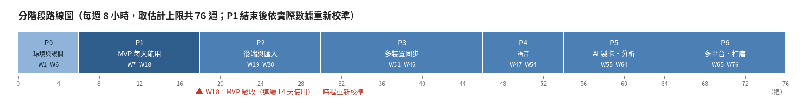

# 分階段路線圖

> 九個子系統分成 P0 到 P6 共七個階段。每個階段固定格式：**目標 → 子系統 → 預估行數 → 練到的章節 → 驗收機制 → 回顧項目**。
>
> 決策背景見 [D-003](../decisions.md#d-003-九個子系統全部保留分階段開發)；架構見 [`overview.md`](./overview.md)。

---

## 總覽

圖源：[`diagrams/src/roadmap-timeline.py`](../diagrams/src/roadmap-timeline.py)

| 階段 | 名稱 | 子系統 | 預估行數 | 預估週數 |
|---|---|---|---:|---:|
| P0 | 環境與護欄 | （基礎建設） | ~3k | 4–6 |
| P1 | MVP：每天能用 | 1、2、3（基本）、8（最小） | ~20k | 12 |
| P2 | 後端與匯入 | 9、5 | ~22k | 10–12 |
| P3 | 多裝置同步 | 4 | ~15k | 12–16 |
| P4 | 語音與發音 | 6 | ~8k | 8 |
| P5 | AI 製卡與進階分析 | 7、3（進階） | ~15k | 8–10 |
| P6 | 多平台客戶端與打磨 | 8（擴充） | ~17k | 10–12 |
| **合計** | | | **~100k** | **64–76 週（約 1.5 年）** |

> ⚠️ **行數與週數都是粗估**，用來檢查規模是否合理，不是承諾。
> - 行數**包含測試程式碼**，但不含第三方函式庫與自動產生的程式碼。
> - 週數以每週 8 小時計算。AI 輔助開發的實際速度目前無法估計，**P1 結束時要用實際數據重新校準**（見[時程估算](#時程估算)）。

### 子系統編號對照
1. 間隔重複排程引擎　2. 卡片與牌組領域模型　3. 學習進度追蹤與分析　4. 多裝置離線同步　5. 內容匯入匯出　6. 語音與發音　7. AI 輔助製卡　8. 客戶端 UI　9. 後端 API、帳號、儲存

---

## P0：環境與護欄

**目標**：在寫任何功能之前，先建好讓 AI 能可靠開發的環境。對應 Lauren Tan 所說的「六個月不起眼的工程」，單人版濃縮成 4 到 6 週。

**內容**
- **Monorepo 骨架**：C++ 與 TS 的目錄結構、CMake target 劃分（見 [`overview.md`](./overview.md)）。
- **C++ 工具鏈**：CMake、編譯器高警告等級並將警告視為錯誤、clang-format、clang-tidy 基線設定、sanitizer 建置組態、測試框架。
- **WASM 工具鏈**：Emscripten 編譯一個 hello world 函式，並由 TS 呼叫成功。
- **TS 工具鏈**：`strict` 模式、ESLint、Prettier、測試框架、Playwright。
- **CI**：每個 PR 都要跑建置、lint、測試。
- **Claude Code 設定**：CLAUDE.md（精簡版）、hooks（例如禁止修改測試檔、禁止加 `NOLINT` 而不說明理由）、git guardrails；在專案 repo 中載入 [`ai-driven-se` 外掛](../skill/README.md)。
- **第一條自訂 lint 規則**：例如「核心函式庫不得 include 平台相關標頭檔」，用來練習寫 clang-tidy 檢查。
- **lint 規則紀錄簿**：建立檔案與格式（見 [`quality-strategy.md`](../quality-strategy.md)）。

**練到的章節**：● [01 流程](../notes/01-process.md)　● [04 設計](../notes/04-design.md)　● [07 品質](../notes/07-quality.md)　● [08 建構管理](../notes/08-configuration-management.md)

**驗收機制**
- [ ] 一個故意違反架構邊界的 PR（例如核心 include 了 UI 標頭）會被 CI **擋下**。
  - 2026-11-19：本機已驗證（clang-tidy、`check_layering.py`、CMake 三層都擋下）。**待辦**：push 到 GitHub、把 `ci` 設成 required check 後，開一個違規 PR 確認。
- [x] 一個故意製造記憶體錯誤的測試，會被 ASan **抓到**。（`cpp/guardrails/asan_canary.cpp`，asan preset 的 ctest 每次都跑）
- [ ] 一個 TS 型別錯誤的 PR 會被 CI **擋下**。
  - 2026-11-19：本機 `tsc` 已擋下。**待辦**：同上，GitHub 上確認。
- [x] Playwright 能開啟頁面，呼叫 WASM 函式並驗證回傳值。（`web/e2e/core.spec.ts`，每次錄影）
- [ ] AI 嘗試修改測試檔時，hook 會**攔截**。
  - 2026-11-19：hook 以腳本餵 JSON 驗證通過（改既有測試 → 要人核准；新測試檔允許，TDD 需要）。**待辦**：在專案 repo 開 Claude Code 實際試一次。

> 驗收方式是「故意犯錯，確認會被擋下」。只確認工具裝好不算數，要確認護欄真的有作用。
>
> 這些「故意犯錯」已寫成可重跑的腳本：專案 repo 的 `tools/guardrail-tests/run.sh`（17 個案例），由 `tools/ci.sh` 每次執行。

**P0 進度（2026-11-19）**
- 專案 repo：`/home/awe/disk/flashcards`，第一個 commit `P0: monorepo skeleton and guardrails`。
- 與計畫不同：「第一條自訂 lint 規則」改用 clang-tidy 內建的 `portability-restrict-system-includes`（只對 `cpp/core/` 開）。寫自訂 clang-tidy 外掛需要 clang-tidy 開發標頭，開發機沒有、要 sudo 才能裝。紀錄在專案的 `docs/correction-log.md` CL-000。
- 工具版本：clang 14、CMake 3.22、Emscripten 4.0.10、Node 24。

**回顧項目**：哪些護欄設定花最多時間？哪些在 P1 前就應該補上？

> **每個階段的回顧都要問一題：這個階段有沒有重複出現 3 次以上的多步驟工作流？** 先問它能不能改成 lint 規則、hook 或 CI 檢查；不能的話，才整理成 skill 放進 [`skill/`](../skill/README.md)（收錄門檻見 [D-008](../decisions.md#d-008-可重用工作流做成-skill以外掛形式載入)）。

---

## P1：MVP，每天能用

**目標**：做出我每天真的會用來背英文的最小版本。**BRIEF 的成功標準在這個階段驗收。**

**子系統**
- **1. 排程引擎**：實作 FSRS（或先實作 SM-2，之後再換成 FSRS，於 phase-1 決定）。
- **2. 領域模型**：Card、Deck、Review 等核心型別。
- **3. 進度追蹤（基本）**：複習紀錄、每日複習數、記憶保留率。
- **8. 客戶端（最小）**：複習畫面、新增卡片、基本統計頁。
- **儲存**：只做本機儲存，具體方案【待決】，於 [`phase-1-mvp.md`](./phase-1-mvp.md) 決定。

**刻意不做**：帳號、伺服器、同步、匯入、語音、AI 製卡。

**練到的章節**：● [02 需求](../notes/02-requirements.md)　● [03 物件導向](../notes/03-object-oriented.md)　● [04 設計](../notes/04-design.md)　● [06 測試](../notes/06-testing.md)　● [07 品質](../notes/07-quality.md)　● [10 流程改善](../notes/10-process-improvement.md)

**驗收機制**
- [ ] **排程引擎**：property-based 測試（例如「同一張卡連續答對時，下次複習間隔不會縮短」）；以 FSRS 參考實作的輸出做對照測試。
- [ ] **領域模型**：單元測試；每條需求都能追溯到至少一個測試（需求 ID ↔ 測試）。
- [ ] **進度追蹤**：以固定的複習紀錄資料集做 golden test。
- [ ] **客戶端**：Playwright E2E 測試覆蓋「新增卡片 → 複習 → 看統計」主流程，並自動錄影供人檢查。
- [ ] **實際使用**：**連續 14 天每天用它背英文**（天數為建議值，可在 phase-1 調整）。

**回顧項目**
- 實際寫了多少行？花了多少小時？→ 用來校準後續時程。
- lint 規則紀錄簿累積了幾條？哪類錯誤 AI 最常犯？
- 每天使用時最大的痛點是什麼？→ 決定 P2 之後的優先順序。

---

## P2：後端與匯入

**目標**：讓資料不只存在單一瀏覽器，並能匯入既有的單字資源。

**子系統**
- **9. 後端**：C++ HTTP server（Drogon 或 Boost.Beast，【待決】）、帳號與認證、資料庫儲存、API。
- **5. 匯入匯出**：Anki `.apkg`（依檔案格式自行實作，見 [D-007](../decisions.md#d-007-不複製-anki-原始碼)）、CSV、字典 API。

**練到的章節**：● [04 設計](../notes/04-design.md)（API 設計）　● [06 測試](../notes/06-testing.md)　● [08 建構管理](../notes/08-configuration-management.md)（部署）　● [10 流程改善](../notes/10-process-improvement.md)

**驗收機制**
- [ ] **API contract 測試**：API 規格（例如 OpenAPI）與實作一致，由 CI 檢查。
- [ ] **認證**：未授權的請求一律被拒絕的測試；sanitizer 與 fuzzing 測試輸入解析。
- [ ] **匯入**：用真實的 `.apkg` 與 CSV 檔案做相容性測試；格式錯誤的檔案不會造成 crash（fuzzing）。
- [ ] **匯出再匯入**後資料完全一致（round-trip 測試）。

---

## P3：多裝置同步

**目標**：手機和電腦都能離線複習，重新連線後自動合併，不遺失任何資料。這是全專案技術難度最高的階段。

**子系統**
- **4. 同步引擎**：CRDT 或事件溯源（【待決】，於本階段開始時以 ADR 決定）。

**練到的章節**：● [04 設計](../notes/04-design.md)　● [05 專案管理](../notes/05-project-management.md)（風險最高的階段）　● [06 測試](../notes/06-testing.md)　● [09 正規方法](../notes/09-formal-methods.md)

**驗收機制**
- [ ] **TLA+ 模型檢查**：同步協定的關鍵性質（例如「任何一方的修改最終都不會遺失」「所有裝置最終收斂到相同狀態」）通過 TLC 模型檢查，並放進 CI。
- [ ] **property-based 測試**：任意順序套用相同的一組操作，結果都一致。
- [ ] **故障注入**：模擬斷線、重複送出、亂序抵達，資料仍然正確。
- [ ] 實作與 TLA+ 規格的對應關係有文件說明。

---

## P4：語音與發音

**目標**：卡片能朗讀單字與例句，並能錄下我的發音。

**子系統**
- **6. 語音與發音**：TTS（呼叫外部服務或使用本機引擎，【待決】）、錄音、發音比對（可行性【待查】，必要時縮減範圍）。

**練到的章節**：● [06 測試](../notes/06-testing.md)　○ [02 需求](../notes/02-requirements.md)（發音比對的需求如何定義成可驗證的條件）

**驗收機制**
- [ ] 音訊處理的單元測試，使用固定的音檔做 golden test。
- [ ] 外部 TTS 服務以介面隔離，測試時用替身（test double），不依賴網路。
- [ ] 主觀品質（朗讀聽起來是否自然）：自動產生驗證產物（音檔清單），由人抽查。

---

## P5：AI 製卡與進階分析

**目標**：用 LLM 自動產生例句、解釋與記憶法；分析出自己的弱點。

**子系統**
- **7. AI 輔助製卡**：呼叫 LLM API，產生例句與解釋。
- **3. 進度分析（進階）**：遺忘曲線預測、弱點分析、學習熱圖。

**練到的章節**：● [02 需求](../notes/02-requirements.md)（「好的例句」要如何定義）　● [06 測試](../notes/06-testing.md)　● [07 品質](../notes/07-quality.md)

**驗收機制**
- [ ] LLM 輸出一律經過 **JSON schema 驗證**，不合格就拒絕或重試。
- [ ] LLM 呼叫以介面隔離，測試時使用錄製好的回應，不依賴網路與費用。
- [ ] 例句品質：建立一組評估集（eval set），由人標註並定期抽查。
- [ ] 進階分析：以固定資料集做 golden test，統計方法有文件說明出處。

---

## P6：多平台客戶端與打磨

**目標**：手機也能順暢使用，整體體驗打磨到我願意長期使用。

**子系統**
- **8. 客戶端擴充**：手機版介面（PWA 或其他方案，【待決】）、離線支援、無障礙、效能最佳化。

**練到的章節**：● [04 設計](../notes/04-design.md)　● [06 測試](../notes/06-testing.md)　● [08 建構管理](../notes/08-configuration-management.md)（發布流程）

**驗收機制**
- [ ] Playwright 在桌面與手機尺寸都跑過主流程。
- [ ] 效能預算（例如啟動時間、複習換卡延遲）寫成自動化測試，退步時 CI 擋下。
- [ ] 無障礙檢查工具整合進 CI。

---

## 時程估算

**估算方法**
- 目前沒有「AI 輔助下每小時能產出多少行合格程式碼」的可靠數據，因此**不從行數推算時間**。
- 各階段週數是依照內容複雜度的主觀估計，P0 與 P1 合計約 4 個月，與 BRIEF 中「MVP 約 3 個月」大致一致（P1 本身 12 週）。

**校準方式**
- 每個階段記錄：實際小時數、實際行數（含測試）、CI 失敗次數、lint 規則新增數。
- **P1 結束時**用實際數據重新估算 P2 到 P6，並更新本文件。

**不確定性**
- P3（同步）不確定性最高，可能超出估計 50% 以上。
- 學習成本（TypeScript、Emscripten、clang-tidy 自訂規則、TLA+）集中在 P0、P1、P3。

---

## 風險清單

| 風險 | 影響階段 | 可能性 | 影響 | 對策 |
|---|---|:-:|:-:|---|
| WASM 綁定（C++ ↔ TS）比預期複雜 | P0、P1 | 中 | 高 | P0 就打通最小可行的雙向呼叫；跨邊界的型別盡量簡單 |
| clang-tidy 自訂規則學習曲線陡峭 | P0 起 | 高 | 中 | 先用內建檢查與 CMake 依賴規則；自訂規則從最簡單的開始 |
| 只寫功能、護欄被擱置 | 全階段 | 高 | 高 | 每個階段的驗收清單都包含護欄項目；回顧時檢查 lint 規則紀錄簿 |
| AI 修改測試或繞過 lint 來讓 CI 通過 | 全階段 | 高 | 高 | hook 攔截、CI 偵測 `NOLINT` 新增、code review 檢查 |
| 同步協定設計錯誤，造成資料遺失 | P3 | 中 | 高 | 先寫 TLA+ 規格，模型檢查通過後才實作 |
| 每週 8 小時被打斷，進度停滯 | 全階段 | 中 | 中 | 任務切成單次 2 小時內能完成的大小；每次結束前留下交接紀錄 |
| 發音比對技術上不可行 | P4 | 中 | 低 | 該功能可縮減為「錄音後與標準發音對照播放」 |
| MVP 做完後不想用 | P1 | 低 | 高 | MVP 範圍以「我每天會用」為唯一標準，不加不必要的功能 |
