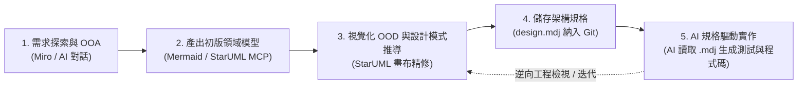

# 1. UML 建模工具與 AI 協作解決方案（OOAD × StarUML × AI）

本文件整理了軟體工程進行**物件導向分析與設計（OOAD）**、**設計模式（Design Patterns）**推導，以及結合 **AI 進行規格驅動開發（SDD / BDD）** 的 UML 工具選型與實戰工作流。

---

## 一、 核心理念：為什麼需要專業的「UML 建模工具」而非單純的「畫圖工具」？

在進行複雜系統設計（如水球潘／水球軟體學院推崇的 OOA $\rightarrow$ OOD 推導流程）時，工具的選擇會直接影響思考深度：

1. **具備語意模型（Metamodel）**：
   * **專業建模工具（如 Astah、StarUML）**：底層維護完整的物件導向語意結構。修改一個類別（Class）或方法（Method）名稱時，所有散落在不同圖表（類別圖、循序圖）中的同一元件會**全域同步更新**。
   * **通用畫布工具（如 draw.io、Miro）**：本質是「方塊與線條」，缺乏語意約束，重構時需手動修改每一處文字與排版，容易在設計迭代時產生疏漏。
2. **流暢的推導體驗**：
   * 專業工具能快速標示**關聯（Association）**、**聚合／組合（Aggregation / Composition）**、**多重性（Multiplicity，如 `1..*`）**、**抽象類別與介面實現**，幫助開發者在設計階段找出邏輯盲點。
3. **作為約束 AI 的「單一事實來源（Single Source of Truth）」**：
   * 先透過視覺化 UML 確立架構邊界與依賴方向，再將架構規格餵給 AI 生成程式碼，能避免 AI 自由發揮導致義大利麵程式碼（Vibe Coding 常見問題）。

---

## 二、 主流 UML 與視覺化工具選型對照

| 工具分類 | 代表工具 | 優勢與特色 | 適用場景 |
| :--- | :--- | :--- | :--- |
| **專業 UML 建模** *(具備語意模型)* | **StarUML** *(主力推薦)* | 跨平台（Linux/macOS/Win）、介面現代、無限期免費評估、`.mdj` 為純 JSON 格式、**原生支援 MCP 與 Mermaid**。 | 日常 OOA/OOD 推導、設計模式練習、**與 AI 深度協作建模與生碼**。 |
| **專業 UML 建模** *(經典老牌)* | **Astah UML** | 水球潘課程與文章主力示範工具；快捷鍵與介面流暢度極佳、對 UML 2.x 規範支援嚴謹。 | 專注於純手工 OOAD 推導與教學展示（商業付費軟體，有學生版）。 |
| **程式碼繪圖** *(Diagram as Code)* | **Mermaid.js** **PlantUML** | 純文字語法、可直接納入 Git 版本控制、嵌入 Markdown 筆記、AI 最容易直接讀寫。 | 撰寫技術文件、README、快速請 AI 產出架構草圖或規格文件。 |
| **線上協作白板** *(自由畫布)* | **Miro** **Excalidraw** | 多人即時協作體驗極佳、不受限於嚴格語法。 | 前期需求探索、Event Storming（事件風暴）、User Story 拆解。 |
| **通用視覺化繪圖** | **draw.io** *(diagrams.net)* | 完全免費開源、內建 VS Code 插件、圖示庫豐富。 | 繪製高階系統架構圖（High-level Architecture）、部署圖、一般流程圖。 |

---

## 三、 StarUML × AI 協作的 4 大核心機制

相比傳統封閉格式的建模軟體，**StarUML** 具備極佳的開放性，能透過以下 4 種方式與 AI Coding Agent（如 Claude Code、Cursor、Antigravity 等）無縫接合：

### 1. 官方 StarUML MCP Server（AI 直接讀寫畫布）
StarUML 內建本地 API Server（預設 Port `58321`），並支援透過 **MCP (Model Context Protocol)** 與 AI 連接：
* **AI 讀圖與審查**：AI 可直接讀取當前開啟的專案結構、查詢所有類別與關聯，甚至擷取當前畫布截圖，幫你檢查設計是否違反 SOLID 原則。
* **AI 自動改圖／畫圖**：直接用自然語言下指令（例如：*「幫我將目前的計價模組套用策略模式（Strategy Pattern）重構」*），AI 即可透過 MCP 直接在 StarUML 中新增介面、類別並拉好關聯線。

### 2. 原生支援 Mermaid 語法互轉（文字草圖 $\rightarrow$ 視覺化模型）
* AI 最擅長快速產出文字版的 `Mermaid` 語法（如 `classDiagram`、`sequenceDiagram`）。
* 在 StarUML 中可直接貼上 AI 生成的 Mermaid 語法，**一鍵轉換為真正的 StarUML 模型元件與圖表**，再用滑鼠進行精細的視覺化調整與擴充。

### 3. `.mdj` 純 JSON 儲存格式（AI Agent 直接解析專案檔）
* StarUML 的專案檔（`.mdj`）底層是結構清晰的 **JSON 格式**（包含 `UMLClass`、`UMLAttribute`、`UMLOperation`、`UMLAssociation` 等節點）。
* 將 `.mdj` 檔案直接放在程式碼專案目錄（Workspace）中，AI Agent 不需要透過任何轉檔工具，就能**直接讀取 `.mdj` 原始檔**，精準解析所有的類別結構、屬性型別、方法簽章與多重性關聯。

### 4. 擴充套件生態（程式碼雙向工程與 PlantUML）
透過 `Tools` $\rightarrow$ `Extension Manager` 可安裝豐富的開源插件：
* **正向工程（Code Generation）**：將畫好的 UML 類別圖直接匯出為 Java、C#、C++、Python、TypeScript 等語言的骨架程式碼（Skeleton Code），再交由 AI 填寫方法內的商業邏輯。
* **逆向工程（Reverse Engineering）**：將現有專案或 AI 寫好的程式碼匯入 StarUML，自動生成類別圖以檢視架構是否腐化。
* **PlantUML 轉換**：將視覺化模型匯出為 PlantUML 純文字規格，嵌入 BDD/SDD 的規格書中。

---

## 四、 實戰標準工作流（OOAD + StarUML + AI 規格驅動開發）

### 步驟詳解：

1. **步驟 1：需求拆解與 OOA（物件導向分析）**
   * 釐清使用案例（Use Cases）與驗收條件（Given-When-Then），找出核心領域名詞與動詞。
2. **步驟 2：快速建立初版領域模型（Domain Model）**
   * 可以自己在 StarUML 手繪，或請 AI 根據需求先生成一段 **Mermaid 類別圖**（或透過 **StarUML MCP**）快速在 StarUML 生成初版類別與關聯。
3. **步驟 3：OOD（物件導向設計）與設計模式推導**
   * 在 StarUML 畫布上進行人類主導的架構思考：檢查耦合度、決定依賴反轉（DIP）的介面位置、套用設計模式（Design Patterns），並補齊精準的方法簽章（Method Signatures）與多重性（`1`、`0..1`、`1..*`）。
4. **步驟 4：將 `.mdj` 納入專案作為架構規格**
   * 將儲存好的 `design.mdj` 放入專案的 `docs/` 或 `specs/` 目錄中，與程式碼一起納入 Git 版本控制。
5. **步驟 5：約束 AI 進行實作（SDD / BDD）**
   * 請 AI 助手直接讀取 `design.mdj`（或透過 MCP 連線），並下達明確約束：
     > *「請讀取 `specs/design.mdj` 中的類別圖規格，嚴格遵照圖中定義的類別名稱、介面繼承關係、方法簽章與依賴方向，撰寫對應的單元測試與實作程式碼，不可自行變更架構邊界。」*
